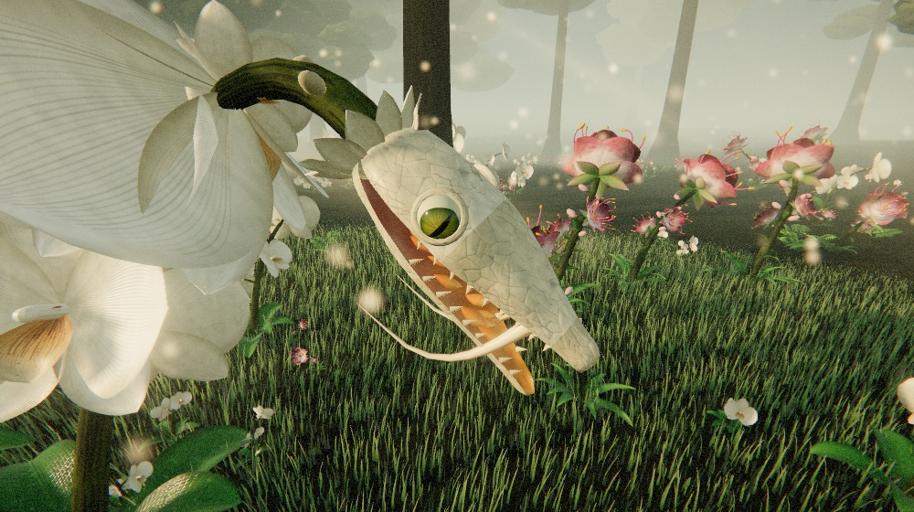
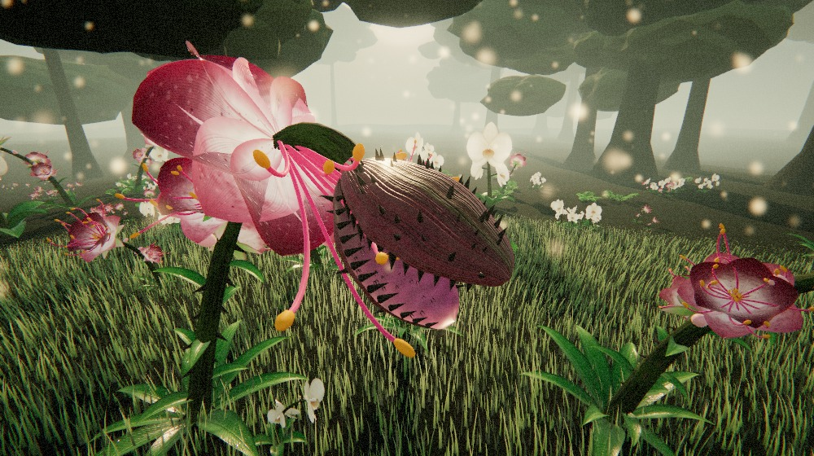
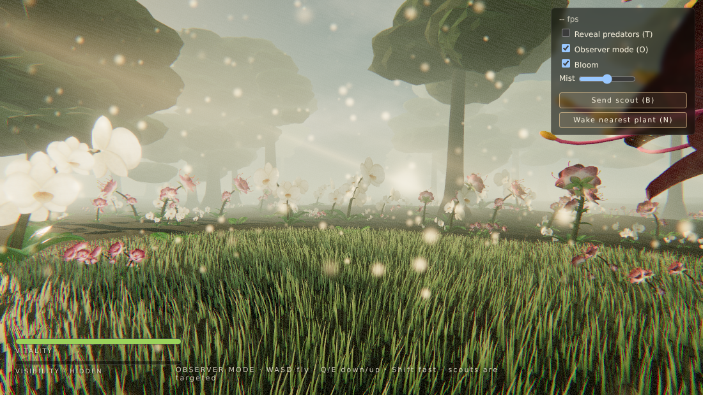
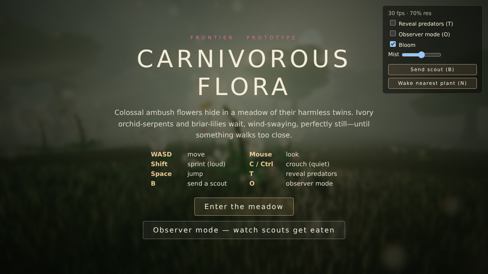

# Carnivorous Flora — WebGL prototype

Colossal ambush plants that hide among their harmless look-alikes and eat the player.
Pure HTML + WebGL2 (Three.js, vendored in `vendor/`), no build step, no binary assets:
every texture, mesh and sound is generated procedurally at load time.

## Run

    cd CarnivorousFlora
    python3 -m http.server 5173 --bind 0.0.0.0     # any static server works
    # open http://localhost:5173

Useful URL flags: `?q=low` (weak GPUs), `?pr=1` (fixed pixel ratio), `?auto` (skip title card),
`?observer`, `?nolock` (no pointer lock), `?manual` (deterministic stepping for captures, see `window.__frontier`).

## Controls

| Key | Action |
|---|---|
| WASD / mouse | move / look |
| Shift | sprint (loud, detected from ~30 m) |
| C / Ctrl | crouch (quiet, ~5-7 m) |
| Space | jump; while grabbed, mash Space/WASD to break free |
| T | reveal predator positions |
| B | send an AI scout (they get hunted too) |
| N | lure a scout to the nearest plant |
| O | observer mode: free-fly camera, scouts are the targets |
| R | respawn |

## The two species (from the reference art)

| | Ivory orchid-serpent | Briar-lily |
|---|---|---|
| Disguise | giant phalaenopsis raceme: ivory petals, amber lip, olive stem, buds, leaf rosette | magenta-tipped pink lily on a thorned briar, leaves, curling filaments |
| Weapon | serpent skull with slit-pupil eye, curled golden fangs, orange lamellae in the maw | thorn-lined flytrap jaws with a stamen cluster inside, 16 whipping filament tendrils |

Decoys and predators are built from the same blueprint (`flora/flowers.js`, `flora/decoys.js`),
so a dormant predator is the same silhouette, colour and wind motion as its harmless neighbours.

## Predator behaviour (`flora/predator.js`)

`dormant -> alert -> strike -> hold -> swallow | stunned -> recover -> dormant`

* Perception uses the target's noise radius (stealth model in `game/player.js`).
* Head/stem are driven by springs + a procedural Bezier stem re-sampled by arc length each frame; the
  collar slides along the stem so the head "unsheathes" through the petals, which flare back.
* Strike = wind-up, lunge with predicted target position, snap; a hit grabs the target, lifts and shakes it,
  drains health; struggle meter frees you and stuns the plant.

## Layout

    src/gfx      procedural textures, wind/translucency shader patch, post (bloom + grade)
    src/flora    petal/leaf/tube geometry, flowers, decoys, predator head + brain
    src/world    sky + PMREM environment, terrain, GPU grass, forest, ferns, wildflowers, pollen, sun shafts
    src/game     player, AI scout, procedural audio, UI

## Gallery

| | |
|---|---|
|  |  |
|  |  |

(Captured headless on a software renderer; real GPUs will be much smoother.)
