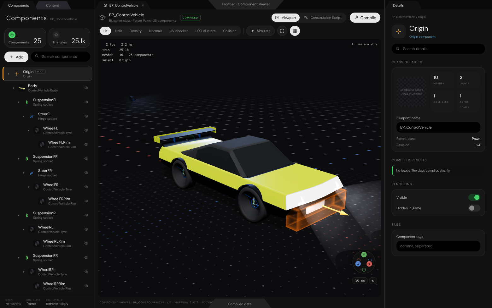

# Component Viewer — C++20 Port Plan (Workspace 1 of 2)

> **TL;DR:** Port `Experimental/ComponentViewer/` (c7egoist, `78a1375`) into the C++20 engine on `unassignedinbox/Frontier` @ `arena/6eeea758-frontier` (`7eb76ce`) as its own workspace, **`FrontierComponentViewer`**. The **Geometry Compile** import overlay moves out into the second workspace, **`FrontierGeometryCompiler`** ([GeometryCompilerPortPlan.md](GeometryCompilerPortPlan.md)). The two hand compiled assets to each other through `.GeometrySpace` files and a live `CompiledGeometryExchange`. The work runs in 6 milestones. It reuses the existing `OutlinerPanel` / `InspectorPanel` / `ViewportPanel` / `ContentBrowserPanel`, `TieredWorldRenderSequence`, `OrbitMode` and `ViewportPickQuery`. The new engine code is the articulation solver, the drivetrain, the component tree, and eight `.slang` overlay units. Every milestone ends in an `Exhibits/` validation with `.png` proofs. 🔴 Four decisions need your answer first (§1, marked 🚩).

---

## 1. 🏆 Key Decisions

*(Legend — Fit / Parity / Maintainability: 🔴 = best, 🚩 = moderate, ✔️ = lowest · Effort: ✔️ = lowest/best)*

### 1.1 🚩 Where the C++ code lands

| Rank | Option | Fit | Effort | Summary |
| :---: | :--- | :---: | :---: | :--- |
| 🏆 🥇 | **A — Work directly on `unassignedinbox/Frontier`** (a new Arena session on that repo, or push access for this one) | 🔴 | ✔️ | The engine, CMake, Exhibits and governance all live there. There's zero duplication, which `ImportantNotes.md` §4 requires. |
| 🥈 | B — Import the engine tree (`7eb76ce`) into `c7egoist/Frontier` and build here | 🚩 | 🚩 | Works today, but forks about 700 MB of history. Every engine fix then has to be merged in both directions. |
| 🥉 | C — Keep the HTML here and send C++ patches as files | ✔️ | 🔴 | Can't build or capture `.png` proofs in CI. Not workable past M1. |

🔴 **Blocker:** this session can **read** `unassignedinbox/Frontier`, but `gh` reports `push: false`. **Recommendation: A.** Until you answer, all C++ work stays planned. Only the HTML ground-truth split (M0) can start here.

### 1.2 🚩 HTML ground truth before C++ (CLAUDE.md §2.5 "zero UI invention")

| Rank | Option | Parity | Effort | Summary |
| :---: | :--- | :---: | :---: | :--- |
| 🏆 🥇 | **A — M0: split the HTML first.** `Experimental/ComponentViewer/` keeps only the Blueprint editor. Geometry Compile moves to `Experimental/GeometryCompiler/` (merged with the reference studio). | 🔴 | 🚩 | Each C++ workspace gets a 1:1 HTML mirror to screenshot and diff against. |
| 🥈 | B — Port straight from today's merged prototype | 🚩 | ✔️ | The C++ split would be UI that exists in no HTML reference, which breaks the zero-invention rule. |

### 1.3 Viewport renderer

| Rank | Option | Fit | Parity | Summary |
| :---: | :--- | :---: | :---: | :--- |
| 🏆 🥇 | **A — `TieredWorldRenderSequence` (Tier 1 GTX) fed by a new `ComponentTreeScene` source** | 🔴 | 🔴 | This is the canonical World renderer (CLAUDE.md §2.5 ②). Channels and overlays plug in as `.slang` units. |
| 🥈 | B — Reuse `MaterialPreviewRenderer` | 🚩 | 🚩 | It's built for single-specimen previews. There's no multi-instance scene, no picking and no overlays. |
| 🥉 | C — A new forward renderer that mirrors three.js | ✔️ | 🔴 | 🔴 Forbidden: "never invent replacement renderers". |

### 1.4 🚩 Socket physics (8 joint categories + dock)

| Rank | Option | Determinism | Parity | Effort | Summary |
| :---: | :--- | :---: | :---: | :---: | :--- |
| 🏆 🥇 | **A — Port `Sockets.js` math into `SimulationSpace/Articulation/`** | 🔴 | 🔴 | ✔️ | Closed-form springs, the pendulum and the dock phases. The 3 socket checks carry over number for number. No vtables, plain structs. |
| 🥈 | B — Jolt constraints (pinned, still unused in `Engine/`) | 🚩 | 🚩 | 🔴 | Adds the first Jolt integration under a viewer. The tuned numbers (1.2 kN break, squat ratio) would drift. |
| 🥉 | C — A then B: port now, swap the dock and tether to Jolt in the Phase 5 physics work | 🔴 | 🔴 | 🚩 | Same as A for this port. Recorded as `BKL` follow-up. |

💡 **Recommendation:** A now, with C noted in `Backlog.md`.

### 1.5 🚩 Persistence of a Blueprint

| Rank | Option | Fit | Summary |
| :---: | :--- | :---: | :--- |
| 🏆 🥇 | **A — New `ComponentCodec` → `.ComponentSpace` on `SpaceContainerCodec`** | 🔴 | Tier 1 PascalCase manifest (tree, properties, joint parameters, torque curve) + Tier 2 binary (icon). Meshes are referenced by `.GeometrySpace` path, never copied. |
| 🥈 | B — Embed in `.ProjectSpace` | 🚩 | Couples every Blueprint save to the project file. Revision history becomes project-wide. |

---

## 2. 🔍 Ground Truth (HTML, captured 2026-11-15)

| Workspace | Reference capture |
| :--- | :--- |
| Component Viewer (Components · Viewport · Details · Drawer) |  |

📝 These captures are 1560×980 and taken with headless Chromium. In M0 they're re-shot at 1600×980 (the size `FrontierParticle` launches at) and saved to `Exhibits/Images/ComponentViewer/Reference/`.

---

## 3. 🧩 Two-Workspace Split

```text
 Experimental/ComponentViewer (today, one page)
 ├── Geometry Compile overlay ───────────────► FrontierGeometryCompiler   (Workspace 2, separate plan)
 │     8 compile steps, readers, LOD/SDF/UV         writes  <Name>.GeometrySpace  (+ ClusterPyramid, SDF, UV, collision, icon)
 │
 └── Blueprint editor ───────────────────────► FrontierComponentViewer    (Workspace 1, this plan)
       Components · Viewport · Details · Drawer      reads   <Name>.GeometrySpace
       Sockets · Simulate · Glide camera             writes  BP_<Name>.ComponentSpace

 FeatureSet (Frontier.exe): both docked as tabs; "Compile" in Component Viewer
 activates the Geometry Compiler tab and CompiledGeometryExchange returns the result live.
 Standalone: each executable boots alone; handoff is the .GeometrySpace file on disk.
```

| Concern | Component Viewer owns | Geometry Compiler owns |
| :--- | :--- | :--- |
| Import of OBJ / glTF / GLB / STL / PLY / FCT1 | ✔️ drops onto Content, forwards the file | 🔴 reads it, compiles it |
| Cluster LOD, SDF, UV charts, collision fit, icon | Displays the results (LOD channel, collision volumes, drawer tiles) | 🔴 Builds them |
| Component tree, sockets, drive preview | 🔴 | ✔️ |
| `WorkspaceCategory` | `ComponentViewer = 11u` (new) | `GeometryCompiler = 12u` (new) |

---

## 4. 🔍 HTML → C++ Mapping (with naming compliance)

### 4.1 Reused 1:1 (zero new UI)

| HTML region / file | Existing C++ unit | Notes |
| :--- | :--- | :--- |
| Docks, trapezoid tabs, 2 px seam | `WorkspaceDockContainer` + `WorkspaceTabStrip` | Components · Viewport · Details panes |
| Top notch | `PanelExpansionTab` + `ControlCentrePanel` | Shortcut list moves to a Control Centre page |
| *Components* tree, eye toggle, drag to re-attach, warnings | `OutlinerPanel` (nested tree attachment, drag reorder, visibility counters) | The "Movement components" section becomes an Outliner folder |
| **Add** list | `OutlinerPanel` `+` construct dropdown → `DropdownSelector` | Component categories + every compiled Content asset + Sockets group |
| *Details* | `InspectorPanel` + `ScalarSlider` · `ExclusiveSelector` · `DropdownSelector` · `TextInputField` · `CapsuleButton` | Driven by `ComponentPropertyRegister` specs (§4.2) |
| Joint category tiles | `InspectorPanel` capability tiles | Same 8 tiles. Parameters are kept when switching. |
| *Drawer* (compiled-data tiles, torque curve) | `ContentBrowserPanel` drawer + `ScalarCurveEditor` | Linear / smooth / ease / step interpolation. C++ name `CompiledAssetShelfPanel` (`draw` is banned) |
| Simulate strip | `ViewportPanel` Edit / Simulate / Play-Pause + `SimulationPlaybackControls` | Space toggles |
| Glide camera | `CameraComponent` + `Modes/OrbitMode` (pivot, log-distance smoothing already present) | Adds: pivot slides to the depth under the cursor (from `ViewportPickQuery`), dolly zoom, eased flights, turntable |
| Click select, drop asset on viewport | `ViewportPickQuery` (`R32G32B32A32_UINT`) | The returned component slot index selects the Outliner row |
| Transform handles | `TransformGizmo` + `GizmoRasterization.slang` | Not in the HTML yet. Kept off unless asked. |
| Toasts | `NotificationSequence` | — |

### 4.2 New units (names checked against `BannedWordsVocabulary.md` + the 7 naming gates)

| HTML source | Banned word avoided | New C++ unit | Location |
| :--- | :--- | :--- | :--- |
| `Blueprint.js` component tree | `Node`, `Parent`/`Child`, `Hierarchy` | `ComponentBlueprint` (contiguous slots with `EnclosingIndex` · `FirstNestedIndex` · `NextPeerIndex` · `DepthLevel`) | `Engine/Workspaces/ComponentViewer/` |
| `COMPONENT_CLASSES` (13 classes) | `Kind`, `Actor` | `ComponentCategory` enum (`Origin`, `Scene`, `Socket`, `StaticGeometry`, `PointLight`, `SpotLight`, `Camera`, `BoxCollision`, `SphereCollision`, `CapsuleCollision`, `Arrow`, `VehicleMovement`, `RotatingMovement`) | same |
| Property specs | `Info`, `Data`, `value` | `ComponentPropertyRegister` (+ `PropertySpecEntry`) | same |
| Validation | — | `BlueprintValidation` | same |
| `StaticMesh` | `mesh` | `StaticGeometry` (references a `GeometryInstance`) | same |
| `Sockets.js` kinds | `Kind` | `JointCategory` (`Fixed`, `Hinge`, `Slider`, `Ball`, `Spring`, `Spin`, `Tether`, `Dock`) | `Engine/SimulationSpace/Articulation/` |
| Socket step (springs, pendulum, sweeps) | `Update`, `state` | `ArticulatedJointSolver::Advance(Δt)` → `JointPose` | same |
| "Joint frame" | `Frame` | `JointBasis` | same |
| Dock state machine | `state` | `DockCouplingSolver` + `DockCouplingPhase` (`Connected`, `Seeking`, `Released`, `Rejected`) | same |
| Torque curve + drive preview | — | `TorqueCurveSampler`, `DrivetrainIntegrator` | `Engine/SimulationSpace/Vehicle/` |
| `Render.js` `Stage` | `stage` | `ComponentTreeScene` (scene source for `TieredWorldRenderSequence`) | `Engine/GeometricRaster/Component/` |
| 7 channels (Lit … Collision) | `Pass` | `ComponentChannelCategory` + `ComponentChannelShading.slang` | `Engine/Shaders/GeometricRaster/` |
| Construction Script node graph | `Node`, `Graph` | `ConstructionSequenceCanvas` (on `VectorCanvasRasterizer`) | `Engine/Workspaces/ComponentViewer/` |
| `VEHICLE_PALETTE` | `palette` | `MaterialSlotSwatches` | same |
| Debug looks, compile-step pipeline | `card`, `pipeline` | "tiles", `CompileStepSequence` (Workspace 2) | — |

### 4.3 GPU overlay units (🔴 mandatory: `.slang` only, never CPU, never `ImDrawList`)

| HTML look (`Visuals.js`, `SocketVisuals.js`, `Camera.js`) | `.slang` unit | Host |
| :--- | :--- | :--- |
| Collision field (fresnel rim, scan bands), SDF collider dots | `CollisionVolumeRasterization.slang` | `SpatialAnnotation` |
| Spot / camera light volumes, point-light glow and radius | `LightVolumeRasterization.slang` | `SpatialAnnotation` |
| 8 joint looks (puck, hinge fan, slider rail, ball cone, coil, spin arcs, tether, dock iris and flux) | `JointIndicatorRasterization.slang` (one unit, category passed as a push constant) | `AnnotationExtension` |
| Selection glow (fresnel on the selected materials, no second instance) | branch inside `ComponentChannelShading.slang` | `ComponentTreeScene` |
| Dot floor (metres / quarters, tinted axes) | `NavigationOverlay` grid shader variant | `EditorLifecycle` overlay hooks |
| Orientation dial, lens readout, turntable switch | `NavigationOverlay` orientation indicator; chips stay ImGui chrome | `ViewportPanel` |
| Pivot anchors, arrow, open-border beads, density heat | `SpatialAnnotation` / `VectorAnnotation` | — |
| Pings, floating socket tag, x-ray of the selected socket | `TextAnnotation` + depth-ignored raster in `JointIndicatorRasterization` | — |
| Cinema camera body | Static `PolygonNetwork` built from `AnalyticPrimitives` | `ComponentTreeScene` |

### 4.4 Axis convention (🔴 differs from the HTML)

| | Forward | Left | Up | HTML → engine |
| :--- | :--- | :--- | :--- | :--- |
| HTML (three.js after import) | `+X` | `−Z` | `+Y` | `(x, y, z) ↦ (x, −z, y)` |
| Engine (`EngineConstants.h`, right-hand rule) | `+X` | `+Y` | `+Z` | identity |

💡 The FCT1 vehicle files are authored Z-up with +X forward, so in C++ they load **without** conversion. Every constant in `Main.js` (dock at `[−2.9822, 0.8367, 0]`, wing span on the width axis) is remapped once in `VehicleBlueprintPreset`.

---

## 5. 🚧 Milestones

| # | Milestone | Deliverables | Exit gate (Exhibit + `.png` → `Exhibits/Images/ComponentViewer/`) |
| :---: | :--- | :--- | :--- |
| **M0** | HTML ground-truth split | `Experimental/ComponentViewer` keeps only the Blueprint editor. Compile opens `Experimental/GeometryCompiler`. Reference captures. | Existing HTML Check (20) + Smoke pass on both pages. 6 reference `.png` (each pane, Simulate, Construction Script, sockets close-up). |
| **M1** | Headless Blueprint | `ComponentBlueprint`, `ComponentCategory`, `ComponentPropertyRegister`, `BlueprintValidation`, `TorqueCurveSampler`, `DrivetrainIntegrator`, `ComponentCodec` (`.ComponentSpace`), `VehicleBlueprintPreset` (BP_ControlVehicle: 1300 kg, 520 N·m peak, 7200 rpm) | `ComponentBlueprintValidation`: ports checks 12–14 (tree add, attach, cycle refusal, delete lifts nested slots; validation flags; torque samples, acceleration, shifting) + `.ComponentSpace` round-trip. 📈 Proof: torque curve chart + drive timeline chart. |
| **M2** | Articulation | `JointCategory`, `JointBasis`, `ArticulatedJointSolver`, `DockCouplingSolver` (key match, snap radius, 1.2 kN break, wrong-key bounce) | `ArticulatedJointValidation`: ports checks 18–20 with identical tolerances. 📈 Proof: spring settle and squat, pendulum period, dock force/phase timeline. |
| **M3** | Viewport | `ComponentTreeScene` → `TieredWorldRenderSequence`, 7 channels, selection fresnel, picking, glide camera additions | `ComponentViewportValidation`: ports checks 15–17 (fitting the view, short-way flights, dolly-zoom size, density ramp, exact restore of the selection tint). Proof: 1 `.png` per channel through SwiftShader. |
| **M4** | Overlays | The units in §4.3 | Proof: joint gallery (8 categories × idle and selected), light volumes, collision volumes. ≤ 5% pixel delta against the M0 references (`MaximumOptimizationPixelDelta`). |
| **M5** | Panels + host | `ComponentOutlinerPanel`, `ComponentInspectorPanel`, `ComponentViewportHost`, `CompiledAssetShelfPanel`, `ConstructionSequenceCanvas`, `ComponentViewerWorkspaceHost`, `ComponentViewerSession` | `ComponentViewerWorkspaceUIValidation`: scripted clicks mirroring `SmokeComponentViewer.mjs` (select `RearWingSocket`, release at 1.2, Kick, Simulate). Side-by-side `.png` against the HTML. |
| **M6** | Executable + FeatureSet | `Engine/Lifecycle/FrontierComponentViewerLaunch.cpp`, `frontier_register_desktop_app(FrontierComponentViewer …)`, `WorkspaceCategory::ComponentViewer`, `CompiledGeometryExchange` intake | CTest `FrontierComponentViewerExecutableSmoke --frames=3 --capture-png=…`. Updates to `FolderStructure.md`, `Tracker.md`, `Backlog.md`. |

### 5.1 Order with Workspace 2

```text
 Wave 1  M0 ─────────────── G0                     (HTML split, both workspaces)
 Wave 2  M1 · M2            G1 · G2                (headless, parallel; no GPU)
 Wave 3  M3 ── M4           G3 · G4 · G5 · G6      (GPU; M3 needs G2's compiled .GeometrySpace)
 Wave 4  M5                 G7                     (panels + hosts)
 Wave 5  M6 ◄──── CompiledGeometryExchange ────► G8 (executables, FeatureSet handoff)
```

---

## 6. ⚠️ Risks

| Risk | Rating | Mitigation |
| :--- | :---: | :--- |
| No push access to the engine repo (§1.1) | 🔴 | Decide before Wave 2. M0 runs here meanwhile. |
| three.js look (fresnel tint, additive beams) vs Tier 1 GTX shading | 🚩 | M4 pixel-delta gate against the M0 captures. Tune in `.slang`, not in the HTML. |
| Glide camera "grab the surface" depends on pick depth | 🚩 | `ViewportPickQuery` already returns depth. Fall back to the pivot plane on a miss (same as the HTML). |
| Banned-word drift while porting (`mesh`, `Node`, `state`, `Frame`) | 🚩 | Naming map §4.2 is binding. Grep gate added to each Exhibit. |
| Android touch for orbit / pan / dolly | ✔️ | Routed through `InputExchange` touch streams. Pinch recognizer is `BKL-007`. |

---

## 7. ✔️ Answers Needed

1. **§1.1** — Can work move to `unassignedinbox/Frontier` (recommended), or should the engine be imported here?
2. **§1.2** — OK to start with the M0 HTML split?
3. **§1.4** — Port the socket math (recommended), or go straight to Jolt?
4. **§1.5** — `.ComponentSpace` per Blueprint (recommended)?
