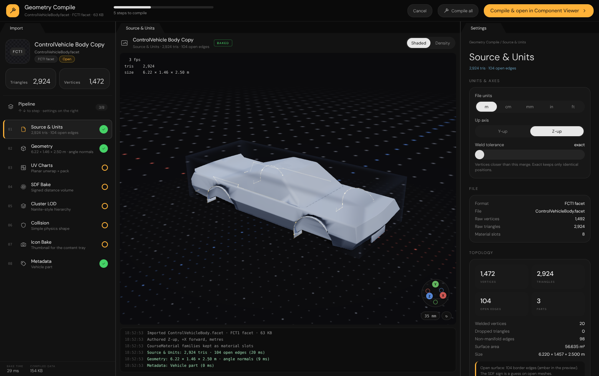
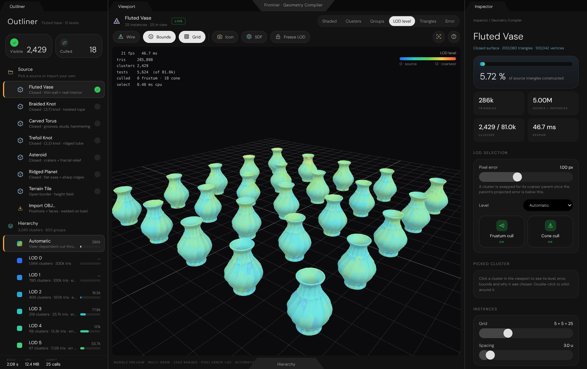

# Geometry Compiler — C++20 Port Plan (Workspace 2 of 2)

> **TL;DR:** **`FrontierGeometryCompiler`** is a separate workspace from the Component Viewer ([ComponentViewerPortPlan.md](ComponentViewerPortPlan.md)). It merges two HTML sources:
> - the **Geometry Compile** step inspector from `c7egoist/Frontier` `Experimental/ComponentViewer/`: 8 steps, 6 readers, material-aware cluster LOD;
> - the **Geometry Compiler studio** from `unassignedinbox/Frontier` `Experimental/GeometryCompiler/`: cluster LOD runtime views, sparse 8×8×8 SDF workspace, UV workspace, geometry editor, icon capture.
>
> Most of the engine already exists (`ClusterPyramid`, `SignedDistanceVolume`, `GpuSdfBaker`, UV `Solvers/`, `GeometryInterchange`, `ClusterCullEncoder`, `VisibilityClusterRasterization`). The port adds:
> - STL / PLY / GLB / FCT1 readers;
> - a headless `CompileStepSequence` with staleness;
> - material seam policies in `ClusterPyramid`;
> - a conservative SDF `Mip1` and raymarch `.slang`;
> - collision fits and icon capture;
> - the workspace panes.
>
> 🔴 One finding blocks part of the work: the **Hybrid** solver chosen in `GeometryCompilerFindingsReport.md` has **no source on the branch** (`CompilerSolvers.js` is missing; see §1.2).
>
> 🏁 **Status 2026-11-15:** the engine is imported into this repo and builds (51/52 CTest). M0 split is done: the step shell now lives at `Experimental/GeometryCompiler/Compile.html`, beside the reference studio `index.html`. §1.1 and §1.2 weren't answered, so the recommended defaults apply (marked ⭐ below); say so if you want them changed.

---

## 1. 🏆 Key Decisions

*(Legend — Parity / Fit: 🔴 = best, 🚩 = moderate, ✔️ = lowest · Effort: ✔️ = lowest/best)*

### 1.1 🚩 Workspace layout (the two HTML sources disagree)

| Rank | Option | Parity | Fit | Summary |
| :---: | :--- | :---: | :---: | :--- |
| 🏆 🥇 | **A — Step-driven shell** (Import · Viewport · Settings, the Geometry Compile layout). The studio's tools fold into their steps. | 🔴 | 🔴 | "Compiler" means steps run top to bottom with staleness. Cluster LOD step gets the studio's view modes (Clusters, Groups, LOD level, Triangles, Error), Freeze LOD, instance grid, frustum/cone cull. SDF Bake step gets the 4 raymarch modes. UV Charts step gets the UV workspace. Geometry step gets the geometry editor. |
| 🥈 | B — Studio shell (Outliner · Viewport · Inspector, the reference studio layout) with the steps as an Inspector section | 🚩 | 🚩 | Keeps the LOD playground first. The compile order and staleness become hard to see. |
| 🥉 | C — Both, switched by a header segment | 🔴 | ✔️ | Two layouts to keep at parity, and twice the Exhibit captures. |

💡 **Recommendation: A**, prototyped first in HTML (G0) so the C++ has a 1:1 reference (CLAUDE.md §2.5).

⭐ **Default in effect: A** (no answer yet). M0 already split the step shell out as `Compile.html`; G0 folds the studio tools from `index.html` into its steps.

### 1.2 🚩 The missing Hybrid solver

| Rank | Option | Summary |
| :---: | :--- | :--- |
| 🏆 🥇 | **A — You point to the branch that holds `CompilerSolvers.js`** (Hybrid probabilistic QEM, adaptive shrinkwrap, retopo-seeded `LOD 3`) | Port it 1:1 with the locked constants from the report (`seedRatio = 0.28`, `minAngleGuardRad = 0.20`, …). |
| 🥈 | B — Ship G3 on today's `ClusterPyramid` QEM + material seams. Hybrid goes to `Backlog.md`. | Nothing blocks. The report's thin-wall result (`0` breaches vs `11`) isn't delivered yet. |
| 🥉 | C — Re-derive Hybrid from the report text alone | 🔴 High drift risk. The report says relaxing those constants caused stalls, spikes and chord sag. |

⭐ **Default in effect: B** (no answer yet). G3 ships on `ClusterPyramid` QEM + material seams; Hybrid is backlogged until you point to `CompilerSolvers.js` (then A).

📝 Also checked: the report quotes **14/14** suites, but `GeometryCompilerValidation.mjs` on `7eb76ce` holds **6 suites (6/6 PASS, run 2026-11-15)**. Every C++ gate below is defined against the 6 suites that exist, plus the 11 compile checks from Component Viewer.

### 1.3 Compiled asset format

| Rank | Option | Summary |
| :---: | :--- | :--- |
| 🏆 🥇 | **A — One `.GeometrySpace` per asset with Tier 2 sections:** `PolygonNetwork`, `ClusterPyramid` (`SerializeToBinaryBytes`), `SparseDistanceVolume` (`.FVOL` payload), UV charts, collision, icon (PNG), metadata manifest | One file per asset, one checksum, and the Component Viewer reads one path. |
| 🥈 | B — Sidecar files (`.FVOL`, `.png`, …) | Paths can drift. Stale-detection is spread across files. |

---

## 2. 🔍 Ground Truth (HTML, captured 2026-11-15)

| Source | Capture |
| :--- | :--- |
| Geometry Compile steps (c7egoist) |  |
| Geometry Compiler studio (unassignedinbox) |  |

---

## 3. 🔍 Feature → C++ Mapping

### 3.1 Compile steps (headless `GeometryCompileSession` + `CompileStepSequence`)

| Step | HTML behaviour | C++ (reuse ✔️ / new 🚧) |
| :--- | :--- | :--- |
| 01 Source & Units | Readers; m/cm/mm/in/ft; up axis; weld tolerance; open / non-manifold edge report | ✔️ `GeometryInterchange` OBJ + glTF · 🚧 `ImportStlBytes`, `ImportPlyBytes`, `ImportGlbBytes`, `ImportFct1Bytes` (OBJ `usemtl` → `FacePartitionRegister` slots) · 🚧 `ConnectivityReport` (open edges, non-manifold, parts) |
| 02 Geometry | Scale, mirror, rotate, pivot (centre / floor / authored), flip, normals (smooth / flat / angle split) | 🚧 `GeometryTransformDirectives` + `CornerNormalSplitter` (studio Geometry Editor = same directives) |
| 03 UV Charts | Normal-cone chart growth, pack, checker, OBJ + SVG export | ✔️ `SeamCutGenerator` + `ConcaveSkylinePacker` · 🚧 `NormalConeChartUnwrap` in `UVProjectionSolvers` if output differs from the JS `unwrapCharts` (`normalLimitDeg = 60`, `mergeBelow = 24`) |
| 04 SDF Bake | Sparse 8×8×8 bricks 16³–128³, conservative `Mip1`, slice, `.FVOL`, VRAM eviction | ✔️ `SignedDistanceVolume`, `GpuSdfBaker`, `BakeVolumeSdfCompute.slang`, `ExtractSdfSectionCompute.slang` · 🚧 exact 3-axis EDT conservative `Mip1` (not in the header today) · 🚧 `.FVOL` section codec · 🚧 `EvictFinestBricks(MaximumResidentBytes)` |
| 05 Cluster LOD | 128-tri clusters, groups of 4, ratio 0.5; **Preserve materials** Off / Slide / Pin; wrong-material share | ✔️ `ClusterPyramid::BuildFromPolygonNetwork` · 🚧 `ClusterBuildDirectives { MaterialSeamPolicy, ClusterTriangleCount, GroupClusterCount, SimplifyRatio }` · 🚧 triple-junction lock, last-face guard, per-material clustering · 🚧 `MaterialDriftMeasurement` |
| 06 Collision | Box / sphere / capsule fit, SDF collider, none | 🚧 `CollisionFitSolver` (`SimulationSpace/PhysicsSpace/`) |
| 07 Icon Bake | Square capture box, clay / normal shading, PNG | 🚧 `IconCaptureSequence` (offscreen `TieredWorldRenderSequence` → `ImageCodec`) → `ThumbnailSheetRepository` |
| 08 Metadata | Name, category, tags | 🚧 manifest keys in the `.GeometrySpace` Tier 1 |
| Staleness | Changing step N marks N…8 stale; Bake steps run on demand | 🚧 `CompileStepSequence` on `WorkspaceThread` (async, triple-buffered snapshots) |

### 3.2 Studio views folded into steps

| Studio feature | Step | C++ |
| :--- | :--- | :--- |
| View modes Shaded / Clusters / Groups / LOD level / Triangles / Error, ramp legend | 05 | ✔️ `VisibilityClusterRasterization` + 🚧 `ClusterInspectionShading.slang` |
| View-dependent cut, pixel-error slider, forced level, Freeze LOD | 05 | ✔️ `SelectMonotonicCut` + `ClusterCullEncoder` |
| Frustum / cone cull tiles, back faces | 05 | ✔️ `EnableNormalConeBackfaceCull` |
| Instance grid 1×1…15×15, spacing | 05 | ✔️ `RigidClusterInstance` span |
| Picked cluster (level, error, bounds, why chosen) | 05 | ✔️ `ViewportPickQuery` → cluster ordinal |
| SDF workspace: Iso + AO, 3D Cutaway, Step Heat, Sparse Bricks; slice navigator; iso offset | 04 | 🚧 `SparseDistanceRaymarch.slang` (4 modes as a push constant; conservative 0.96 / 0.78 relaxation; second-smallest-distance brick edges, from the report) |
| UV workspace: charts list, rotate / mirror / pack, checker, seams, fill | 03 | ✔️ UV `Solvers/` + `UVTileRasterization.slang` |
| Geometry editor: scale XYZ / uniform, mirror, rotate, centre, normals | 02 | 🚧 shared `GeometryTransformDirectives` |
| Icon camera box, default angle, size, save / copy | 07 | 🚧 `IconCaptureSequence` |
| 7 procedural presets (vase, braid, carved torus, trefoil, asteroid, planet, terrain) | 01 | 🚧 `ProceduralSourcePresets` beside `AnalyticPrimitives` (seeded `DeterministicRandom` noise) |
| Level chart, time chart, build overlay | 05 | ImGui chrome via `PixelSpace` (charts are panel UI, not viewport overlays) |

### 3.3 Panels (reuse only)

| Region | Unit |
| :--- | :--- |
| Import pane (asset tile, counts, step list with ✔️ / stale markers) | `OutlinerPanel` → `GeometryCompilerStepsPanel` |
| Viewport + log strip | `ViewportPanel` + `ViewportProjectionPane` → `GeometryCompilerViewportHost` |
| Settings | `InspectorPanel` + `ExclusiveSelector` (units, up axis), `ScalarSlider` (weld, ratios), `DropdownSelector` (level, budget), `CapsuleButton` → `GeometryCompilerInspectorPanel` |
| Header (progress, Cancel, Compile all, **Compile & open in Component Viewer**) | `CapsuleButton` + `GeometryCompilerWorkspaceHost` header |

### 3.4 Axis convention

📝 The engine is `+X` forward, `+Y` left, `+Z` up. Step 01's up-axis switch therefore converts **Y-up files into Z-up**, the reverse of the HTML. FCT1 (authored Z-up) loads unchanged. Check 4 becomes "body is 6.22 m long, 1.46 m tall **along +Z**".

---

## 4. 🚧 Milestones

| # | Milestone | Deliverables | Exit gate (Exhibit + `.png` → `Exhibits/Images/GeometryCompiler/`) |
| :---: | :--- | :--- | :--- |
| **G0** | HTML merge | `Experimental/GeometryCompiler/` adopts the step shell (§1.1 A) with studio tools inside the steps. ✔️ Already done in M0: `Compile.html` exists and Component Viewer's Compile opens it (framed, `CompileExchange.js`). Left: fold `index.html`'s tools into the steps. | HTML: 6 GC suites + 11 compile checks + smoke. Reference captures for every step. |
| **G1** | Readers | STL (bin / ascii), PLY (ascii / bin), GLB, FCT1, OBJ `usemtl` slots | `GeometryReaderValidation`: ports checks 1–3 (FCT1 counts, fan-triangulated quads). Proof: the 6 formats rendered as clay tiles. |
| **G2** | Headless compile | `GeometryCompileSession`, `CompileStepSequence`, `ConnectivityReport`, `GeometryTransformDirectives`, `CornerNormalSplitter`, `CollisionFitSolver`, `.GeometrySpace` sections | `GeometryCompileValidation`: ports checks 4–9 (units, welding, normals, fits, downstream-only invalidation, vehicle body with 8 material families). Proof: step timeline + collision fits. |
| **G3** | Cluster LOD | `ClusterBuildDirectives`, seam policies, `MaterialDriftMeasurement`, inspection shading, Hybrid (if §1.2 A) | Ports checks 10–11 + GC suite 1 (monotone error, nested spheres, crack-free cuts, edge counts). Body LOD 2 < 1% drift (Slide = 0.02% at 744 tris). Proof: Off / Slide / Pin side by side. |
| **G4** | SDF | EDT `Mip1`, eviction, `.FVOL`, `SparseDistanceRaymarch.slang` | GC suites 3–5 (thin-wall vase, `Mip1 ≤ Mip0`, slice RGBA, eviction fallback, raymarch contract). Zero-tunnelling front wall (`GlassVessel 64³`, `0` punctured pixels). Proof: 4 modes. |
| **G5** | UV charts | Chart unwrap parity, pack, OBJ + SVG export | GC suite 2 (unwrap, pack, OBJ round-trip). Proof: chart sheet + checker. |
| **G6** | Icon + presets | `IconCaptureSequence`, `ProceduralSourcePresets` | Proof: 7 preset icons, transparent background (`alpha = 0` outside). |
| **G7** | Panels + host | §3.3 units, `GeometryCompilerSession` revision via `RevisionTracker` | `GeometryCompilerWorkspaceUIValidation`: click every step, Compile all, Cancel. Side-by-side `.png` against G0. |
| **G8** | Executable + handoff | `FrontierGeometryCompilerLaunch.cpp`, `WorkspaceCategory::GeometryCompiler`, `CompiledGeometryExchange` | CTest `FrontierGeometryCompilerExecutableSmoke --frames=3 --capture-png=…`. FeatureSet: Compile & open lands the asset in Component Viewer Content. |

📝 GC suite 6 (StudioIconSet integration + zero-`And` naming) maps to the shared `VectorIconRepository` check and the banned-word grep gate. There's no separate milestone.

---

## 5. ⚠️ Risks

| Risk | Rating | Mitigation |
| :--- | :---: | :--- |
| Hybrid solver source missing | 🔴 | §1.2 default B: G3 ships on `ClusterPyramid`; Hybrid backlogged. |
| Report numbers vs code drift (14 vs 6 suites) | 🚩 | Gates are defined only against runnable suites. Report corrections noted in `Tracker.md`. |
| WebGPU WGSL raymarcher → `.slang` | 🚩 | Same math, and the 4 modes keep the CPU fallback as the Exhibit reference image. |
| Nanite-style cluster streaming | ✔️ | Stays out of scope (report §5). Only the cut and culling views are ported. |
