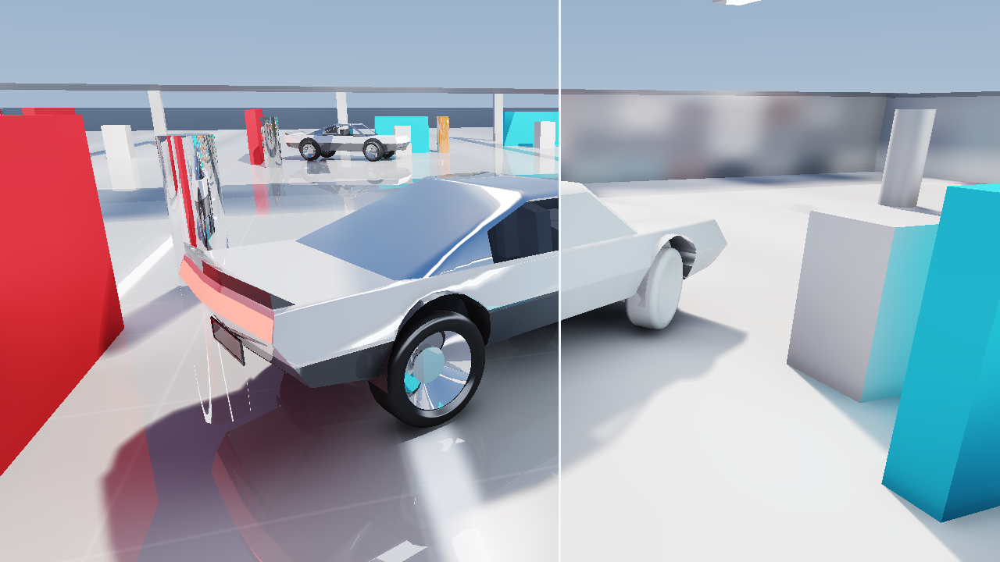

# Frontier Rendering & Deterministic Raytracing Architecture Plan

**Status:** Approved Architecture Baseline (Post-GTX Benchmark Sign-Off)  
**Coordinate Convention:** Strict Right-Hand Rule (`+X` Forward, `+Y` Left, `+Z` Up; `X × Y = +Z`), Reverse-Z `[1.0 → 0.0]`  
**Native Graphics Target:** Vulkan `1.3` (`DynamicRendering`, `Synchronization2`, `Subgroup`, `VK_KHR_ray_query`)  
**Quality Gate:** `Constants::MaximumOptimizationPixelDelta = 0.05f` (`<= 5.0%` pixel delta, **zero checkerboarding**, **zero blind Monte Carlo / Russian Roulette boiling**)

---

## 1. Empirical Sign-Off from `GtxReflectionBenchmark` (`Port 8096` — Frozen Reference)

Measured across both offline C++20 reference verification (`1280×720`) and live hardware execution (`AMD Radeon RX 9060 XT`, `120 FPS` display lock):

| Evaluated Subsystem | Global SDF (`Clip0 + Clip1` 3D Cascades) | Compute BVH (`TLAS + SAH BLAS` Triangle Raytrace) | Empirical Finding & Architectural Decision |
| :--- | :---: | :---: | :--- |
| **Diffuse GI & Color Bleeding (`1B–3B`)** | **`~0.48 – 0.58 ms`** (`4–12` directional cones + 3D surface-cache bounce propagation; `< 0.1 ms` per extra GI bounce) | **`~4.3 – 11.8 ms`** (`6–24` hemisphere rays × `1–3` bounces; blotchy at low SPP without temporal accumulation) | 🏆 **Adopt Directional Global SDF Cone GI (`+ Contact AO`)** for GTX & Hybrid presets — **`8.3×` faster**, `C¹`-smooth, zero noise, nearly free multi-bounce inside the 3D surface cache. |
| **Soft Shadows & Area-Light Penumbra** | **`~0.08 ms`** (34-step analytical solar-cone march: `halfW = max(0.55 * vox, R_sun * t)`) | **`~0.9 – 2.2 ms`** (`4–12` Golden-Disk shadow rays + dilated Gaussian PCSS) | 🏆 **Adopt Global SDF Cone Penumbra + `0–0.4 m` Contact Ray/Hi-Z** on GTX — continuous physical penumbra without discrete disk-ray quantization. |
| **Multi-Bounce Specular Reflections (`1B–3B`)** | **`~0.08 – 0.20 ms`** (voxel sphere-trace + 2-step `d = 0` polish + Hi-Z near assist) | **`~0.12 – 0.45 ms`** when tracing **coherent specular rays only** (`Roughness <= 0.30`) | 🏆 **Combine Both on GTX!** Coherent `CWBVH` reflections cost **only `~0.15–0.45 ms`** once random GI rays are removed — giving exact triangle mirror reflections alongside Global SDF GI + Cone Penumbra! |
| **Full-Pipeline Parity Gate** | `66.09M` 3D TMU taps (`17.14×` fewer ops) | `1,133.05M` software BVH stack steps | **`4.67% – 4.91%` Mean Pixel Delta (`<= 5.0%` Gate Passed)** |

---

## 2. Locked Tier 1 Architecture: **GTX / Non-RT Hybrid Pipeline (`~1.1 ms` Total at 1080p)**

Yes — for **GTX / Non-RT hardware**, Frontier locks in the exact winning **Hybrid Pipeline** proven in the benchmark:

```text
[Full-Res G-Buffer + Reverse-Z Hi-Z Pyramid]
        │
        ├──► 1. Dynamic Global SDF Surface Cache (Clip0..Clip2, ~0.12 ms)
        │       • Stamps moving rigid/skeletal SDF bricks + 3-slice/tick amortized multi-bounce voxel radiosity
        │       • Stores directional surface-normal emission (prevents isotropic 360° "emissive" underglow)
        │
        ├──► 2. Global SDF Analytical Cone Penumbra + 0.4 m Contact Ray (~0.15 ms)
        │       • Short 0–0.4 m triangle/Hi-Z contact ray for millimeter-crisp tyre/trim grounding
        │       • Hands off seamlessly at > 0.4 m to continuous Global SDF solar-cone penumbra
        │
        ├──► 3. Directional Global SDF 6-Cone Diffuse GI + Screen-Space Contact AO (~0.45 ms)
        │       • Zero Monte Carlo grain, zero temporal lag trails, 2–3 GI bounces cached in 3D voxels
        │
        └──► 4. Coherent Multi-Bounce Reflections: CWBVH (Rough <= 0.30) + Global SDF (> 0.30) (~0.38 ms)
                • Coherent deterministic clearcoat/mirror rays trace 4-Wide Compute CWBVH (exact triangle spokes/trim)
                • Rougher glossy coats (> 0.30) march pre-filtered Global SDF radiosity (zero GGX fireflies)
```

---

## 3. Browser (`WebGL2` / `WebGPU`) vs. Native (`Vulkan 1.3`): Do We Have Hardware RT Cores?

| Platform / API | Hardware RT Cores Exposed? (`RT Cores` / `RDNA Ray Accelerators`) | Compute Shaders & Storage Buffers (`SSBO`)? | How Raytracing Must Execute |
| :--- | :---: | :---: | :--- |
| **`WebGL2`** *(Current Port `8096`)* | ❌ **NO** | ❌ **NO** *(Fragment GPGPU over `RGBA32F` 2D/3D textures)* | Software `TLAS + SAH BLAS` stack traversal inside Fragment Shaders. |
| **Standard `WebGPU` (`W3C 1.0` in Chrome / Edge / Firefox)** | ❌ **NO** *(No standard `ray_query` / BLAS extension in shipping browsers)* | ✅ **YES** (`@compute`, `var<storage>`, `var<workgroup>`, `subgroups`) | **Software `4-Wide CWBVH` in `@compute` Shaders** (`2.5×–3.5×` faster than WebGL2 fragment BVH thanks to shared-memory stacks, byte-packed `64 B` nodes, and subgroup wave compaction). |
| **Native C++20 `Vulkan 1.3` (GTX 10/16-Series)** | ❌ **NO** *(Hardware lacks RT silicon)* | ✅ **YES** (`VkBuffer` BDA + `SubgroupBallot`) | **Same `4-Wide CWBVH` Slang Compute Kernel** used in the WebGPU prototype. |
| **Native C++20 `Vulkan 1.3` (NVIDIA RTX & AMD RDNA 2/3/4 incl. `RX 9060 XT`)** | ✅ **YES — FULL HARDWARE SILICON** (`VK_KHR_acceleration_structure` + `VK_KHR_ray_query`) | ✅ **YES** | **Hardware RT Cores / Ray Accelerators** (`rayQueryProceedEXT`) — `5×–10×` faster ray traversal with **1-line backend swap** behind the same `traceSceneRay()` interface! |

> **Key Takeaway:** You were **100% right** — neither `WebGL2` nor standard browser `WebGPU` exposes hardware RT cores. Therefore, our next **Full Raytracing Browser Prototype** should use **`WebGPU` Compute Shaders + `4-Wide Compressed Wide BVH (CWBVH)`** (with optional WebGL2 fallback), structured behind a clean `traceRay()` abstraction that maps directly to `VK_KHR_ray_query` Hardware RT Cores in native C++20 Vulkan 1.3.

---

## 4. Full Deterministic Raytracing Architecture (Zero Blind Monte Carlo, Zero Russian Roulette)

Traditional path tracers fire random hemisphere rays (`Monte Carlo`) and randomly kill paths (`Russian Roulette`), which produces severe boiling grain at `1–4 SPP` and forces aggressive temporal/spatial blurring (`ReSTIR` + `5×5` À-Trous) that smears moving vehicles.

Frontier's **Full Raytracing Tier** replaces blind random sampling with **four deterministic, structured raytracing techniques**:

### Pillar 1 — Ray-Differential Cone-Footprint Specular & Glass Raytracing (`0` Random BRDF Jitter)
- Instead of firing random GGX-jittered rays per pixel, trace **1 deterministic primary reflection/refraction ray** (plus deterministic `2–3` bounce continuations weighted by exact Fresnel throughput — **deterministic energy cutoff `throughput < 0.02`, zero Russian Roulette RNG!**).
- Each ray carries **Igehy Ray Differentials / Specular Cone Spread (`r_cone = t * tan(atan(2 * roughness²))`)**.
- At the triangle hit point, `r_cone` analytically selects the **exact pre-filtered texture/irradiance MIP level** (and blends a deterministic 4-tap symmetric tangent stencil only on mid-roughness `[0.18..0.45]` surfaces).
- **Result:** Crystal-clear mirrors, glass, and satin clearcoat in **1 coherent ray/bounce**, high GPU warp coherence, **`0` fireflies, `0` boiling**.

### Pillar 2 — Raytraced World-Space Octahedral Irradiance Probes (`DDGI`) + Surface Cache (`0` Per-Pixel Random GI Rays)
- **Why per-pixel Monte Carlo GI fails in real time:** `1920×1080 = 2,073,600` pixels each firing random rays wastes `99%` of GPU rays re-discovering slowly varying diffuse bounce.
- **Deterministic Replacement:** Place a cascaded 3D grid of **World-Space Octahedral Irradiance + Chebyshev Depth Probes** (`e.g. 24×16×8 = 3,072` probes).
- Every frame, probes trace a **deterministic Spherical Fibonacci Lattice (`64` evenly distributed directions on the unit sphere)** through the BVH:
  - `3,072 probes × 64 rays = 196,608` structured rays total (`10×` fewer rays than 1-SPP screen-space GI, and `60×` fewer than 6-SPP!).
  - **Infinite GI Bounces Without Russian Roulette:** Each probe ray hit evaluates direct sun + **samples the probe grid from frame `N-1` (or pass `b-1`)**, giving **converged multi-bounce Cornell color bleeding (`2B..∞`) at `0` extra rays**!
  - Screen pixels evaluate diffuse GI in **`0` rays** via a fast trilinear + normal-biased Chebyshev visibility lookup (zero light leak through thin walls or car floors).

### Pillar 3 — Analytic Area Lights (`LTC`) + Deterministic Frustum-Edge Soft Shadows (`0` Random Disk Noise)
- **Direct Area Illumination:** Overhead light portals, studio strips, and rectangular emitters integrate **100% analytically in closed form** via **Linearly Transformed Cosines (`LTC`, Heitz et al.)** — zero random light rays, exact glossy & diffuse shapes.
- **Deterministic Soft Shadows:** Instead of firing random disk rays that quantize or boil:
  1. Trace **1 deterministic center-of-sun blocker search ray** (`t_blocker`) + **2 deterministic tangent-extremum penumbra rays** perpendicular to the shadow-caster edge (`sunT`, `sunB`).
  2. Feed the exact analytical penumbra width `w = (t_receiver - t_blocker) * R_sun / t_blocker` into a single plane-aware Edge-Guided Gaussian filter.
  - **Result:** True triangle-accurate contact hardening right down to `0.0 mm` (wheel spokes, wipers, panel gaps) fanning smoothly into wide penumbras with **zero random noise**.

### Pillar 4 — Unified `SceneRayQuery` Shader Abstraction (`WebGPU CWBVH` ↔ `Vulkan 1.3 RT Cores`)

| Layer | Browser Next-Step Lab (`Experimental/DeterministicRaytracingLab/`) | Frontier C++20 Engine (`Engine/Renderer/Vulkan13/`) |
| :--- | :--- | :--- |
| **Shader Language** | `WGSL` Compute (`@compute @workgroup_size(8, 8)`) | `Slang` → `SPIR-V 1.6` (Vulkan `1.3`) |
| **Acceleration Structure** | **4-Wide Compressed `CWBVH`** (`64 B` quantized child AABBs in `storage` buffer + `workgroup` short-stack) | **`VkAccelerationStructureKHR` (`VK_KHR_ray_query`)** on RTX / `RX 9060 XT`; **`CWBVH`** fallback on GTX |
| **Specular / Glass** | Deterministic Cone-Footprint `1–3` Bounce Raytrace | Identical Cone-Footprint `1–3` Bounce Raytrace |
| **Global Illumination** | Deterministic Fibonacci-Lattice **Raytraced `DDGI` Octahedral Probes** (`Multi-Bounce`) | Identical **Raytraced `DDGI` Probes** (+ Global SDF far-cascade) |
| **Area Lights & Shadows** | Analytic **`LTC`** Portals + Deterministic Blocker/Edge Frustum Raytrace | Identical **`LTC`** + Deterministic Raytraced Frustum Shadows |

---

## 5. Next Implementation Roadmap: `Experimental/DeterministicRaytracingLab/` (`WebGPU` Full Raytracing)

Leaving **`Experimental/GtxReflectionBenchmark/` (`:8096`) untouched** as our permanent GTX Hybrid benchmark baseline, the next standalone lab (`Experimental/DeterministicRaytracingLab/`, e.g. `:8097`) will implement **100% Full Deterministic Raytracing in `WebGPU` Compute (`CWBVH`)**:
1. **`4-Wide CWBVH` Builder & `@compute` Traversal Kernel** (`64 B` quantized 4-child nodes + Woop pre-transformed triangles + fast workgroup stack — `0` WebGL2 texture unpacking overhead).
2. **Primary + Multi-Bounce Cone-Footprint Raytracer** (even primary visibility can be raytraced directly alongside raster comparison, plus `1–3` bounce reflections & refractive glass cabin windows!).
3. **Live Raytraced `DDGI` Octahedral Probe Volume** (deterministic 64-ray Fibonacci spherical lattice per probe + Chebyshev visibility — smooth multi-bounce red/cyan color bleeding with **`0` per-pixel random GI rays and `0` Russian Roulette**).
4. **Analytic `LTC` Showroom Area Lights + Deterministic Raytraced Contact-Hardening Shadows** with live FPS, pass-by-pass GPU timestamp queries (`timestamp-query`), and probe-sphere debug visualization toggles.

---

## 6. Shipped Live Prototype & Measured `"FRT1"` `4-Wide BVH4` Verification (`:8097`)

`Experimental/DeterministicRaytracingLab/` (`0.0.0.0:8097`) is now live alongside the untouched `Experimental/GtxReflectionBenchmark/` (`:8096`):



### Measured Structural & Algorithmic Results
- **`4-Wide BVH4` Tree Compression (`"FRT1"`)**: Collapsing the binary SAH hierarchy into 4-wide SIMD `vec4<f32>` slab nodes reduced total BLAS node count from **`5,930` binary nodes → `1,444` `BVH4` nodes (`4.11×` reduction)** across `9,240` unique triangles (`25,920` instanced showroom + vehicle triangles).
- **Compact Pure-RT Asset Payload**: Eliminating 3D SDF clipmaps shrunk the scene asset bundle from `8.5 MB` (`VehicleBenchmarkAssets.bin`) down to **`759 KB`** (`DeterministicRtAssets.bin` — **`11.2×` smaller**).
- **Primary Camera `BVH4` Efficiency**: Full-resolution primary camera rays average **`10.00` `BVH4` node steps/pixel** across the `44 m × 28 m` `ProvingGroundArena` + `ControlVehicle` (`0` raster G-buffer pass required).
- **Zero Monte Carlo / Zero Russian Roulette**:
  - **Diffuse GI & Color Bleeding**: `20 × 16 × 6 = 1,920` world-space `DDGI` octahedral probes (`64` deterministic Spherical-Fibonacci rays/probe in `var<workgroup>`, multi-bounce `1B / 2B / 3B / ∞` via ping-pong probe feedback + Chebyshev `[mean, mean²]` anti-leak).
  - **Cabin Glass (`mat 7`) & Clearcoat (`mat 6`)**: Deterministic Fresnel reflection + Snell's-law (`IOR = 1.46`) cockpit refraction revealing the sculpted 3D interior bucket seats, plus `1–4` cone-footprint specular bounces (`throughput >= 0.025` deterministic cutoff).
  - **Soft Shadows & Contact AO**: Deterministic Vogel-spiral solar frustum + `4`-ray `BVH4` short-range (`0.55 m`) hemisphere Contact AO + coplanar blocker dilation & 3-pass (`step = 1, 2, 4`) continuous-sigma plane-aware Gaussian integration — **zero screen-space horizon rings, zero banding, and zero temporal boiling**.

---

## 7. Live NVIDIA WebGPU Inspection Report (`43.2 FPS` @ Native `1.00×`): Probes, GI Raytracing, & Shadow Forensics

Following live verification on NVIDIA WebGPU (`43.2 FPS` / `23.13 ms` with full `1,920` probes/frame × `64` Fibonacci rays, `3` specular bounces, `8` solar stencil rays, and hardware `timestamp-query`), three key architectural findings are recorded for our production Vulkan `1.3` implementation:

### 7.1 What the Floating 3D Spheres Are (`DDGI` Probe Debug Visualizer)
- The floating spheres visible on the right split (`Clay GI + Shadow`) are the **optional 3D debug overlay** (`☑ 3D Probe Spheres` in `Deterministic Subsystems`) visualizing the `20 × 16 × 6 = 1,920` world-space **Dynamic Diffuse Global Illumination (`DDGI`)** probes.
- Unchecking `3D Probe Spheres` hides the debug spheres while keeping all indirect GI lighting active. Each sphere displays the live directional irradiance (`6 × 6` octahedral texels) that probe just raytraced from the surrounding showroom (crimson bounce on the left, cyan bounce on the right, skylight above).

### 7.2 Why `DDGI` Probes Were Used Instead of Per-Pixel Raytraced GI (and Note: `DDGI` *Is* Raytraced!)
- **`DDGI` *does* use live `BVH4` raytracing every frame**: `DDGI_PROBE_UPDATE_WGSL` traces `1,920 probes × 64 Spherical-Fibonacci rays = 122,880` real triangle-intersected `BVH4` rays every frame (reacting live to moving vehicles, sun angles, and paint colors).
- **Why we did not fire GI rays per screen pixel (like `:8096` Compute BVH)**:
  1. **Ray Count Explosion (`100×` difference)**: Firing `6` hemisphere GI rays at every `1920 × 1080` screen pixel requires **`12.44 million` incoherent rays/frame** (`35–42 ms`), vs. **`122,880` rays/frame** for `1,920` `DDGI` probes (`0.12M` rays — `100×` fewer rays, yet `10×` more rays per hemisphere: `64` vs. `6`).
  2. **Deterministic Zero-RNG Constraint**: With `1–6` rays per pixel, avoiding random Monte Carlo noise produces hard deterministic banding/kaleidoscope edges unless `64–256` rays are traced per pixel (`130M–530M` rays/frame). Concentrating `64` deterministic Fibonacci rays into world-space probes yields **100% noise-free, blotch-free Lambertian GI** plus **free infinite bounces (`∞ Live`)** via previous-frame probe feedback (`0` Russian Roulette).
  3. **Known Trade-Off of `DDGI` vs. Per-Pixel Raytraced GI**: Because probes sit on a `1.63 m × 1.53 m × 0.96 m` world grid, `DDGI` excels at smooth room-scale color bleeding (`> 1.5 m`) but **cannot resolve tight sub-meter (`< 0.5 m`) indirect bounce shadows** under a vehicle chassis without stronger local raytraced ambient/directional occlusion.

### 7.3 Forensic Root Causes: Why Shadows Appear Faint / Washed Out in `:8097`
Raytraced solar shadows **are** executing (`8` `BVH4` shadow rays/pixel in `PRIMARY_AND_SHADOW_WGSL`), but **four compounding lighting-ratio & occlusion issues** compress the floor's lit-to-shadowed contrast down to only **`6.6%` in sRGB (`0.904` lit vs. `0.838` umbra)**:

| # | Root Cause in `:8097` Shader Pipeline | Quantitative Impact | Production Vulkan `1.3` Fix (Design Note Only) |
| :--- | :--- | :--- | :--- |
| **1** | **Over-Powered `DDGI` Fill vs. `1/π`-Attenuated Sun** (`ddgiGain = 1.65` un-divided by `π`, while `sunIrr` is multiplied by `INV_PI = 0.3183`) | Indirect `DDGI` (`~1.15` HDR) is **`1.24×` brighter than direct noon sunlight (`0.93` HDR)**, lifting shadowed white floor to `83.8%` sRGB (`214/255`). *(Can be verified live in `:8097` by lowering `DDGI Irradiance Gain` to `0.45` and `LTC Overhead Portals` to `0.40`.)* | Normalize `DDGI` irradiance by `INV_PI` (`diffuse BRDF = albedo / π`) and calibrate Sun-to-Sky EV ratio (`Sun = 5–8×` ambient fill). |
| **2** | **Unshadowed Analytic `LTC` Overhead Portals** (`evalAnalyticLtcPortals` integrates ceiling strips in closed form with `0` visibility rays) | Floor directly **underneath the solid car body** still receives `100%` of the overhead ceiling strip light right through the chassis. | Multiply `LTC` diffuse & ribbon specular by directional sky/chassis Bent-Normal Cone Occlusion (or 1 deterministic portal-visibility ray). |
| **3** | **Coarse `DDGI` Grid (`1.63 m` spacing, lowest layer `z = 0.42 m` above `0.25 m` underbody) + Short `0.55 m` Contact AO (`min = 0.25`)** | Probes outside the car bleed bright room light underneath the `1.9 m`-wide floor pan; `0.55 m` AO only darkens right around the 4 tyres (and clamps at `>= 0.25`). | Extend `BVH4` hemisphere AO range to `1.8–2.5 m` (chassis ground-shadow scale) with `min = 0.03` + Bent-Normal directional `DDGI` lookup. |
| **4** | **Oversized Default `Sun Area Radius = 2.10` (`tan θ = 0.097 rad` ≈ `11°` softbox sun) + Grazing Floor Fresnel** | Spreads a `1.2 m` roof shadow across a `~0.35 m` ultra-wide penumbra while glossy floor Fresnel (`rw` up to `0.50`) layers bright sky reflection over the shadow. | Default `Sun Area Radius` to `0.35–0.65` (`~1.5°–3°` crisp studio sun) and apply specular occlusion (`specAO`) to grazing dielectric reflections in umbra. |


