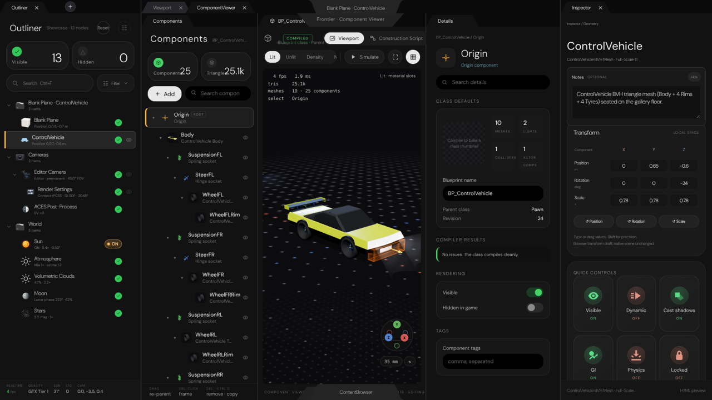
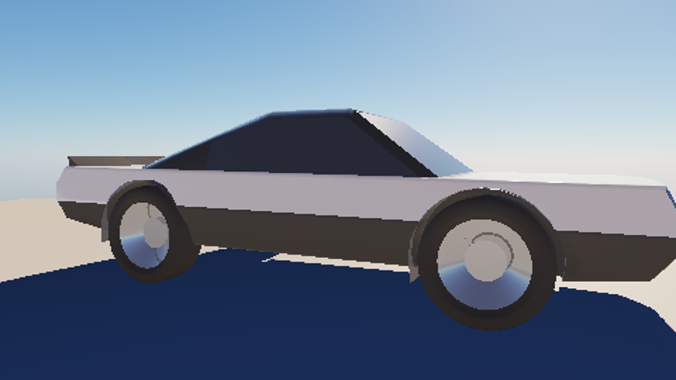

# World Mirror × ComponentViewer — Merge Plan

> **TL;DR:** `Experimental/FrontierWorldMirror` is refreshed from upstream (`SultanAladin/Frontier-1` @ `5af9a1b7`). ComponentViewer now docks inside it as a **`ComponentViewer` tab**: drag it between docks, open it from the dock **+** menu, or **right-click the viewport → Open ComponentViewer**. The sky follows the C++ `AtmosphericSkySequence` (192×108 limb-split Sky-View LUT, Neckel & Labs solar disc + corona). The sun follows `CelestialEphemerisSolver`. A new **Blank Plane · ControlVehicle** level opens on fresh storage or with `?level=blank`. ComponentViewer loses its Content tab and gains **Add → IMPORT → Import mesh file…**. 🟢 Everything below is done and verified.



---

## 1. 🏆 Key Decisions

| Rank | Option | Summary |
| :---: | :--- | :--- |
| 🏁 | **A — One persistent iframe laid over the active dock slot (chosen)** | `ComponentViewerHost` mounts once at workspace level. `ComponentViewerSlot` reserves the dock area. Blueprint, camera and Simulate state survive tab switches and drags between docks. |
| 🥈 | B — iframe rendered directly inside `PanelBody` | React remounts it on every dock move, so ComponentViewer reloads and loses state. |
| 🥉 | C — Port ComponentViewer modules into the React bundle | Large rewrite with duplicated three.js. ComponentViewer stays standalone on port 8095 anyway. |

🏁 **Blank level:** a **separate** `level-blank-vehicle` level, not an edit of the empty proving ground. Its parts:

- **Plane:** a 16 × 16 m box.
- **ControlVehicle:** clear coat finish.
- **Sun:** set from `SolveSolarEphemeris()` (15:30, 10 Sep 2026, Benoni).
- **Atmosphere:** the C++ medium defaults. The ground albedo `0.045/0.088/0.165` linear becomes `#3c5471`.
- **Clouds:** off.
- **Create Level dialog:** offered as template `blank-vehicle`.

---

## 2. 🧩 What changed

| Area | Files | Change |
| :--- | :--- | :--- |
| Dock tab | `ComponentViewerDock.jsx` (new), `Editor.jsx`, `Editor.css` | `COMPONENT_VIEWER_TAB` case in `PanelBody`. `OpenComponentViewer` activates the tab where it already lives, or appends it to Centre. Dock **+** menu entry. New `"Viewport"` popup menu. |
| Viewport right-click | `GtxWorldViewport.jsx` | New `OnViewportContextMenu({X, Y})` prop. Fires when an RMB press travels ≤ 4 px (an RMB drag still flies the camera). |
| Atmosphere | `AtmosphereSky.js`, `WebgpuGtxRenderer.js`, `GtxWorldViewport.jsx`, `CpuGtxFallbackRenderer.js` | 192×108 limb-split Sky-View LUT (limb 1.576404 rad at 100 m). Solar transmittance. `evalSolarCorona` in WGSL, GLSL and CPU. Uniforms `uSolarCfg`/`uSolarTrans`/`uSolarTint` (WGSL buffer 576 → 624 B). |
| Ephemeris | `CelestialEphemerisSolver.js` (new), `Inspectors.jsx`, `ShowcaseGalleryScene.js` | +X North, +Y West, +Z Up. Azimuth/elevation ↔ axis conversion matches C++. |
| Levels | `LevelSystem.js` | `BuildBlankVehicleLevel`. Storage key bumped to v7 (v5 and v6 removed). `LoadSavedLevelsState(PreferredLevelId)`. |
| ComponentViewer | `ComponentViewer.js`, `Main.js`, `index.html` | Content tab removed. `Add → IMPORT → Import mesh file…` opens `#FileInput`. |

---

## 3. ✅ Verification

| Gate | Result |
| :--- | :--- |
| `node Experimental/FrontierWorldMirror/Build.mjs` | ✔️ 5.32 MiB standalone `index.html` |
| `WorldMirrorValidation.mjs` | ✔️ 19/19 suites. New checks: LUT 192×108, limb-split round trip, Rayleigh-blue zenith, reddening transmittance, limb-darkened disc, C++ ephemeris defaults (Az 294.05°, El 31.25°), blank level compiles the vehicle and the solar disc. |
| Headless WebGPU (SwiftShader) | ✔️ WGSL compiles, pipelines build, badge reads **GPU · WebGPU**, no console errors. |
| Dock behaviour | ✔️ Right-click menu lists *Open ComponentViewer*. Tab docks in Centre and BP_ControlVehicle loads (25 components, 25.1k tris). Switching back to Viewport hides the iframe without unloading it. |
| `SmokeComponentViewer.mjs` / `CheckComponentViewer.mjs` | ✔️ 0 errors / 20 of 20 |

📝 Headless Chromium here **can't composite or read back WebGPU canvases**. Even a plain red clear screenshots as white, and `mapAsync` aborts. So the frame below comes from the CPU port of the same sky and solar code:



```text
 node Experimental/FrontierWorldMirror/Build.mjs
 python3 Experimental/FrontierWorldMirror/Serve.py 8102      # http://…:8102/?level=blank
 node Experimental/FrontierWorldMirror/WorldMirrorValidation.mjs
```

---

## 4. ⏭️ Follow-ups

- 🚩 Sun keys differ between levels: the slalom level uses `Irradiance` / "Angular Radius", the others `SolarIrradiance` / "Angular Diameter". Unify them in a schema pass.
- 🚩 Confirm on real hardware that the WebGPU frame matches the CPU frame.
- ✔️ Optional: pass the selected World Mirror vehicle to ComponentViewer through `postMessage`, so it opens the matching blueprint.
