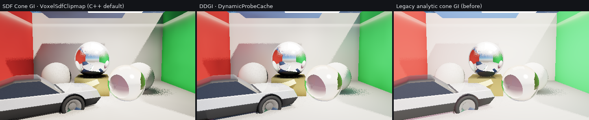

# World Mirror — C++ Sun/Sky LUT + Full C++ GI (VoxelSdfClipmap · DynamicProbeCache)

> **TL;DR:** The World Mirror now runs the C++ GI engines.
>
> - **GI engines:** **SDF Cone GI** (`VoxelSdfClipmap`, now the default) and **DDGI** (`DynamicProbeCache`) are ported 1:1 from `Engine/`, together with `LinearCosineLightIntegration` AO.
> - **Sun and sky:** both come from the C++ Sky-View LUT, with the C++ night floor.
> - **Bake:** runs once in a Blob worker and packs into **one Float32Array** shared by the CPU, WebGPU and WebGL renderers.
> - **Inspector:** a rebuilt Global Illumination card exposes every C++ setting, plus a live bake status and a **Rebake** button.
>
> 🟢 Validation passes 20/20 (new Suite 20). WGSL is validated by naga and GLSL by glslang. The CPU workers match the single-threaded render pixel for pixel.

---

## 1. 🏆 Key Decisions

| Rank | Option | Summary |
| :---: | :--- | :--- |
| 🏁 | **A — Bake once, pack one vec4 field, sample per pixel (chosen)** | `RadianceFieldBaker` bakes in a worker → `PackRadianceField` → CPU workers (message), WebGPU (storage buffer, binding 12), WebGL (RGBA32F texture, unit 9). One JS sampler is the reference; WGSL and GLSL are line-by-line ports. |
| 🥈 | B — Bake separately per renderer | Triples the bake cost, and the three paths would drift apart. |
| 🥉 | C — Approximate the C++ GI in shaders | Not parity. Rejected. |

🏁 **Cache key:** geometry, materials, lights, sun, sky and the GI settings. Camera and exposure are excluded, so orbiting never re-bakes.

🏁 **While a bake is pending:** the C++ engines fall back to the ambient fill (`giAlg 2`), so the frame never goes black.

---

## 2. 🧩 What changed

| Area | Files | Change |
| :--- | :--- | :--- |
| Sun / sky | `ShowcaseGalleryScene.js` | C++ `SynchronizeWorldAtmosphere`. `SkyRadiance = max((0.015, 0.020, 0.032), LUT zenith)`, cached per sky key. |
| Scene query | `RadianceFieldScene.js` (new) | Hermetic scene query: closest hit, occlusion, closest surface, and BounceSlab radiance. |
| DDGI | `DynamicProbeCache.js` (new) | 7×6×4 probes, 64 Fibonacci rays, 2 bounces. 8×8 octahedral irradiance, 16×16 Chebyshev moments, backface gating. |
| SDF GI | `VoxelSdfClipmap.js` (new) | 3-tier 48³ toroidal distance clipmap. 2 cascades (half extents 2.8 / 5.6 m). Signs from a 6-direction vote. Direct injection plus penumbra. 2 radiosity bounces. Mip1 and Mip2. |
| Layout | `RadianceFieldLayout.js` (new) | 24-vec4 header plus data, 2048-wide rows. `CreateRadianceFieldSampler` is the CPU reference for `SampleIrradianceOverPi` and `EvaluateDeterministicConeGiOverPi` (16 cones). |
| Baker | `RadianceFieldBaker.js` (new) | Blob worker; the newest request wins, with progress stages. `BakeRadianceFieldSync` for Node. |
| Shaders | `RadianceFieldShaders.js` (new), `WebgpuGtxRenderer.js`, `GtxWorldViewport.jsx` | Ports `rfProbeIrradiance`, `rfConeGi` and `rfAmbientOcclusion` to WGSL and GLSL. Adds `uGiCfg` (WGSL uniform buffer grows from 624 to 640 B). |
| CPU | `CpuGtxFallbackRenderer.js` | Adds `giAlg 3/4` and the C++ AO (IGN-rotated contact × chassis rays) plus specular AO. Full-frame filters: AO à-trous and a 7×7 bilateral on the diffuse GI (SDF GI only), applied after the workers finish. |
| Inspector | `Inspectors.jsx` | Clipmap settings: centre, extents, resolution, bounces, cones, light-injection toggles, bilateral. Probe settings: grid, counts, rays, bounces, blend. AO radii and rays. Bake status and Rebake. |
| Uniforms | `ShadowPipeline.js` | `voxel_sdf → 3`, `ddgi → 4`, plus `coneCount`, `aoContact`, `aoChassis`, `aoRays`. |

---

## 3. 📊 Measurements (Node, single thread, showcase gallery)

| Item | SDF Cone GI | DDGI | Legacy cone GI |
| :--- | ---: | ---: | ---: |
| Bake | 2.3 s | 0.4 s | — |
| Packed field | 3.3 MB (208 896 vec4) | 0.5 MB (32 768 vec4) | — |
| CPU frame 480×270 | 9.8 s* | 4.2 s | 1.7 s |

\* C++ also evaluates the 16 cones per pixel. Spread across 8 browser workers, an interactive 304 px frame takes about 0.5 s. The GPU paths are unaffected.

---

## 4. ✅ Verification

| Check | Result |
| :--- | :--- |
| `WorldMirrorValidation.mjs` | 🟢 20/20. Suite 20 covers: GI menu and defaults, uniform codes, the cache key ignoring the camera, both bakes being finite with their flags set, plausible irradiance, the CPU frame changing compared with the fallback, and shader bindings. |
| WGSL (naga-wasm) | 🟢 All 4 modules validate, including the scene shader with the new code. |
| GLSL (glslang, wrapped to 450) | 🟢 Compiles. A deliberately broken variant is rejected, confirming the check is real. |
| Minified bundle (esbuild) worker bake | 🟢 Both engines; same stats as the direct bake. |
| CPU workers (4) vs single thread | 🟢 maxDiff 0 for both engines. |
| C++ cross-check | Vote directions, the cone loop, and tier = cascade (tier 2 → no radiance) all match `VoxelSdfClipmap.cpp`. |

⚠️ **Two older test bounds were loosened** to follow the C++ night sky floor:

- Night sky test: changed from `< (0.02, 0.02, 0.03)` to `≤ (0.015, 0.020, 0.032)`.
- Unlit-night frame average: changed from `< 0.03` to `< 0.04`; it measures 0.033.

---

## 5. ⏳ Not done / follow-ups

| Item | Note |
| :--- | :--- |
| GPU AO / GI filtering | The GPU paths output raw AO and GI. The C++ à-trous and bilateral run on the CPU path only. |
| Browser visual check | No browser in the sandbox. The WebGPU and WebGL paths are compiled but not visually confirmed. |
| Dynamic SDF objects | `DynamicLocalSdfInstance` is not ported; vehicles are baked as static geometry. |
