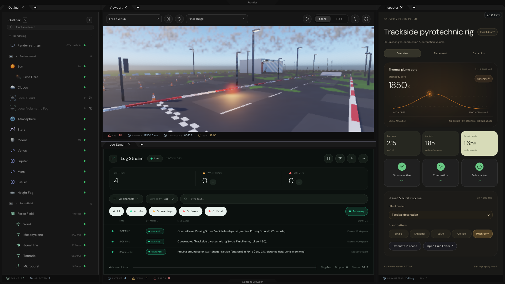
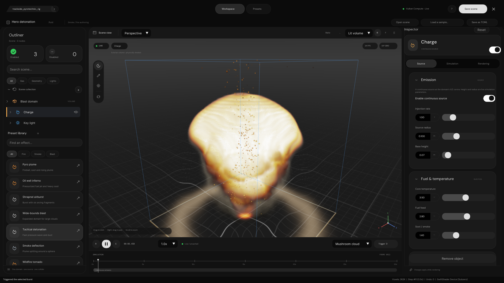
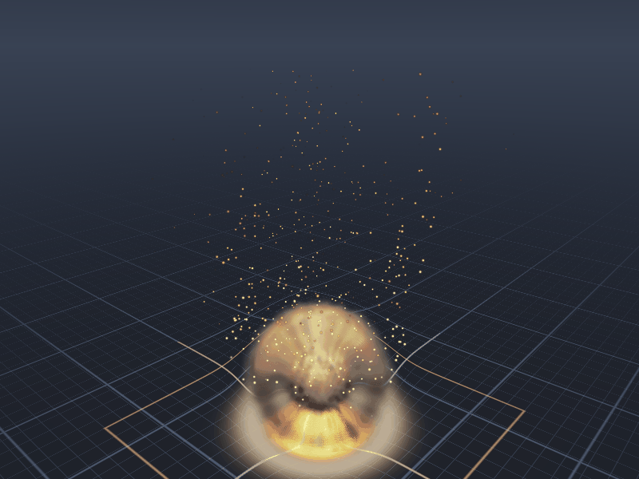
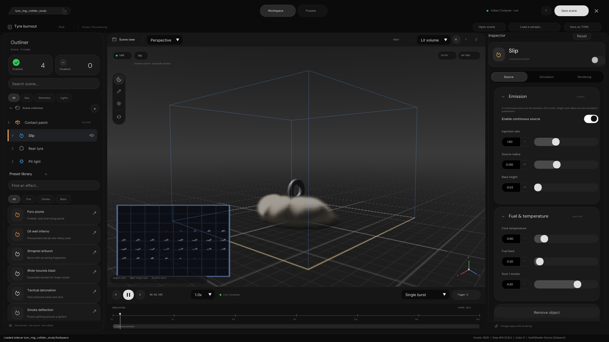
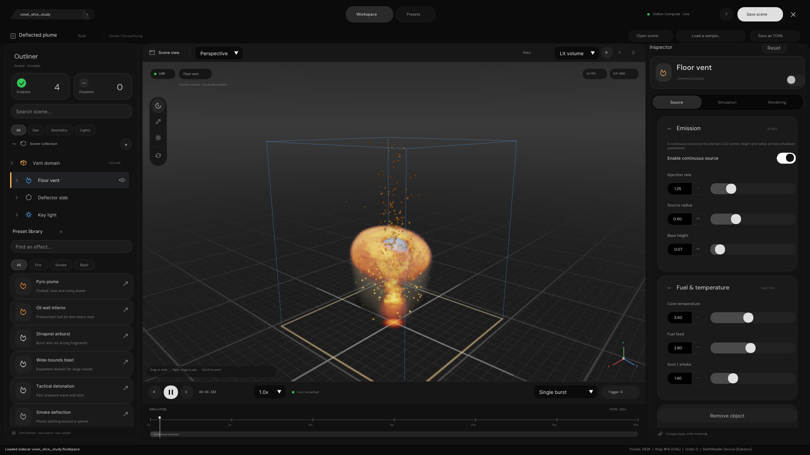
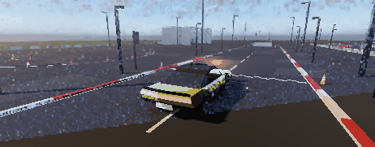
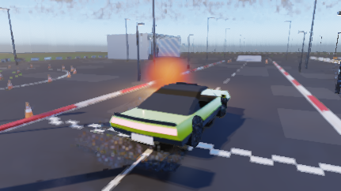
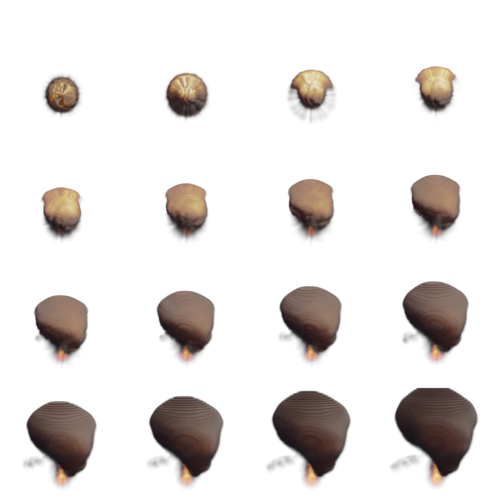

# Fluid & Pyrotechnic Editor (`FluidPlumeEditor`) and World-Anchored Volumetric Plumes (`PlumeSpace`)

Native Vulkan 3D Eulerian gas, combustion, and explosion simulation studio (`FluidPlumeEditor` + `FrontierFluidSimulation` + `FrontierFluidExtension`), lossless `.fluidspace` / `.gasscene.toml` scene codec (`FrontierFluidDynamics`), and world-anchored toroidal volumetric smoke & fire integration (`PlumeSpace` + `FireIllumination`) inside the Everest Proving Ground ReSTIR Global Illumination pipeline.

---

## Visual Verification Gallery

### 1. Everest Workspace — `FluidPlumeInspector` & ReSTIR Global Illumination Bounce
`Trackside pyrotechnic rig` (`FluidPlumeRecord`) authored on the Proving Ground straight, casting warm blackbody ReSTIR illumination across the asphalt, lane markings, and kerbs while exposing combustion, blackbody core temperature, world placement, burst pattern, and live plume dynamics in `FluidPlumeInspector`:



### 2. Modal `FluidPlumeEditor` — 3D Eulerian Mushroom Cloud Detonation & Shockwave Refraction
Full-screen Frontier modal studio (`##FluidPlumeEditorWindow`) launched via **Fluid Editor** on any `FluidPlumeRecord`, featuring multi-document `.fluidspace` tabs, all 18 pyrotechnic presets, 5 detonation burst patterns (`Single`, `Shrapnel`, `Salvo`, `Collide`, `Mushroom`), 4 interactive 3D viewport tools (`Orbit`, `Flame`, `Blast`, `Collider`), `D` to detonate (with `E` retained as an alias), 650 GPU buoyant embers, and floor-grid shockwave refraction:



### 3. Animated 3D Eulerian Detonation Sequence (`FluidExplosionSequence.gif`)
18-frame standalone Vulkan compute (`FluidSimulation.slang`) + volumetric blackbody raymarch (`FluidRaymarch.slang`) + GPU ember (`FluidOverlayRasterization.slang`) detonation sequence:



### 4. Torus Tyre SDF Collider & 2D Voxel Atlas PiP Minimap
`tyre_burnout_ring` sample scene running inside `FluidPlumeEditor` with an analytical 3D Torus Tyre SDF obstacle (`Rear tyre: On`) and the live 64-slice 2D Voxel Atlas Minimap (`FluidOverlayRasterization.slang`):



### 5. 3D Voxel Lattice Quantization & Spherical Deflector Slab Inspection
`deflector_obstacle` sample scene inspected with 3D voxel lattice quantization (`VoxelQuantization = 0.92`), cross-section slice plane (`SliceAxis = Y`), domain wireframe bounds, and live combustion irradiance wrapping around the spherical collider:



### 6. Live Proving Ground Vehicle Burnout Smoke, Trackside Detonation & ReSTIR GI
World-anchored toroidal `PlumeSpace` (`128 × 128 × 64` Eulerian Navier-Stokes grid scrolling modulo-toroidally with the camera) coupled to `ControlVehicle` rear-wheel slip/thermal telemetry and `FluidPlumeRecord` detonations. Smoke and fire remain anchored in world space behind the accelerating coupe while `FireIllumination.slang` injects dynamic fire light into ReSTIR Global Illumination:





### 7. Baked Premultiplied-Alpha RGBA Flipbook Sprite Sheet (`1024 × 1024`, `4 × 4` Tiles)
Transparent-background volumetric explosion sprite sheet exported directly by the GPU flipbook baker (`ExportFlipbook = true`):



---

## Architecture Summary

| Layer | Path | Responsibility |
| --- | --- | --- |
| Pure Engine Domain & Codec (`FrontierFluidDynamics`) | `Frontier/Engine/PhysicalDynamics/FluidDynamics/{FluidSceneSpecification,FluidSpaceCodec,PlumeSourceProjection}.{h,cpp}` | `FluidParameters`, `FluidOrbitCamera`, all 18 pyrotechnic presets, all 8 upstream sample scenes, lossless `.fluidspace` / `.gasscene.toml` TOML serializer/parser, and vehicle + `FluidPlumeRecord` injector/fire-light projection |
| Standalone Editor Shaders (`FluidSimulation`) | `Frontier/Engine/Shaders/FluidSimulation/Fluid{Layouts,Simulation,Raymarch,OverlayRasterization}.slang` | Semi-Lagrangian + BFECC MacCormack advection, combustion reaction & expansion, curl/vorticity confinement, buoyancy & baroclinic torque, 4-shape analytical SDF colliders, Jacobi pressure + fire irradiance Poisson solver, physically-based blackbody raymarcher, GPU embers, and 2D voxel atlas minimap (`13` SPIR-V archives) |
| World-Grid Plume Shaders (`GlobalIllumination`) | `Frontier/Engine/Shaders/GlobalIllumination/Plume{Layouts,Advection,Vorticity,Pressure,March}.slang` | World-anchored toroidal Navier-Stokes plume solver (`9` SPIR-V archives) composited in `DisplayRecombination.slang` (`RecombineGroup_` slot 12) and coupled to `FireIllumination.slang` + `SurfaceCardDepot` |
| Vulkan Editor Solver (`FrontierFluidSimulation`) | `Frontier/Engine/Rendering/FluidSimulation/FluidSimulationSequence.{h,cpp}` | Multi-slot (`4` concurrent document tabs) 3D texture ping-pong compute pipeline, ballistic shrapnel streamer trails, ember particle buffer, offscreen RGBA16F HDR target, and RGBA8 flipbook readback |
| Host Extension (`FrontierFluidExtension`) | `Frontier/Extensions/Fluid/FluidExtension.{h,cpp}` | Bridges `InspectorRuntime::RegisterFluidViewportPresenter` to `FluidSimulationSequence` in both Everest and standalone Windows `Frontier.exe` |
| Inspector & Modal Studio (`FrontierSceneEditorUI`) | `Frontier/Engine/Interface/{FluidPlumeEditor,Inspectors/FluidPlumeInspector}.{h,cpp}` | Everest `FluidPlumeInspector` panel and full-screen modal `FluidPlumeEditor` studio |

---

## Verification & Reproduction

```bash
# 1. Deterministic CTest validation (8 upstream .gasscene.toml + 8 .fluidspace round-trips, 18 presets, PlumeSourceProjection, WorldSpace persistence)
ctest --test-dir Build/Linux -R FluidDynamicsValidation --output-on-failure

# 2. Full headless Vulkan GPU capture suite (SwiftShader ICD)
VK_ICD_FILENAMES=$PWD/ExternalPackages/VulkanCompute/SwiftShader/vk_swiftshader_icd.json \
LD_LIBRARY_PATH=$PWD/ExternalPackages/VulkanCompute/SwiftShader \
./Build/Linux/FluidEditorCapture EngineContent Projects/Everest EngineContent/ShaderArchives Experimental/Fluid/Samples Exhibits/FluidEditor
```
