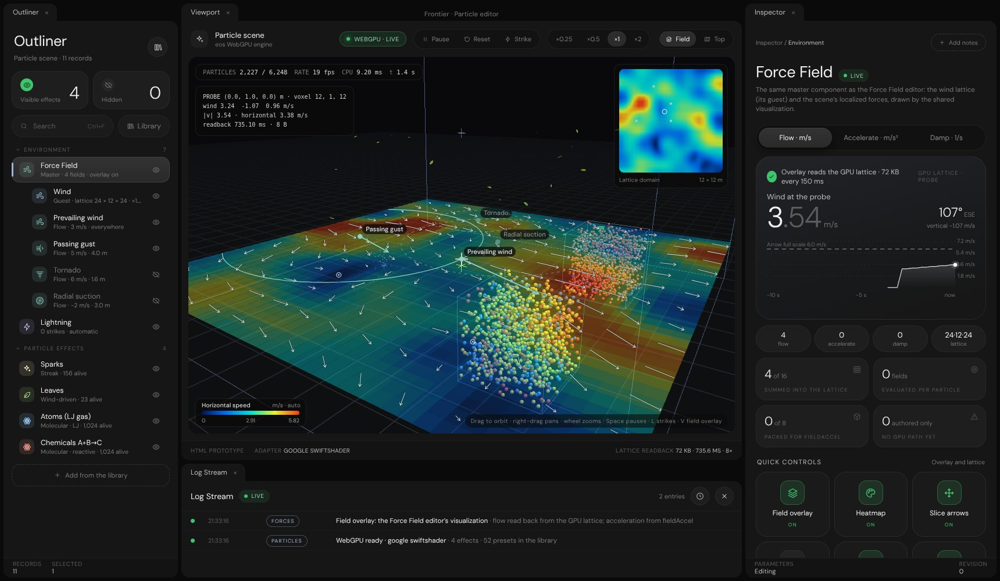
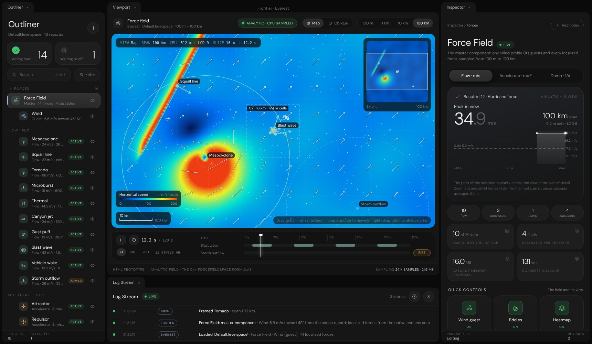

# Force Field and Particle editor prototypes: evidence

Rendered captures and checks for `Experimental/ForceFieldEditor`, `Experimental/ParticleEditor` and the visualization
they share, `Experimental/ForceFieldVisualization`.

## Results

| Check                                                | Script                                     | Result      |
|------------------------------------------------------|--------------------------------------------|-------------|
| Field model, visualization helpers, `fieldAccel` port | `ForceFieldValidation.mjs`                 | 🟢 33 of 33 |
| eos force-field taxonomy (engine unchanged)          | `ParticleEditor/Engine/CheckForceFields.mjs` | 🟢 91 of 91 |
| Rendered pages, interactions, GPU readback agreement | `PrototypeCaptures.mjs`                    | 🟢 11 of 11 |

`ForceFieldValidation.mjs` covers:

- the Wind against an independent transcription of `ForceFieldSpace::EvaluateStepSample` at 400 points from 0 to
  6 km up (worst difference below 1e-9 m/s), and the level-of-detail filter removing the gust bands at 2 km cells;
- divergence-free eddies; Begins / Lasts / Repeats windows with ramps; triggers armed, fired and spent;
- the flow shapes (Burgers–Rott peak at the inner radius, cyclonic spin, microburst downdraft and outflow, thermal
  updraft, gust front ahead / behind its nose, blast shell at r₀ + c·t) and the accelerate / damp types;
- the prepared fast path equal to direct evaluation; every levelspace key shown as existing is read by
  `WindRecord` or `ForceFieldRecord` in `SceneWorld.cpp` (checked against the C++ source);
- distance formatting, scale bars, the camera unprojection, the colour stops; the Particle editor's `fieldAccel` port
  and half-float decoding.

`PrototypeCaptures.mjs` asserts at runtime: the outliner's 16 rows; 512 m cells at 100 km; a library card adding a
force and logging it; the eos default scene running on WebGPU; the lattice readback; the overlay's copy of the probe
voxel equal to the engine's own probe texel (difference 0); 52 presets in 14 groups; a preset joining the scene with
its attractor reaching `fieldAccel`; Render settings still building every section; no page errors. Facts are in
`CaptureReport.json`.

## Captures

| Image                              | Shows                                                                          |
|------------------------------------|--------------------------------------------------------------------------------|
| `ForceFieldMap6km.jpg`             | Master page; 6 km map, LOD 5, sources, minimap of the 100 km extent, timeline  |
| `ForceFieldWindPage.jpg`           | Wind guest page: speed now, gusts above the base speed, Beaufort, chips        |
| `ForceFieldWindAltitude.jpg`       | Variability gust preview and the Ekman altitude profile                        |
| `ForceFieldTornadoOblique.jpg`     | Tornado page, oblique plate with the column standing on it, radial profile     |
| `ForceFieldMap100km.jpg`           | 100 km: mesocyclone, squall line, cascade overlay, 512 m cells                 |
| `ForceFieldAccelerate.jpg`         | Accelerate: attractor and repulsor arrows; gravity marks nothing               |
| `ForceFieldLibrary.jpg`            | The sixteen force types by contribution                                        |
| `ForceFieldSourceSections.jpg`     | A force's Reach, Falloff curve and Strength sections                           |
| `ParticleFieldOverlay.jpg`         | Particle editor: WebGPU scene with the shared overlay, minimap, probe          |
| `ParticleEffectPage.jpg`           | Effect page: particles alive against capacity, chips, readback tiles           |
| `ParticleEffectSections.jpg`       | Source and Particle sections with vector and colour rows                       |
| `ParticleLibrary.jpg`              | The 52-preset library with group tabs                                          |
| `ParticleBlackHoleAccelerate.jpg`  | Black hole preset; the overlay shows its pull (Accelerate) inside the domain   |
| `ParticleTopViewWind.jpg`          | Top view of the lattice slice; Wind guest page                                 |
| `RenderSettingsRegression.jpg`     | Render settings unchanged with the extended `InspectorControls`                |





## Reproduce

| Item          | Value                                                                                         |
|---------------|-----------------------------------------------------------------------------------------------|
| Platform      | Linux x64 sandbox, Node 22.22, headless Chromium 153 (`@sparticuz/chromium@153.0.0`)          |
| Drivers       | `puppeteer-core@25.16.0`; WebGPU and Vulkan on SwiftShader; 2D canvas on the CPU rasterizer   |
| Environment   | `VK_ICD_FILENAMES` → SwiftShader ICD; NSS / NSPR libraries on `LD_LIBRARY_PATH`               |
| Revision      | Recorded in `CaptureReport.json` (`Revision`)                                                 |

```bash
npm install --prefix /tmp/browser @sparticuz/chromium@153.0.0 puppeteer-core@25.16.0
node Exhibits/ForceFieldEditor/ForceFieldValidation.mjs
node Exhibits/ForceFieldEditor/PrototypeCaptures.mjs /tmp/browser
```

The capture script serves the repository on a free local port, drives the pages through the DOM, and calls each
page's capture hold (`ForceFieldEditorHold`, `ParticleEditorHold`: render one frame, stop the loop) before a
screenshot, because a software-rendered page animating at full rate starves capture.

## Limits

- Browser prototypes on SwiftShader. They do not prove the C++ editor renders the same result, and frame rates here
  (about 20 fps for the Particle editor) are not desktop GPU rates.
- Not run in a Windows browser in this session.
