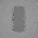

# Compact replay output layout

The opt-in `PathReplayCompactOutput` uses a replay-only output range rather than reserving the legacy lighting
layout. It retains the same path sampling, reservoir logic and reconstruction. It suppresses the primary-hit
slot-15 diagnostic; ordinary lighting or diagnostic passes must not use the same output range under this layout.
Switching layouts or output allocations requires a full reservoir and optional colour/seed-history reset. The
caller owns synchronization, buffer lifetimes and the remaining requirements in [PathReplayEngine](PathReplayEngine.md).
This is not complete ReSTIR GI or a production renderer integration.

## Output range at 1920 × 1080

The numbers are calculated from the C++ minimum descriptor range helpers, assuming one float4 is 16 bytes.
They are not measured VRAM totals: receiver, geometry, texture and other allocations are additional. Vulkan
`maxStorageBufferRange`, allocation and dispatch limits still apply; the recorder cannot infer them from the
provided descriptor counts. A device may not support these full-resolution ranges.

| Replay mode            | Legacy minimum | Compact minimum | Reduction |
|------------------------|---------------:|----------------:|----------:|
| Reservoir              | 949.45 MiB     | 189.84 MiB      | 80.00%    |
| Colour reconstruction  | 1,139.30 MiB   | 379.69 MiB      | 66.67%    |
| Seed history           | 1,265.86 MiB   | 506.25 MiB      | 60.01%    |

`PathReplayRequiredCompactOutputRecords(N, Reconstruct, SampleHistory)` supplies float4 counts, not bytes.
The recorder checks mode-specific counts and uint indexing; it does not check actual device storage limits.
The test exhibit selects compact allocation when `FRONTIER_REPLAY_COMPACT` is set. This environment variable is
an exhibit convenience, not an application setting. The API flag is off by default.

## Readbacks and checks

| Legacy output | Compact output |
|---------------|----------------|
|  |  |

These are actual 64 × 64 SwiftShader CPU Vulkan captures of the same four-bounce, half-pixel seed-retracing
fixture. Their decoded images are identical; four separate tone-mapped PPM readbacks matched byte-for-byte.
This demonstrates parity for this fixture, not improved visual quality. The captured paths include prior frames;
the seed-history mode remains mutually exclusive with reservoir reuse.

- Release and host ASan/UBSan: 5/5 CTests; the 32 × 32 fixture compares float output and used history slots for
  four frames in both reservoir-reuse and seed-history modes. Outputs compare bit-for-bit.
- Reconstruction: four moving-scene frames compare float outputs, counters and history slots in compact versus
  legacy layout. The separate four-bounce dynamic fixture reports 904 accepted histories, 3,968 spatial links and
  all 88 changed-token temporal donors rejected. It is a bounded fixture, not arbitrary dynamic-scene proof.
- One initial [sanitized attempt](Results/ReplayCompact-sanitized-initial.txt) reported a history-slot mismatch
  using float equality without a pixel or slot identifier. The cause is **not established**. The comparison was
  changed to bitwise equality with mismatch diagnostics, and subsequent release and sanitizer runs passed. This
  unresolved initial result warrants repeated testing on real devices; it must not be treated as disproven.
- Device: SwiftShader CPU Vulkan, Slang 2026.14.1, GCC 12.2.0/Linux. Sanitizers instrument the host, not shaders
  or the driver. No GPU frame timing, Windows, physical GPU or full-resolution allocation was tested.

[Release](Results/ReplayCompact-release.txt) · [Host sanitizer retry](Results/ReplayCompact-sanitized.txt) ·
[Moving scene](Results/ReplayCompactMotion-release.txt) · [Capture comparison](Results/ReplayCompactCapture.txt).
The release and sanitizer retry include the added mismatch-print diagnostic.

## Repeated parity follow-up

Eight deterministic seed batches now exercise both reservoir reuse and seed history across three warm-up
frames and a half-pixel camera move. In each batch, legacy and compact outputs are compared bit-for-bit for
1,024 pixels in four frames per mode. Reservoir/guide slots 0–4 and seed-bank slots 11–14 are also compared
bit-for-bit; reservoir/guide channels are required to be finite. This is 65,536 paired output pixels in total.
The 8/8 release batches pass; see the [release log](Results/ReplayCompactRepeat-release.txt) and
[host sanitizer log](Results/ReplayCompactRepeat-sanitized.txt). The earlier mismatch did not recur in these
runs, but its original cause remains unknown. A fixed synthetic scene, finite seeds and software Vulkan cannot
rule out failures under different devices or scene content.

## Reproduce

Requires CMake 3.20+, C++20, Slang 2026.14.1, Vulkan-Headers 1.4.321 and SwiftShader under
`ExternalPackages/VulkanCompute` as expected by the inherited scripts. The tested compiler came from the
`slangtorch==1.3.22` PyPI wheel and the tested SwiftShader libraries from `@sparticuz/chromium@153.0.0`;
the release log records their hashes. Run serially:

```sh
FRONTIER_REPLAY_COMPACT=1 RESULTS="$PWD/_ClaudeScratch/compact-release.txt" \
  bash Exhibits/LightCompute/RunReplaySampleHistory.sh
FRONTIER_REPLAY_COMPACT=1 SANITIZE=1 BUILD_JOBS=1 RESULTS="$PWD/_ClaudeScratch/compact-sanitized.txt" \
  bash Exhibits/LightCompute/RunReplaySampleHistory.sh
FRONTIER_REPLAY_COMPACT=1 RESULTS="$PWD/_ClaudeScratch/compact-motion.txt" \
  bash Exhibits/LightCompute/RunReplayDynamicCamera.sh
bash Exhibits/LightCompute/RunReplayCompactCapture.sh
# After preparing the release/sanitized builds above:
bash Exhibits/LightCompute/RunReplayCompactRepeat.sh
SANITIZE=1 bash Exhibits/LightCompute/RunReplayCompactRepeat.sh
```

The frame-time cost, physical-GPU behavior, full renderer integration, dynamic reconstruction, unbiased reuse
and combining seed history with reservoir reuse remain open. Memory reduction alone is not a speedup claim.
