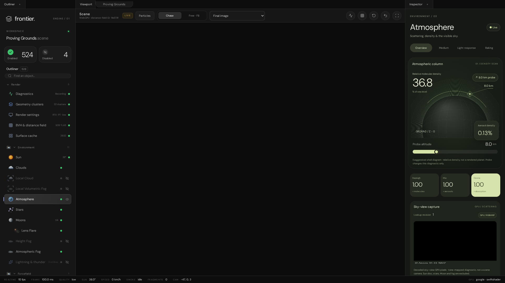

# VehicleHMI demo interface — 1:1 port inventory

The demo's interface is being ported into the Everest workspace one region at a time, following the contract in
SultanAladin/Frontier `e7a0aaf2` (`Frontier/Projects/Project-VehicleHmiDemo/Contract`). Every row ends as *ported → C++
file* or *removal approved by the owner*. The first region is ported: the **viewport column** (tab strip, viewport bar,
readout, distance slice, notices, bring-up, failure) and the **status strip**. The Outliner restyle and the Inspector
page families come next.

*The demo at `6afb6f00`, captured headless on SwiftShader (`Tools/CaptureDemoInterface.js`). Its viewport is black
because the capture path presents off-canvas. The port is `Images/EverestLiveSceneViewport.png`.*

## Viewport column and status strip

Sources: `index.html`, `Source/EditorControls.js` (bar), `Source/EditorShell.js` (status), `Source/OverlayDock.js`,
`Source/IlluminationHost.js` (`PresentMeasurements`), `Style/FrontierEditor.css`. The controls carry the CSS metrics and
colours (`Frontier/Engine/Interface/ViewportChromeControls.{h,cpp}`), and the Everest workspace lays them out and
wires them (`Projects/Everest/Source/EverestWorkspace.cpp`).

| Demo element                                                  | Status                                                                           | C++                                                    |
|---------------------------------------------------------------|----------------------------------------------------------------------------------|--------------------------------------------------------|
| `.viewport-tabs`: tab "Viewport"                              | ✔️ ported (dock caption; the window id is unchanged)                             | `EverestWorkspace` dock registration                   |
| `.scene-pill` "Proving Grounds"                               | ✔️ ported                                                                        | `ConstructScenePill`                                   |
| `.scene-heading` "Scene" / subtitle                           | ✔️ ported; subtitle names Vulkan, not WebGPU                                     | `ConstructSceneHeading`                                |
| `.live-pill` LIVE                                             | ✔️ ported; shown while an image is live                                          | `ConstructLivePill`                                    |
| `.particle-launch` Particles                                  | ✔️ ported; opens the level's `Particles` record in `ParticleEditor`              | `ConstructLabelButton`                                 |
| `.segmented` Chase / Free · F8                                | ✔️ ported; Chase inactive (no vehicle); Free is the Unreal Engine camera         | `ConstructSegmentedSwitch`                             |
| `.select-field`: the 15 inspection views                      | ✔️ ported; writes `RenderPipeline.InspectionModeIndex`, the port's `Inspection`  | `ConstructSelectField`, `RenderInspectionModes`        |
| Readout (H)                                                   | ✔️ ported                                                                        | `ConstructIconButton`                                  |
| Distance slice (I)                                            | ✔️ ported; the port's inset (HMI word bit 0); I and J both toggle it             | `ConstructIconButton`                                  |
| Respawn (R)                                                   | ✔️ ported, inactive: this level has no vehicle                                   | `ConstructIconButton`                                  |
| Reassemble every prop                                         | ✔️ ported, inactive: no breakable props in this viewport                         | `ConstructIconButton`                                  |
| Clean view (V)                                                | 🚩 readout and slice hidden as in the demo; the editor columns stay              | `ToggleViewportOverlay`                                |
| `#hud` readout                                                | ✔️ ported: line 1 and the TLAS line in the demo's format; the vehicle line states the omission; this viewport's camera keys replace the driving keys | `ConstructReadoutOverlay` |
| `#inset-frame`, legend, close                                 | ✔️ ported (legend verbatim)                                                      | `ConstructInsetFrame`                                  |
| `#overlay-notice`                                             | ✔️ ported (camera speed, clean view)                                             | `ConstructOverlayNotice`                               |
| `#event-notice`                                               | 🚧 pending (fracture events are not in this viewport)                            | —                                                      |
| `#overlay-dock` "⊞ Editor (P)"                                | 🚧 pending (P hides the editor columns)                                          | —                                                      |
| `#bring-up` heading, caption, bar                             | 🚩 ported as a card; the bring-up runs synchronously, so the bar shows no steps  | `ConstructBringUpCard`                                 |
| `#failure`                                                    | ✔️ ported                                                                        | `ConstructFailurePanel`                                |
| `footer#status`: REALTIME FRAME QUALITY SUN SPEED SMOKE FRAGMENTS CAM … GPU | ✔️ ported; SPEED "–" (no vehicle), SMOKE idle, FRAGMENTS 0          | `ConstructStatusStrip`                                 |

The demo's labels disagree about the distance-slice key. The bar says "Distance slice (I)" and the inset's close
button says "(J)". `OverlayKeys` binds J, and I cycles the vehicle's lights. With no vehicle here, both keys toggle the
slice, and both labels are kept verbatim.

## Label contract

`Results/UiLabels.tsv` is the contract's `UiLabels.tsv` (138 labels) with its `PortedTo` and `ApprovedRemoval` columns
filled.

| Status                      | Labels | How it was decided                                                                      |
|-----------------------------|-------:|-----------------------------------------------------------------------------------------|
| ✔️ ported this turn         |     13 | by hand (the rows above)                                                                |
| ✔️ ported earlier           |     28 | 25 GPU labels found verbatim in the 1:1 GI port's sources, plus Outliner, Inspector and the search field |
| 🚩 proposed removal         |      1 | "Could not load the app runtime." (a web module-loading failure), awaiting the owner    |
| 🚧 pending                  |     96 | Inspector pages, cabin, CSV export, geometry debug and others                           |

## Pending regions

| Region                                           | Demo sources                                                                                   |
|--------------------------------------------------|------------------------------------------------------------------------------------------------|
| Outliner restyle (brand, workspace, count tiles, tree rows with meta and state dots) | `EditorShell.js`, `EditorIcons.js`, `FrontierEditor.css`          |
| Inspector top (crumbs, title, live pill, section tabs)                              | `InspectorPages.js`, `InspectorCategories.js`                     |
| Inspector pages: Sun, Clouds, Atmosphere, Moons, Stars, Fog, Wind, Lens optics, Lightning, Vehicle systems, Cabin HMI, Environment root, Diagnostics, Geometry debug, Particle workspace, Materials | `*InspectorDashboard.js`, `Native*Panel.js`, `*Infographics.js`, the 12 panel stylesheets |
| Editor-column toggle (P), overlay dock, event notices | `OverlayDock.js`, `EditorShell.js`                                                        |

The reference set for these regions comes from `Tools/CaptureDemoInterface.js`: the shell, the HTML of every region and
one page per Outliner entry (45 entries at `6afb6f00`). It is regenerated rather than committed.
