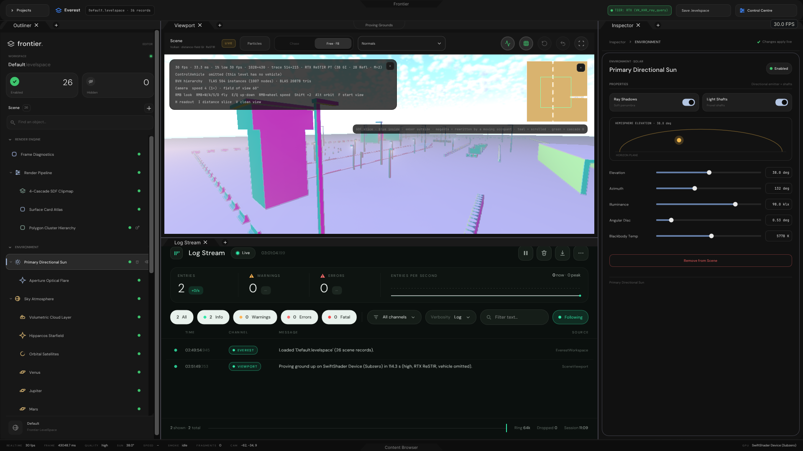
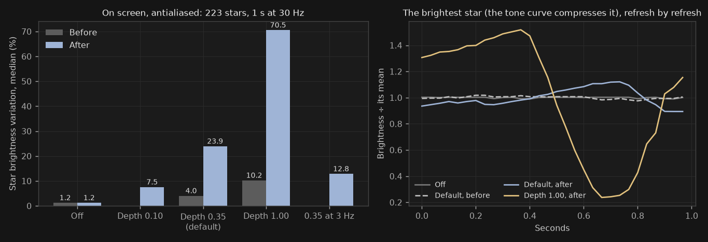
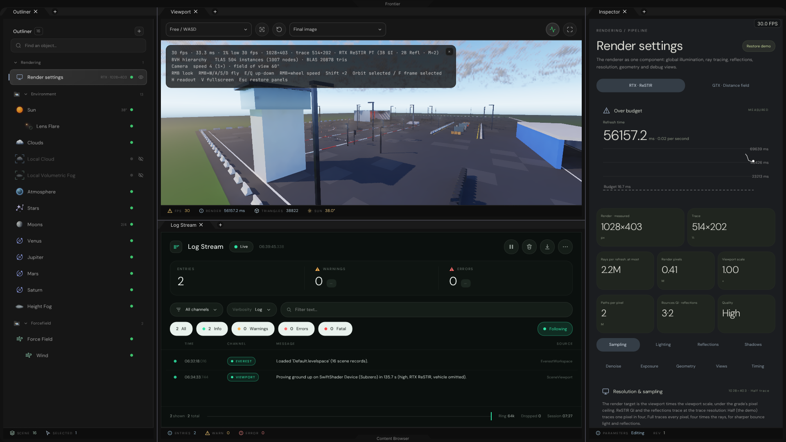
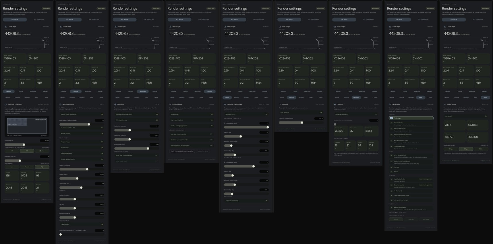

# Scene Viewport — the live ReSTIR GI port with the PlanetaryAtmosphere environment

## Result

The Everest workspace's **Scene Viewport** no longer draws a schematic. It presents the 1:1 C++/Vulkan/Slang port of the
VehicleHMI demo's ReSTIR GI (`Exhibits/RestirGiParity`) live. The scene is the demo's own **proving ground with no car**.
The **PlanetaryAtmosphere** environment is overlaid on it: atmosphere, sun disc, lens flare, volumetric clouds, height
fog lit by the scene's lamps, Luna and Ember from the six-body atlas, ringed and banded planets, and Hipparcos stars.
The level's records drive all of it, and they can be edited in the Inspector.

Since 2026-11-02 the environment also **lights the scene** (the owner's Option A). Its sun through its own air is the
key light, and at night Luna and Ember are. Its sky is the sky view that every bounce and reflection samples. Its clouds
shade the ground, and the scene's sun cascades shadow the fog's sun shafts. The GI algorithms are unchanged: the
environment only feeds the inputs the ported units already read (see *How it is wired*). The four planets are level
records in the Scene Directory, like the sun, the moons and the stars.

The viewport navigates like **Unreal Engine's** perspective viewport (see *Camera*). The VehicleHMI demo's interface is
being ported 1:1. Two regions are in:

- its **viewport column** (tab strip, viewport bar, readout, distance slice, notices, bring-up and failure) and its
  **status strip**; the 15 inspection views and the distance slice drive the port's own inputs;
- its **Sun page**, which occupies the Inspector when the Solar record is selected. Every control writes the level's
  sun, and a day clock (the demo's `AdvanceCelestial`) can place the sun from a date, a place and a time.

`InterfacePortInventory.md` tracks every element and label of the demo's interface.

| Daylight — the level as authored | Low sun — flare, long shadows |
|---|---|
|  |  |
| **Dusk — fog lit by the street lamps** | **Night — Luna, Ember, Jupiter, Mars, stars** |
|  |  |

The four images come from the same `SceneViewport` the editor uses, with the environment lighting the scene. They were
rendered offscreen on SwiftShader at 480 × 270 (quality `low`, 12 refreshes each) from the stored SPIR-V in
`EngineContent/ShaderArchives`. The cameras and records are listed in `Code/SceneViewportValidation.cpp`. What the
environment fed each refresh:

| Scenario | Key light (refresh units) | Sky view, zenith | Cloud shadow map | Image: sky / ground |
|---|---|---|---|---|
| Daylight | sun (10.86, 8.53, 6.20) | (0.165, 0.400, 1.220) | 39.6 % of the map shaded, τ up to 3.80 | 0.729 / 0.272 |
| Low sun, 8° | sun (7.96, 4.18, 1.53): red/blue 5.20 against 1.75 by day | (0.084, 0.191, 0.562) | 42.3 %, τ up to 9.21 | 0.674 / 0.254 |
| Dusk, −4° | sun 0 (below the horizon) | (0.006, 0.006, 0.017) | — (no sun) | 0.134 / 0.148 |
| Night, −28° | Luna + Ember (0.064, 0.064, 0.067) from Luna's direction | 0 | — | 0.003 / 0.041 |

Before Option A, the same four views measured sky / ground 0.863 / 0.395, 0.787 / 0.397, 0.161 / 0.176 and 0.003 / 0.045.
The scene is now darker where the clouds shade it, and cooler under the environment's blue sky.


*The fog's sun shafts.* Left: the low sun with the fog shadowed by the scene's sun cascades. Middle: the next refresh
with `Fog.ReceiveRayShadow` off. Right: the difference, ×4. Orange is light that the shadows of the posts, gantry and
buildings remove from the haze. Blue is antialiasing jitter between consecutive refreshes. Over the whole frame the
overlaid radiance is 0.767 shafted, 0.771 unshadowed and 0.767 shafted again (three consecutive refreshes at the same
clock), so the shafts take 0.42 % of the frame's light. The drift between the two shafted refreshes is 0.02 %.


That capture runs the real `EverestWorkspace` and the same `EverestSceneViewport` bridge the editor uses, through the
level's records (`Default.levelspace`, quality tier 2 → `high`, 1028 × 430 under the demo's viewport bar). The bridge
opens a device of its own here, reads the presented image back, and the interface is CPU-rasterized at 1920 × 1080
(`Code/SceneViewportWorkspaceCapture.cpp`, log in `Results/SceneViewportWorkspaceCapture.txt`). In the editor, the image
stays on the GPU and ImGui samples it directly. The capture took 12 refreshes, 11 min 10 s on SwiftShader. The demo's
readout (H) and distance slice (I) are switched on here; the editor starts with both off.

The readout's TLAS line reads 504 instances (1007 entries) and 20,878 BLAS triangles. The demo reports 509 (1017) and
the same 20,878 triangles. Its five extra instances are the car body and wheels, which this level omits, and a TLAS over
N instances has 2N − 1 entries. A thirteenth refresh, with the RenderPipeline record set to the demo's "Normals" view as
the bar's select sets it, shows the port's normals inspection:



## Layout

```text
Frontier/Engine/
├── DeviceExchange/VulkanDeviceAccess.h       the editor's Vulkan device as the exchanges attach to it
├── Rendering/
│   ├── GlobalIllumination/                   the 1:1 port (namespace Frontier::GlobalIllumination)
│   │     IlluminationHost, SceneStructure, BoundingStructure, OccupantDistanceSpace, SceneDistanceSpace,
│   │     SurfaceCardDepot, RayTracingSpace, AtmosphereIntegrator, ShadowProjection, SurfaceProjection,
│   │     ResamplingSequence, DisplayProjection, RefreshEncoding, EnvironmentEncoding, LuminaireRegister, …
│   └── SceneViewport/                        SceneViewport (bring-up + refresh) and EnvironmentOverlay
└── Shaders/GlobalIllumination/*.slang        55 Slang units, 33 SPIR-V entries (EnvironmentVisibility and
                                              EnvironmentLighting bridge to the environment; the rest is the port)
EngineContent/ShaderArchives/
├── GlobalIllumination/                       stored SPIR-V of the port (33) + ShaderCompilation.json
└── Environment/                              stored SPIR-V of PlanetaryAtmosphere (15) + ShaderCompilation.json
Projects/Everest/Source/EverestSceneViewport  level records → SceneViewport
```

## How it is wired

```
VulkanPresentation (Vulkan 1.3 + dynamicRendering, scalar layouts, draw parameters — SceneRendering)
   │  QueryDeviceAccess() → VulkanDeviceAccess
   ├─ DeviceExchange::AttachDevice          illumination port     ─┐  one VkDevice, one queue, the editor's thread
   └─ VulkanComputeExchange::AttachDevice   PlanetaryAtmosphere   ─┘
EverestWorkspace::ConstructViewportSurface   Unreal Engine viewport navigation (IntegrateSceneViewportFlight, Camera)
   ├─ ConstructViewportBar / ConstructViewportOverlays / ConstructStatusStrip   the demo's viewport column + status
   │     (ViewportChromeControls; inspection view → RenderPipeline.InspectionModeIndex; distance slice → request)
   └─ PresentSceneViewport(request) → EverestSceneViewport::Render(request, level records)
        │  Rendering.Inspection → RefreshToggles::Inspection; Rendering.DistanceSlice → HMI word bit 0
        │  Readout ← SceneViewport::QueryStatistics
        └─ SceneViewport::Refresh
             ① AdvanceCelestial → ResolveLight → AdjustLight* → light-change relighting (10° / 30 %) → EncodeEnvironment
               → RefreshConstants; LuminaireRegister (20 street lamps + 10 lamp posts) — all ported 1:1
               * the environment's transmitted sun replaces the demo's air mass; at night Luna + Ember are the key light
             ── BeforeRecording ──  realm resolved; PlanetaryAtmosphere: LUTs · sky view · cloud shadow map
               (ExecuteSkyAndShadows); the bridge profile and the port's CloudShadowParams written
             ② sky view → ProjectEnvironmentSky (the environment's sky over the port's sky view)
                        → ProjectCloudShadow (its cloud shadow map → the port's projected cloud shadows)
               distance union, shadow cascades, card lighting, surface, direct, ReSTIR GI, reflection, SVGF, resolve
             ③ EnvironmentVisibility: recombined radiance × scale + reversed depth + rays → the environment's 4 layers
             ── submit ──  PlanetaryAtmosphere: dome · clouds · fog (sun shafts through the port's sun cascades) · flare
             ④ RestoreEnvironmentRadiance → the port's DisplayAntialias integrates the overlaid image with its history
               → DisplayExposure meters the recombined image → DisplayPresent tone-maps → full dependency
   ImGui_ImplVulkan_AddTexture(presented view, GENERAL) → AddImage over the panel
```

- **One device.** With `ApplicationWindowCallbacks::SceneRendering`, the presentation device carries everything
  `DeviceExchange::Initialize` enables. Both exchanges attach to it and never destroy it. Every submission is ordered
  on the presentation queue. The present submission ends with a global dependency, so the interface submission that
  samples the image comes after it. Resizing retires the queue before the screen targets are replaced, and the targets
  follow the panel once its size has held still for six interface ticks.
- **No car.** `IlluminationAssets::OmitVehicle` deactivates the body and four wheels before bring-up. Inactive occupants
  are skipped by every step, as idle fragments are. The file still contains them, for when vehicles come back.
- **The environment lights the scene** (`SceneViewportConfiguration::EnvironmentLighting`, on in the editor). Three
  hooks of `RefreshInterlude` carry it, and every ported unit keeps reading its inputs exactly as before:
  - *Sun.* `AdjustLight` passes the sun through the environment's own air (`ResolveAirTransmittance`, the
    transmittance its sky uses) instead of the demo's 64-step air mass. It keeps the same direction, the level's colour
    temperature and the demo's horizon fade. `CelestialSky` keeps drawing its analytic disc, in that colour.
  - *Night.* Below the demo's −4° the key light is Luna, at the `Moons` record's phase and albedo against the demo's
    full-moon light (0.08, 0.10, 0.14), plus Ember lit by its elongation from the sun. Both pass through the same air;
    the brighter of the two casts the shadows.
  - *Sky.* `ProjectEnvironmentSky` writes the environment's sky view into the port's sky view, in refresh units. This
    is what `SampleSkyRadiance` returns to the surface cards and to every ray that escapes in ReSTIR GI and the reflections.
  - *Clouds.* `ProjectCloudShadow` turns the environment's cloud shadow map (±1,200 m around the origin, 256²) into the
    port's projected cloud shadows: 128², optical depth −ln T. The demo leaves that input idle, and the port's
    `DirectRadiance` already samples it (bindings 11–13).
  - *Fog.* The environment's fog samples the port's three sun cascades (`FogSceneShadow`, bindings 6/7 of
    `IntegrateFogSpace`), so buildings, posts and the gantry cut shafts out of the sunlit haze. Lamp glow is unchanged.

  With `EnvironmentLighting = false` the refresh keeps the demo's own sun, moon, sky and idle cloud shadows, and only the
  fog shafts remain. These are the demo's own inputs, and `RestirGiParityValidation` runs without the environment, so
  the parity evidence is unaffected. The demo's own fog, aerial perspective and flare stay off in the refresh, because
  the environment draws them.

## Records → viewport

| Level record | Illumination refresh | PlanetaryAtmosphere |
|---|---|---|
| `Solar` | `SunElevation`, `SunAzimuth` (counter-clockwise from +X east), `SolarIlluminance` = 12 × klx / 98, `SunTemperature`, `SunRadius`; the key light's colour is the environment's air transmittance × that tint × illuminance | sun direction; disc irradiance = demo tint × illuminance, in environment units; disc radius |
| `OpticalFlare` | — (the demo flare stays off) | flare gain, aperture blades, halo radius, chromatic shift, anamorphic and starburst toggles |
| `Atmosphere` | `Rayleigh`, `Mie` = (turbidity − 1) / 1.4, `Ozone`, `MieG`, on/off | the same scales on the Earth reference, planet radius, thickness, aerial perspective |
| `Clouds` | the environment's cloud shadow map as the projected cloud shadows (`CastGroundShadows`) | one cumulus slab: base, thickness, coverage, density, wind drift, silver lining |
| `Stars` | stars, planets on/off | Hipparcos limit from the count, brightness, Milky Way, scintillation, sidereal speed |
| `Moons` | primary moon direction on the sky path; at night Luna's light from `PrimaryPhase` and `PrimaryAlbedo`, plus Ember (`SecondaryMoonEnabled`) by its elongation | Luna (and Ember when the secondary moon is on) at their orbit angles |
| `Planet` (×4: Venus, Jupiter, Mars, Saturn) | — | one entry per body: on/off, drawn diameter, brightness, rings, atmosphere shell; placed by the demo's orbital solver for `Body` |
| `Fog` | — | height fog: density, falloff height = 1 / falloff, base altitude, phase; lamps as fog luminaires; sun shafts shadowed by the refresh's sun cascades (`ReceiveRayShadow`) |
| `Wind` | — | cloud advection |
| `RenderPipeline` | quality tier → `low` / `medium` / `high`; RTX tier → ReSTIR path tracer or GTX distance field; GI, TAA and exposure toggles | — |

The sky is placed for the demo's date, time and observer: 2026-10-20, 12:00, −26.18°, 28.32°. The Hipparcos stars are
rotated from the catalogue's J2000 axes by the demo's sidereal angle. The planets come from the demo's own orbital
solver (`CelestialSolver.js`, ported).

In `Default.levelspace` the four planets are `rec_planet_{venus,jupiter,mars,saturn}` under the `Atmosphere` record. Their
defaults are the earlier built-in ones: 0.80° / 1.26° / 0.69° / 1.03° drawn diameters, Venus with an atmosphere shell,
Saturn with rings. A level without planet entries still draws those four. The sun (`Solar`), the moons (`Moons`) and the
stars (`Stars`) were already entries.

## Radiometric scale

PlanetaryAtmosphere's constants are tuned for a sun irradiance of about 1.38, while the illumination port's sun is 12.
These constants include the cloud and fog skylight, the night floor and the star flux. Both sides keep their balance:

- The resolved radiance enters the environment multiplied by `ResolveEnvironmentRadianceScale`, and
  `RestoreEnvironmentRadiance` divides the overlaid image back before present. The port's eye adaptation never sees
  the conversion.
- The scale is the daylight unit 1.38 / 12, divided by the share of skylight left at the sun's elevation:
  e^((elevation − 6°)/3°), clamped to [0.002, 1]. As a result, the environment's constant daylight skylight fades through
  twilight. Clouds and fog are lit only by the moon, the stars and the lamps at night.
- Stars and the Milky Way are scaled so that under the port's night exposure (at most 0.82) they read as they do under
  the environment's own night exposure (2.9).

## 1:1 host encoders added for the live path

`EncodeEnvironment` (`EnvironmentSettings.js`), the orbital solver (`CelestialSolver.js`), the moon roster
(`CelestialAtlas.js`) and `LightingSystem.Update` / `BuildClusterGrid` (`LuminaireRegister`) are ported statement for
statement. `RestirGiParityValidation … live` takes neither the environment block nor the luminaire register from the
capture. Over all 12 refreshes, the demo's `Frame record` (1,072 B) and `Clustered light records` (12,320 B) writes are
byte-identical to the port's. The solver's planets agree to 8.4 × 10⁻¹⁶ and its sidereal angle exactly. After the
renaming the log again has 150 checks and 0 failures; every deterministic stage is unchanged, and the presented image
matches 99.98 % of 8-bit values (84.4 dB; 99.94 % before, the stochastic stages vary run to run as two runs of the demo
do). See `Results/ParityLiveNativeEnvironment.txt`.

## Shaders: Slang sources, stored SPIR-V

Every shader is a `.slang` unit: the 55 units in `Frontier/Engine/Shaders/GlobalIllumination` (the port and its two
environment bridges) and the PlanetaryAtmosphere units in `Frontier/Engine/Shaders`. CMake compiles them to SPIR-V 1.3
with the pinned Slang compiler (`Automation/PrepareVulkanCompute.py`, slangc 2026.14.1).

So that an editor build without that compiler (for example MSVC on Windows) still starts and runs the viewport, the
compiled archives are also stored in `EngineContent/ShaderArchives/{GlobalIllumination,Environment,Surface}`:

- `Surface` is the editor's own raster set (`Engine/Render/Shader`, 18 entries): the Project Browser previews that
  `Frontier.exe` loads at start-up, CAD, MatCap and material surfaces, vector coverage and the bake field. It is
  compiled with the repository's portable compiler, `slang-loader@0.0.7` (Slang 2026.19 WASM, `FRONTIER_SLANG_WASM`),
  because the pinned slangc has no SPIR-V optimizer. Until 2026-11-02 it was not stored: a build without a Slang
  compiler on `PATH` (the 21a0ccb4 download, or MSVC without the Vulkan SDK) stopped at start-up with
  "Missing or malformed browser shader archive". CTest `BrowserPreviewStartupValidation` now runs the browser's
  start-up rendering from the stored set (four pipelines, four catalogue thumbnails, one read back).

- The editor build copies `EngineContent` beside `Frontier.exe`, stored archives included. A set the build compiled
  replaces its stored copy afterwards.
- The port's units compile only with the pinned compiler by default, so every build presents the SPIR-V the parity
  validation measured. `-DFRONTIER_GLOBAL_ILLUMINATION_SLANGC=<slangc>` selects another compiler.
- `Automation/StoreShaderArchives.py --build <build> --compiler <slangc or slang-wasm.js> --sets <set>` refreshes the
  stored archives after a shader change. `ShaderCompilation.json` records the compiler and the SHA-256 of every source
  and archive.
- CTest `StoredShaderArchiveValidation` fails when a Slang source changed without refreshing the stored archives. When
  the build compiled a set with the compiler that stored it (pinned slangc; for `Surface`, the slang-loader WASM by its
  SHA-256), the test also requires the compiled and stored SPIR-V to be byte-identical. Recompiling from scratch
  reproduced all 46 GlobalIllumination and Environment archives byte for byte, and the 18 Surface archives likewise.

## Temporal antialiasing

The demo's TAA and its 16-frame Halton jitter are ported 1:1 (`DisplayAntialias.slang`). The PlanetaryAtmosphere overlay
is not part of the demo, and until 2026-11-02 it was drawn after the antialiasing: on the antialiased image, but with
this refresh's jittered depth and jittered rays (`EnvironmentVisibility.slang` reconstructs both through the jittered
view projection). So with TAA on, the sky, the sun and every silhouette against them moved with the jitter and were
never resolved. That was the edge shimmer seen with TAA on. With TAA off there is no jitter, so nothing moved.

Now the overlay is drawn on the recombined image, before the antialiasing, and `DisplayAntialias` integrates the
overlaid image with its history, as it integrates the demo's own sky (`RefreshInterlude::AntialiasSource`). Exposure
meters the recombined image, so the overlay does not move it. Without the overlay, the refresh keeps the demo's own
resolve.

Measured on the Everest level (a still camera, a frozen clock, 288 × 162, the low tier, 12 refreshes after 6 warm-up
refreshes, SwiftShader). *Frame Δ* is the mean absolute change between consecutive presented frames (8-bit levels): over
the whole image, and over silhouettes only.

| | TAA off | TAA on |
|---|---|---|
| refresh, before | 4,909 ms | 5,070 ms |
| frame Δ, before (whole / silhouettes) | 0.217 / 1.222 | 6.725 / 8.404 |
| refresh, after | 4,987 ms | 4,866 ms |
| frame Δ, after (whole / silhouettes) | 0.217 / 1.222 | 6.238 / 3.832 |

- Silhouette shimmer with TAA on dropped by 54 %. TAA off is unchanged.
- The rest of the whole-image Δ is SwiftShader's own: asphalt and grass flip between two luminance levels (about 133 and
  147) with TAA on. The owner's AMD captures do not show it.
- Cost: the antialiasing pass is 9 taps and one bilinear history fetch. TAA on and off measured within 3 % of each other
  here (noise), and the pass is about 0.1–0.2 ms at 1080p on a GPU. It does not explain a frame-rate difference between
  TAA on and off.

## The sun behind the clouds

Before 2026-11-02 the solar disc showed through clouds. The clouds attenuated it by their transmittance, but the march
stops at a transmittance of 1 %, and the disc is about 180 times brighter than the sky around it. So the disc stayed
visible through any cloud, and a cloud edge across the sun looked like the sun in front of it. The powder term also
darkened the sunlit thin parts of clouds in every direction, which removed the bright rim of a cloud lit from behind.

Now:

- **The disc is occluded.** `PlanetaryProjection.slang` passes the discs' share of each sky pixel to the cloud composite
  (in alpha). The composite attenuates that share by the cloud transmittance to the fourth power
  (`ResolveSolarDiscTransmittance`). The disc's direct beam leaves the cloud as forward-scattered glow, so the sharp
  disc is hidden behind any cloud thicker than an optical depth of about 1.5. The flare's visibility uses the same
  function, so the flare dims exactly as the disc does.
- **Clouds are lit from behind.** Single scattering blends in the droplets' sharp forward lobe (Henyey–Greenstein g 0.9,
  20 % at the default Silver Lining 0.72), so the thin parts of a cloud near the sun glow. The powder darkening only
  applies when looking away from the sun. The Clouds record's Silver Lining drives that lobe; before, it drove the
  powder darkening, which is the opposite effect.

`Exhibits/EnvironmentRealm/Code/SolarOcclusionValidation.cpp` (CTest) measures it on SwiftShader: the Everest sun (38°
up, azimuth 132°) and a dense cumulus box.

| | before | after |
|---|---|---|
| ① disc behind the cloud ÷ the cloud around it | 1.61 (disc visible) | 1.03 (hidden) |
| ② cloud beside the sun ÷ the same cloud with the sun behind the camera | 1.89 | 2.58 |

It requires ① below 1.5 and ② above 2.2. It also renders the Everest cloud deck looking into the sun for inspection.

## Star twinkle

The owner reported that the stars did not twinkle and that the star controls seemed unhooked. There were two causes:

- **Too weak to see.** The overlaid sky (PlanetaryAtmosphere) did twinkle, but its own equation swung a star at the
  zenith only ±5.5 % at the default Twinkle depth (0.35, taken as strength depth ÷ 0.35); only stars near the horizon
  moved more. The antialiasing then smooths what reaches the screen. Measured on screen: 4.0 % median brightness
  variation at the default and 10.2 % at the slider's maximum, against 1.2 % with the twinkle off.
- **Half unhooked.** The port's own night sky (the demo's NightStars, seen in reflections) took only the star switch
  from the Stars record; brightness, limit, size, rotation, halo, Milky Way and the twinkle kept their defaults.

The fix:

- **One equation.** `PlanetaryProjection.slang`, its CPU twin `PlanetaryDomeProjection::EvaluateStarScintillation` and
  the Stars page chart share the demo's three-frequency signal. Twinkle depth is the peak brightness swing at the
  zenith. Toward the horizon the swing deepens with the airmass, × √(1.15 / (sin h + 0.15)): × 1.33 at 30°, × 1.9 at
  10°, at most × 2.5.
- **A twinkle clock.** The overlay integrates elapsed time × Twinkle rate, refresh by refresh, into the realm's slot
  18.y. A rate change speeds or slows the twinkle without a jump in phase. The clock wraps hourly to keep the shader's
  single-precision phase exact.
- **Hooked.** The port's night sky takes every star field from the Stars record; its twinkle equation stays the
  demo's.

Measured with `Code/StarScintillationCapture.cpp`: night, moons, planets, clouds and fog off, the camera 50° up,
480 × 270, low grade, antialiasing on. Each variant runs 6 warm and 30 measured refreshes at 30 Hz. Stars are the 223
isolated peaks of the twinkle-off image; a star's brightness per refresh is its brightest pixel within one pixel. The
log is `Results/StarScintillation.txt`.

| Twinkle            | Before: median variation (p90), peak-to-peak | After: median variation (p90), peak-to-peak |
| ------------------ | -------------------------------------------- | ------------------------------------------- |
| Off                | 1.2 % (2.6 %), 3.8 %                         | 1.2 % (2.6 %), 3.8 %                        |
| Depth 0.10         | —                                            | 7.5 % (8.9 %), 24.1 %                       |
| Depth 0.35 default | 4.0 % (5.3 %), 13.8 %                        | 23.9 % (28.1 %), 76.0 %                     |
| Depth 1.00         | 10.2 % (13.1 %), 33.8 %                      | 70.5 % (78.4 %), 205.3 %                    |
| 0.35 at 3 Hz       | —                                            | 12.8 % (17.3 %), 46.3 %                     |

The default now twinkles six times as much on screen, and every depth reads as its own. Faster twinkle loses more to
the antialiasing's history: at 3 Hz the default keeps 12.8 % here, sampled at 30 refreshes a second; at the editor's
60 or more it keeps more. The twinkle also dims stars a little on average (11 % at the default), because the
antialiasing follows a dimming star at once but a brightening one over a few refreshes.



## Inspection views

`Code/InspectionViewCapture.cpp` renders the fifteen inspection views of the settled daylight view, at 960 × 540 and
the high grade, through this viewport. They are the Render settings prototype's debug-view thumbnails
(`Experimental/RenderSettingsInspector`), in `Images/Inspection/`. The first view settles over 12 antialiased
refreshes; each further view is one refresh with the antialiasing off, so no view carries the previous one's history.
The capture found:

- **View 6 (BVH / distance field) was black:** nothing wrote `InspectionRadiance`, because the demo's `InspectionMarch`
  was not ported. It is now (`InspectionMarch.slang`, `DisplayProjection::RecordInspection`, dispatched only for view
  6). With ray tracing its primary rays read the BVH (`Inspection-06.jpg`: albedo and normals, a half-metre lattice);
  on the GTX path they march the distance field (`Inspection-06-Gtx.jpg`: normals tinted by the cascade that answered,
  the voxel lattice, freshly rewritten bricks glowing). Render settings › Debug views picks normals, step heat or
  light (`distance_inspection`).
- **Views 10 and 11 need virtualized geometry.** Without it they show the demo's own diagnosis, the orange "no
  virtualized geometry" checker (`ClusterDebugFallback`) and an empty visibility buffer. The
  `Inspection-NN-Virtualized.jpg` captures have it on.

## Reflections with indirect GI off

With indirect GI off the RTX reflections vanished: the glossy variance filter takes its validity guide (normal, depth,
prior depth) from the ReSTIR temporal step, which does not run then, so every texel read as "no surface". A guide-only
entry, `ReservoirTemporal.slang` `ProjectResamplingGuide`, now writes the guide when the resampling does not run;
with indirect GI on nothing changes (the resampling's SPIR-V is byte-identical). `Images/ReflectionsIndirectOff.jpg`,
640 × 360, high grade, after 6 refreshes: the final image and the reflection view (5) before and after, and the
reflection view with indirect GI on for reference (rough ground stays darker with it off: there is no irradiance to
fall back on).

## Render settings inspector

The whole renderer is one Outliner component, Render settings (the `RenderPipeline` record), with one page: the
approved prototype (`Experimental/RenderSettingsInspector`) in C++. `Images/RenderSettings/` holds the workspace with
it selected (`RenderSettings.png`) and each of its nine sections in a column tall enough to show it whole
(`RenderSettings-Section-0.png` … `-8.png`: sampling, lighting, reflections, shadows, denoise, exposure, geometry,
views, timing). `RenderSettings-Analytic.png` is the workspace with debug view 15, the analytic illumination,
chosen. The timing figures are the viewport's measured refreshes on SwiftShader, not estimates: about 55 s per
global-illumination refresh there, 0.2 s per analytic one.





## Checks

`Code/SceneViewportValidation.cpp` (log: `Results/SceneViewportValidation.txt`, 18 checks, 0 failing) checks the
following:

- the environment is overlaid on the illumination device;
- the vehicle is deactivated;
- the 20 street lamps and 10 lamp posts are placed from the scene;
- every image is lit;
- the daylight sky is bright;
- the low sun saturates;
- the night sky is darker than the day and shows stars;
- the fog's sun shafts are shadowed by the scene's sun cascades: the unshadowed refresh carries more than 0.1 % more
  light than both shafted refreshes around it;
- what the environment fed the refresh (read back from the port's own inputs):
  - the daylight sky view is the environment's blue sky;
  - the clouds shade the ground: more than 1 % of the projected cloud shadow map shaded (optical depth above 0.05),
    and somewhere deeper than 0.2;
  - the low sun is reddened by the environment's air: red/blue at least 1.15 × the daylight ratio;
  - Luna and Ember light the night: a moon key light from above the horizon;
  - the night sky view is far darker than the day's;
- no transfer was rejected and no submission failed (`DeviceExchange::Faults`).

The tenth argument `demo` renders the same scenarios with the demo's own light inputs (Option A off).

## Camera

The viewport navigates like Unreal Engine's perspective viewport (`SceneViewportFlight`,
`IntegrateSceneViewportFlight` in `Projects/Everest/Source/EverestWorkspace.cpp`; the controls table is in
`WindowsPreviewReadme.md`). It replaced an orbit camera whose right vector was `Up × Forward`. The renderer's screen
right is `Forward × Up` (`ConstructViewTransform`), so A and D moved the wrong way.

| Unreal Engine 5 setting (editor defaults)              | Here                                                  |
|--------------------------------------------------------|-------------------------------------------------------|
| `MouseSensitivty` 0.2                                  | 0.2° per pixel: look, orbit, left-drag turn           |
| `CameraSpeed` 4 of 8, `GetCameraSpeed` 0.03125 … 32    | same table; right button + wheel steps it             |
| `MovementAccelerationRate` 20000, damping 10           | 20 m/s at speed 1, reached with a 0.1 s time constant |
| `CameraBoost` 2 with Shift                             | Shift doubles the flight speed                        |
| drags: `Drag *= CameraSpeed` (1 unit per pixel)        | 1 cm per pixel at speed 1                             |
| wheel: `GetCameraSpeed(MouseScrollCameraSpeed 5) × 32` | 0.96 m per notch                                      |
| Z/C field of view with recoil once flight input stops  | same; the view returns to 60° vertical                |

During a camera drag the host hides the pointer and locks it to the window that shows the viewport
(`GLFW_CURSOR_DISABLED`, raw motion when available), as Unreal does. GLFW puts the pointer back where the drag began.
The viewport also owns the wheel and, while dragging, the flight keys, so keyboard navigation of the panels does not
move on the arrow keys. F returns to the level's starting view, because the viewport has no selection to focus.

`Code/SceneViewportFlightValidation.cpp` (CTest `SceneViewportFlightValidation`, 19 checks) drives the camera with
synthetic input and reads directions from the renderer's own view basis:

- D moves along screen right and A along screen left, purely sideways, at 5 headings × 4 elevations;
- W flies into the screen (pitch included), E rises along world z and R along the screen's up;
- terminal speeds are 20 m/s at setting 4, 40 m/s with Shift, 640 m/s at 8 and 0.625 m/s at 1;
- released flight settles within 0.5 s, and W without the right button does nothing;
- the wheel steps the speed 1–8 while flying and dollies 0.96 m otherwise;
- right drag right and down turns the view right and down; left drag up moves 1 m forward per 100 px;
- middle drag moves the camera right and up with the pointer;
- Alt orbits and dollies about a fixed pivot and tracks camera and pivot together;
- Z widens the view and it recoils after release, and F frames the starting view and keeps the speed.

## Build and run it yourself (Windows)

1. Fonts, once: `python -m pip install -r Automation/FontRequirements.txt`, then `python Automation/PrepareFonts.py`.
2. In a Visual Studio x64 developer prompt at the repository root:

   ```bat
   cmake -S . -B Build/Editor -A x64
   cmake --build Build/Editor --config Release --target Frontier
   Build\Editor\Release\Frontier.exe
   ```

3. Started from the repository root, the Project Browser lists **Project Everest** (`Projects/Everest`). Open it, and
   the Scene Viewport brings the scene up. Started from elsewhere, open `Projects/Everest/Everest.projectspace` through
   the browser.

No Slang compiler is needed for this: the stored archives are used (all three sets, since 2026-11-02). A Slang
compiler on `PATH`, such as the Vulkan SDK's, recompiles the Surface set instead. `Frontier.exe
Projects\Everest\Everest.projectspace` opens Everest without the browser. A ready-made package is built with
`Automation/PackageEditorPreviewWindows.py` (see Distribution below).

## Reproduce (Linux host, SwiftShader)

```sh
# Proving-ground content from a reference capture (Exhibits/RestirGiParity/Code/CaptureReference.sh)
python3 Exhibits/SceneViewport/Code/ExportProvingGround.py <capture> EngineContent/EnvironmentArchives/ProvingGround
# Offscreen images (SwiftShader: FRONTIER_VULKAN_DRIVER / VK_ICD_FILENAMES as in the parity README)
build/SceneViewportValidation EngineContent/ShaderArchives/GlobalIllumination EngineContent/ShaderArchives/Environment \
    EngineContent/EnvironmentArchives/ProvingGround EngineContent/EnvironmentArchives/CelestialMaps out low 480 270 12
# Everest workspace with the live viewport
build/SceneViewportWorkspaceCapture EngineContent Projects/Everest EngineContent/ShaderArchives out/EverestLiveSceneViewport.png 12
# The fifteen inspection views (then 1 10 14 at the end for the virtualized cluster views; view 6 on the GTX path:
# … 0 6 6 1 0; reflections with indirect GI off: … high 640 360 6 0 5 5 0 1, then 0 0 0 0 1 for the final image)
build/InspectionViewCapture EngineContent/ShaderArchives/GlobalIllumination EngineContent/ShaderArchives/Environment \
    EngineContent/EnvironmentArchives/ProvingGround EngineContent/EnvironmentArchives/CelestialMaps out high 960 540 12
# The Render settings page: the workspace with it selected, then its nine sections one by one
build/SceneViewportWorkspaceCapture EngineContent Projects/Everest EngineContent/ShaderArchives out/RenderSettings.png \
    6 RenderPipeline 0,1,2,3,4,5,6,7,8
# Star twinkle under the Stars record's controls
build/StarScintillationCapture EngineContent/ShaderArchives/GlobalIllumination \
    EngineContent/ShaderArchives/Environment \
    EngineContent/EnvironmentArchives/ProvingGround EngineContent/EnvironmentArchives/CelestialMaps out \
    Still,Default,Shallow,Deep,Fast 480 270 6 30 30
```

The build stages `EnvironmentArchives/ProvingGround` into `Projects/Everest/Content` through the project's content
imports.

## Distribution

`Automation/PackageEditorPreviewWindows.py --executable <build>/Frontier.exe --toolchain "<toolchain>"` packages
`Frontier.exe` with `EngineContent` (shader archives included), Project Everest with its staged content, the licence
notices, `WindowsPreviewReadme.md` as `README.md` and a `Package.json` with a SHA-256 for every file. It checks the
executable is Windows x64 PE32+, every entry of every stored shader set is present and well-formed, the files
`Frontier.exe` opens before the first click are there, and the fonts match their catalogue.
`--omit-material-archives` leaves out the Texture Studio material archives (about 180 MiB), which the Scene Viewport
does not read.

**Download from GitHub.** The branch carries the current Zig-built package,
[`Binaries/FrontierSceneViewport-Windows-x64.zip`](../../Binaries/FrontierSceneViewport-Windows-x64.zip), with its
SHA-256 in `Binaries/FrontierSceneViewport-Windows-x64.zip.sha256`. On GitHub, open the file and press *Download raw
file*. `Documentation/Tracker.md` records each package's revision and SHA-256. Earlier packages went to the owner's
Google Drive.

`Automation/Workflows/EditorPreviewWindows.yml` publishes downloads as GitHub releases once it is in
`.github/workflows/`. GitHub runs workflows only from there. When Arena's GitHub App pushes the file, GitHub refuses
it: `refusing to allow a GitHub App to create or update workflow .github/workflows/EditorPreviewWindows.yml without
workflows permission` (tried again on 2026-11-02). Commits without workflow files are accepted. The owner places the
file once: on GitHub, *Add file → Create new file* on the branch, name it `.github/workflows/EditorPreviewWindows.yml`,
paste the contents of `Automation/Workflows/EditorPreviewWindows.yml`, and commit. Then every push of `main` or an
`arena/…` branch runs:

1. the Zig cross-build, packaged (the download);
2. an MSVC build exactly as above (`cmake -S . -B Build/Editor -A x64`), packaged as `…-MSVC.zip`;
3. the packaged `Frontier.exe` launched on a GitHub Windows runner with a CPU Vulkan driver
   (`Automation/LaunchEditorPreviewWindows.ps1`: Chrome's SwiftShader, else Mesa lavapipe): the Project Browser until
   its first thumbnails are confirmed, then Everest from the command line until the Scene Viewport has presented
   four refreshes, with a screenshot and the diagnostic file of each;
4. a pre-release `editor-preview-<sha>` with both packages, the screenshots and the results in its notes.

Once the workflow runs, the agent stops committing packages to `Binaries/`, so that each package does not add another
22 MiB to the repository's history.

## Device loss on the RX 9060 XT (fixed in `8d50414`)

The owner's log of the `e4b9baf4` download on an AMD RX 9060 XT showed "staged write submission failed" 2.7 s after
Everest opened, and then `VK_ERROR_DEVICE_LOST`.

- **Cause.** `DeviceExchange::FlushWrites` recorded the staged writes of one flush as buffer copies with no barrier
  between them. `ConstructRegionFrom` stages a zero fill and then the contents into the same buffer. Vulkan does not
  order such copies, and on that GPU the zero fill could land last. The distance volumes' hierarchy was then zero, so
  `TransferDistance` traversed it forever. The GPU hung, Windows reset it after 2 s, and the next submission reported the
  lost device. CPU drivers execute the copies in order, which is why no run here failed.
- **Fix.** A write that overlaps an earlier write of the same flush now waits for it. The Khronos validation layer's
  synchronization validation (built from source here) reported 4 `SYNC-HAZARD-WRITE-AFTER-WRITE` before the fix and none
  after it: on SwiftShader over the bring-up and 8 refreshes, and on Mesa lavapipe over the bring-up.
- **Hardening** in the same commit:
  - fence waits are checked;
  - every failure names the `VkResult` and the labelled submission;
  - out-of-range writes, copies and reads are rejected, as WebGPU rejects them;
  - unwritten descriptor bindings are reported;
  - `robustImageAccess` is enabled on both device paths;
  - the device is probed before the first submission;
  - every bring-up step is journalled with its duration (`[SceneViewport] bring-up ①…⑧`);
  - the first two refreshes are submitted step by step, so a fault names its step (`device fault: …`).

## Not claimed

- **Hardware.** Every image here was rendered on SwiftShader (CPU Vulkan): about 12–19 s per refresh at 480 × 270, and
  about 52 s at the workspace's 1028 × 482 `high` tier. No hardware GPU and no Windows desktop session was run. The
  RX 9060 XT fault was traced from the owner's log and confirmed with synchronization validation, not on that GPU.
- **Windows.** The Windows editor target was cross-compiled and linked with the repository's pinned Zig 0.13.0
  `x86_64-windows-gnu` toolchain (`Automation/WindowsToolchain.cmake`), configured without a Slang compiler so it used
  the stored archives. It imports only Windows system DLLs and the UCRT, and loads `vulkan-1.dll` at run time. It was
  never launched here, and MSVC was not run: `Automation/Workflows/EditorPreviewWindows.yml` does both on GitHub's
  Windows runners once it is copied to `.github/workflows/`. The owner's first launch of the `21a0ccb4` package stopped
  at start-up because the `Surface` set was missing; `e4b9baf4` stores it and checks it (see Shaders above). On the
  RX 9060 XT, `e4b9baf4` then lost the device; `8d50414` fixes that (see above).
- **Parity of the environment lighting.** Option A feeds the port inputs the demo never had: the environment's sun
  colour, sky view, cloud shadows and moonlight. There is nothing 1:1 to compare them with. `RestirGiParityValidation`
  runs the port without an environment, and there the three new hooks are never called, so the 150 parity checks still
  describe the demo inputs. That capture was not re-run after Option A, because its reference capture is not in this
  sandbox.
- **Moon phase record.** The drawn moon discs follow the sun–moon geometry. The `Moons` record's phase sets only Luna's
  light.
- **Interface.** Only the demo's viewport column, status strip and Sun page are ported (`InterfacePortInventory.md`);
  the other environment pages still show the generic inspector. The Sun page's "Sun disc" switch reaches the GI sky's
  disc only, because the PlanetaryAtmosphere sky has no disc switch. The Clean view keeps the editor columns, because
  hiding docked panels (the demo's P) is not ported yet. The bring-up card shows no progress, because the bring-up runs
  synchronously. The viewport chrome uses the demo's dark colours and does not follow a light appearance. The controls
  were checked offscreen (layout, readout figures, the Normals view through the record). Clicking through them on
  Windows was not tried.
- **Synchronous submissions.** Submissions are synchronous (one fence wait per step group). Pipelining the viewport
  with the interface (Option A's optional step 6) waits until the device-loss fix has run on the RX 9060 XT, because
  pipelining changes the same synchronization.
