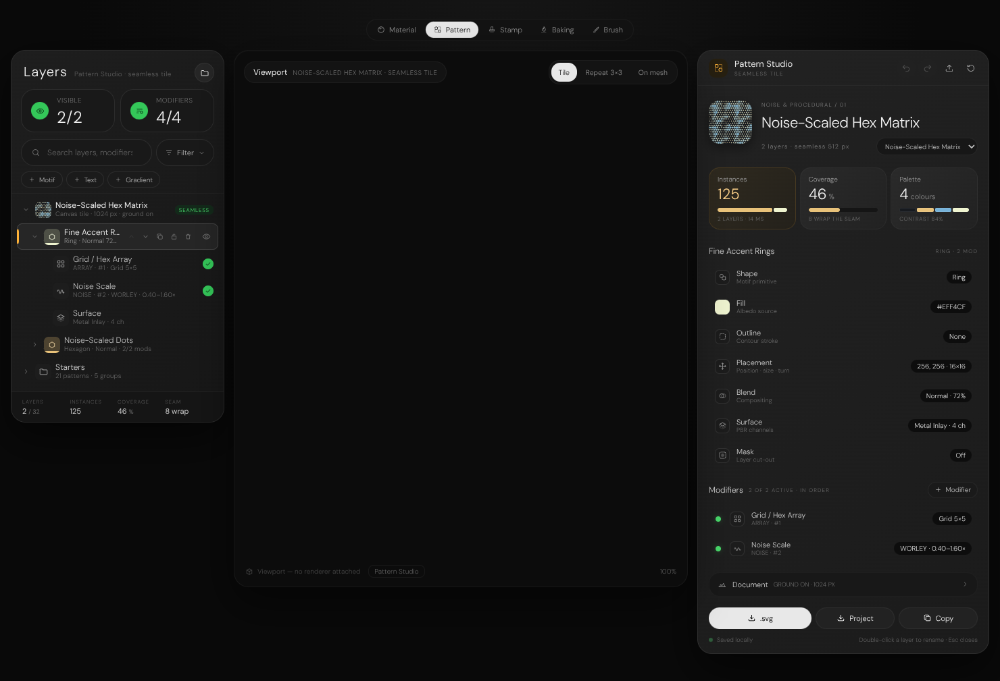
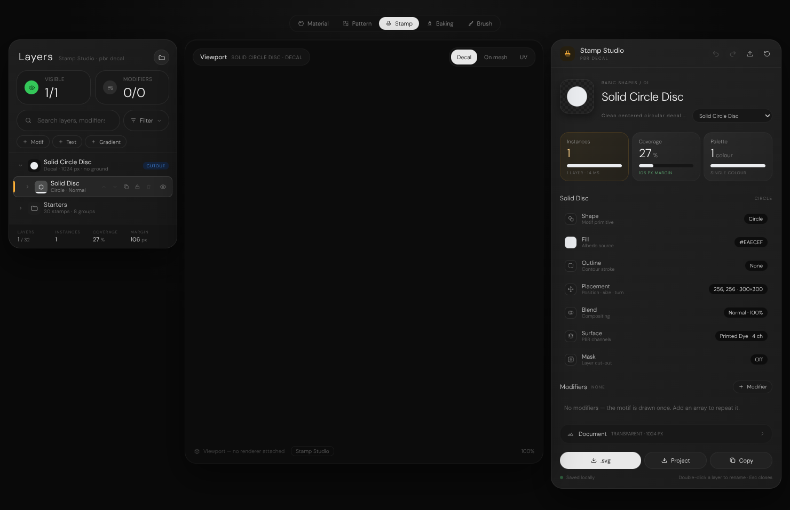

# Pattern / Stamp Studio card

This is the inspector of TextureStudio's **Pattern Studio** (seamless tiles) and **Stamp Studio** (PBR decals), rebuilt as a **single card** in the Project Zero style. It uses the same language as the [Material card](../MaterialInspector/README.md) and has no workspace, canvas or viewport.

```
python3 Experimental/ArtworkInspector/Serve.py        # http://0.0.0.0:8098/  (?mode=pattern | ?mode=stamp)
```

The two studios share one card. The dock bar above it (Material · Pattern · Stamp · Baking) switches between studios. There is no mode toggle in the card itself.

## Screenshots

| Pattern workspace | Stamp workspace |
| --- | --- |
|  |  |

Both modes use the shared workspace layout: outliner · **viewport** · card. The viewport is blank because no renderer is attached; its view modes are Tile / Repeat 3×3 / On mesh for Pattern and Decal / On mesh / UV for Stamp.

## What changed from the TextureStudio inspector

| TextureStudio | This card |
| --- | --- |
| Instances / Scale Span / Coverage trio. | **Instances** (stacked per layer, plus evaluation time), **Coverage** (motif area, excluding the ground), and an **edge** caption: seam wraps for patterns; margin or *clipped* for stamps, which turns red when a decal crosses its border. **Palette** shows the distinct authored colours and their luminance contrast, and warns below 25 %. |
| Long always-open sections: transform, fill, stroke, PBR (22 sliders), mask, modifiers, ground. | One row per property with a live readout (Shape, Fill, Outline, Placement, Blend, Surface, Mask). One row opens at a time. |
| Fill and stroke sources as dropdowns with separate stop editors. | Solid · Linear · Radial segment, a stop strip (2–12 stops) and angle. |
| 22 PBR sliders shown at once. | Finish chips (ink, cotton, wool, ceramic, foil, rubber), then only the channels in use. `+ Channel` adds others; × removes one. |
| Modifier cards with every field. | A modifier list with a bypass dot and a one-line readout (for example "Grid 5×5" or "WORLEY · 0.40–1.60×"). One editor opens at a time, with reorder, remove and a dice button for seeds. |

## Card anatomy

1. **Header:** undo, redo, open project, reset to starter.
2. **Identity:** live SVG thumbnail (shown 2×2 for patterns so the seam is visible), editable name, grouped starter picker (21 pattern, 30 stamp).
3. **Statistics:** Instances · Coverage · Palette, refreshed on the next frame after every edit.
4. **Layers** (top → bottom): an eye dot, a colour chip and the motif glyph. Double-click to rename. The active row has ↑ ↓ duplicate and delete. `+ Layer` adds a motif, text or gradient layer.
5. **Properties** of the selected layer.
6. **Modifiers** of the selected layer, applied in order.
7. **Document** (folded): ground switch and colour, export resolution.
8. **Export:** `.svg`, Project (`frontier.<mode>.v1`, which opens in TextureStudio with *Open project*), Copy SVG.

Keyboard: ↑ / ↓ move between property rows. Esc closes popovers, then the open editor. Ctrl+Z / Ctrl+Shift+Z (or Ctrl+Y) undo and redo.

## Data and compatibility

- **`ArtworkModel.js`** is pure (no DOM). Every edit returns a new document.
- `Engine/NoiseField.js`, `Engine/PbrChannelDefinitions.js` and `Engine/Patterns/ArtworkStackEngine.js` are byte-identical copies from TextureStudio. `Engine/Patterns/ArtworkStarters.js` holds the 51 starter builders, extracted without three.js.
- Shape parameter ranges follow the engine's own clamps. For example, ring inner ratio is 0.1–0.92, star points are 3–16 and gear teeth are 6–20.
- Documents are stored per starter under `localStorage["Frontier.ArtworkInspector.v1:<mode>:<starter>"]` and sync live between windows. `?starter=<id>` opens a specific starter.
- The thumbnail is the document's own SVG export, passed as a Blob URL. A 1 000-instance layer exports about 1 MB of SVG, too much to re-encode as a data URI on every render.

## Outliner

The page also shows a **Layers outliner** (`ArtworkOutliner.js`) with this tree: canvas → layers → modifiers. Its stat tiles are Visible and Modifiers. Rows have tools to reorder, duplicate, lock and hide, and you can rename a row inline or drag it to reorder. See the outliner notes in `../MaterialInspector/README.md`. Add `?outliner=0` to the URL to hide it.

## Checks

```
node Experimental/ArtworkInspector/Scripts/CheckArtworkInspector.mjs
JSDOM_DIR=/tmp/smoke node Experimental/ArtworkInspector/Scripts/SmokeArtworkInspector.mjs   # npm i --prefix /tmp/smoke jsdom@25
```

If `TS_DIR` points at a TextureStudio checkout (`…/Experimental/TextureStudio`), the check also confirms the copied engine files are unchanged.
