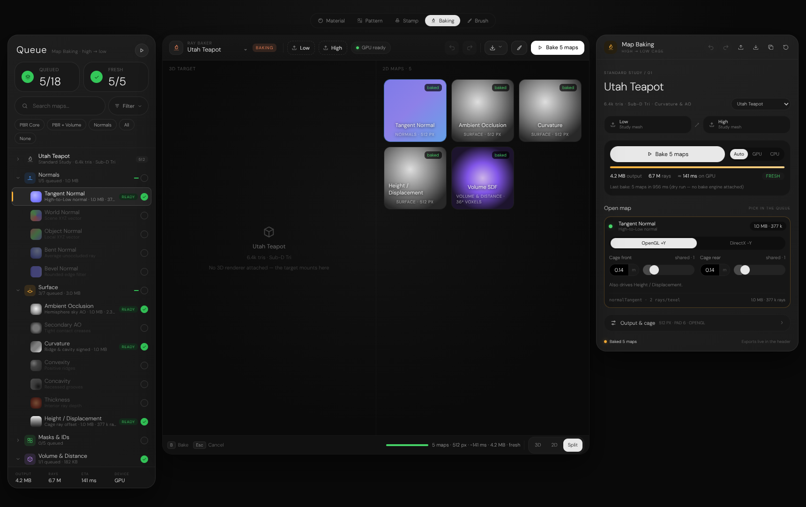

# Map Baking card

This is the inspector of TextureStudio's **Baking** workspace, rebuilt as a **single card** in the Project Zero style, with a workspace viewport beside it, alongside the [Material](../MaterialInspector/README.md) and [Pattern / Stamp](../ArtworkInspector/README.md) cards. It contains no three.js and no baker: it edits bake settings, estimates their cost, and hands a request to whatever host bakes.

```
python3 Experimental/BakeInspector/Serve.py        # http://0.0.0.0:8099/
```

## Screenshots



The workspace is the queue outliner · **viewport** · card.

## Workspace viewport (`BakeStage.js`)

TextureStudio's `BakingWorkspace` header had:

- an eyebrow, a status, the study title and a badge;
- a resolution combo and a three-way view select;
- undo / redo and a save menu;
- three CTAs (GeometryCompiler · Send to Paint · Bake Targets);
- a second group with the study select, Low Target / High Source uploads and a GPU pill.

A HUD hint floated over the stage. Here that is one header bar and one footer bar.

| Bar | Contents |
| --- | --- |
| **Header** | Bake glyph · **study ▾** · BAKING badge · **Low / High** mesh sources (`.obj` / `.stl`; dashed until a file is loaded) · **GPU ready / CPU fallback** pill. Then undo · redo │ **Export ▾** (current map `.png` and Volume SDF `.fvol`, both enabled once a real bake engine returns data; bake preset; bake request; copy request; *Open in GeometryCompiler*) │ **Send to Paint** · **Bake N maps**, which becomes *Cancel %* while baking. |
| **Footer** | Key hints (B bake, Esc cancel) · a progress meter with the estimate or live progress (maps · resolution · time · memory · fresh / stale / unbaked) │ **3D · 2D · Split** view segment. |

The stage:

- **3D pane:** left blank on purpose; no renderer is attached, and the pane shows the study or source names.
- **2D pane:** a map sheet with one tile per queued map. Tiles are tinted by group and go queued → running → baked live during a bake. Clicking a tile opens that map in the card.
- **Split** (the default) shows both panes.

Resolution stays in the card's *Output & cage* fold, because it is a bake setting rather than a view setting. GeometryCompiler moved from a header CTA into the Export menu.

The docked card is decluttered:

- It shows only the map opened in the queue.
- Output, rays, ETA and freshness sit on one line under the Bake button, instead of three stat tiles.
- Export preset and copy request are icon buttons in the header, instead of a footer block.
- Undocked (`?outliner=0`), it keeps the full card.

## What changed from the TextureStudio inspector

| TextureStudio | This card |
| --- | --- |
| Resolution / Rays per Px / Volume SDF trio, which echoed the sliders. | **Output:** memory of the results, stacked by map group. **Ray budget:** rays traced plus an estimated time on the chosen device; turns amber or red as it grows. **Result:** Unbaked, Baking (stepped meter), Fresh, or **Stale** once a setting that affects output changes. Switching device does not make results stale. |
| An 18-item checklist on one side and always-open "Ray Execution & Surface Settings", "3D Volume SDF" and "Export" cards on the other. It was unclear which slider affected which map. | Maps are grouped (Normals, Surface, Masks & IDs, Volume & Distance). The dot queues a map. **Opening a map shows only the settings that shape it** (for example, AO shows rays per texel and ray distance). It says when a setting also drives other queued maps, and shows that map's own memory and ray cost. |
| Settings scattered across cards. | Rarely changed output settings (resolution, padding, cage, tangent convention) sit in one folded "Output & cage" section. |

## Bake hosting

`Mount(element, { Bake, OnResult, OnSource })`:

- `Bake(request, { Progress(fraction, text, mapIndex), Signal })` resolves to `{ Device, Ms, Maps, Data }`.
  - `request` is `BakeModel.Request(settings)`. It is split the way TextureStudio's `runBake` splits it: `surface` holds `bakeMeshMaps` options and channels; `volume` holds `bakeVolumeSdf` options.
  - Abort through `Signal` when the user presses Cancel.
- `OnSource(slot, File | null)` passes custom low / high meshes (`.obj` / `.stl`) to the host.

This page attaches no host. **Bake** runs a clearly labelled dry run that walks the queue on the estimated timings, so the progress, cancel and staleness behaviour can be tried.

## Data

- **`BakeModel.js`** is pure. Its defaults and ranges are field-for-field those of `BakingWorkspace` (teapot; normal, AO, curvature, height and SDF; 512 px; 12 rays; cage 0.14 / 0.14; SDF 36³ signed).
- **`Engine/BakeCatalog.js`** holds the map catalog (18) and studies (5), copied verbatim from `Engine/BakingEngine.js`.
- **Estimates:**
  - RGBA8 maps, float32 SDF voxels.
  - Rays per texel by map: cage maps 2, hemisphere maps N, bevel 8; curvature, IDs and wireframe are free.
  - UV coverage is assumed to be 72 %.
  - Throughput is assumed to be about 320 M rays/s on GPU and 4.5 M on CPU.
  - These are orders of magnitude for comparing settings, not promises.
- Settings persist in `localStorage["Frontier.BakeInspector.v1"]`. Preset files use `frontier.bake.v1`; request files use `frontier.bake-request.v1`.

## Outliner

The page also shows a **Queue outliner** (`BakeOutliner.js`) with this tree: study → map groups → maps. Its stat tiles are Queued and Unbaked. Each row has a status disc that queues or skips the map, and a badge that shows its queue position or its READY / STALE state. See the outliner notes in `../MaterialInspector/README.md`. Add `?outliner=0` to the URL to hide it.

## Checks

```
node Experimental/BakeInspector/Scripts/CheckBakeInspector.mjs
JSDOM_DIR=/tmp/smoke node Experimental/BakeInspector/Scripts/SmokeBakeInspector.mjs   # npm i --prefix /tmp/smoke jsdom@25
```

The smoke test also mounts `BakeStage.js` and drives it: study and sources from the header, tile → card, the 3D / 2D / Split views, Bake / Cancel from the header and the B / Esc keys, live tiles, the Export menu, Send to Paint (fresh results only) and the GeometryCompiler hand-off.
