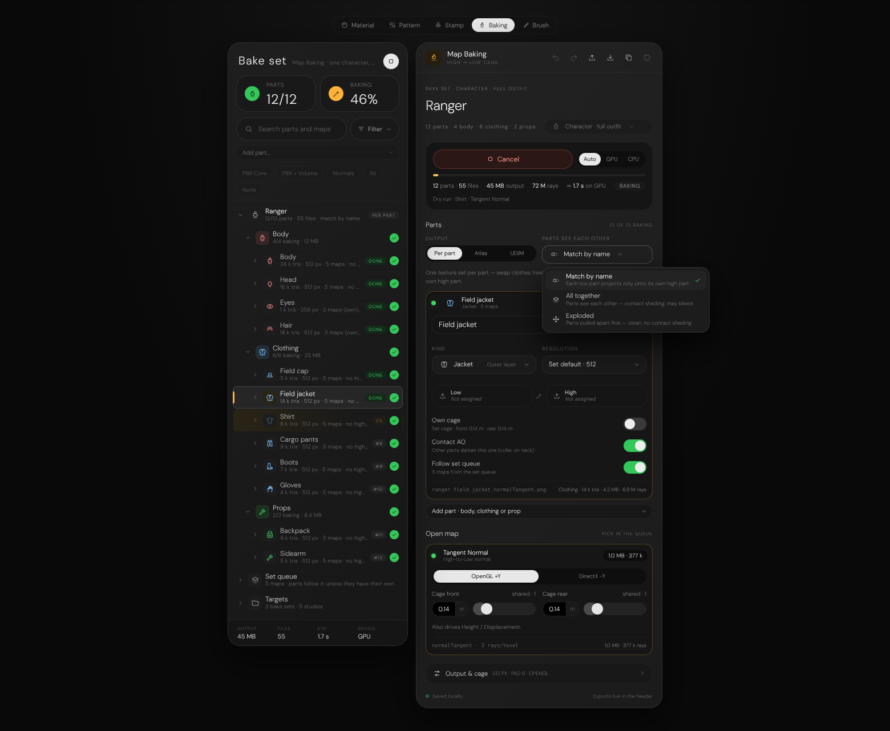
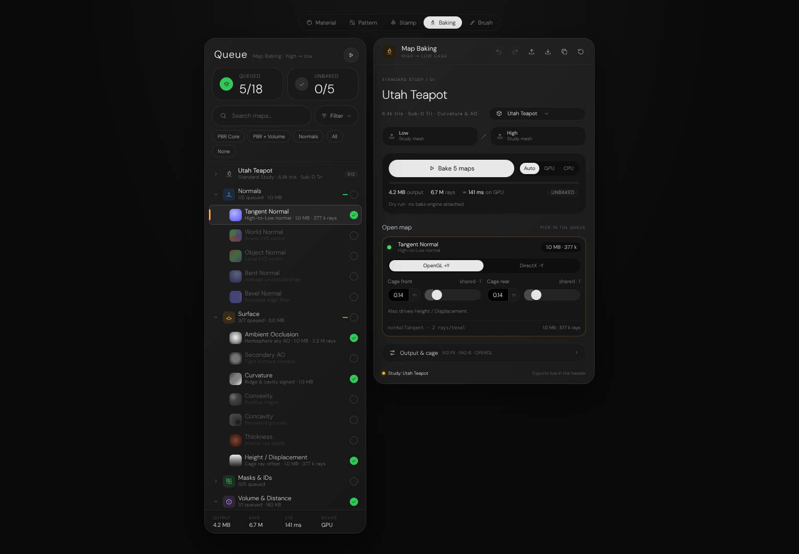

# Map Baking card

This is the inspector of TextureStudio's **Baking** workspace, rebuilt as a **single card** in the Project Zero style beside its outliner (outliner · card; no viewport), alongside the [Material](../MaterialInspector/README.md) and [Pattern / Stamp](../ArtworkInspector/README.md) cards. It contains no three.js and no baker: it edits bake settings, estimates their cost, and hands a request to whatever host bakes.

```
python3 Experimental/BakeInspector/Serve.py        # http://0.0.0.0:8099/
```

## Screenshots


| Baking, progress per part (isolation dropdown open) | Single study |
| --- | --- |
|  |  |

## Bake sets: one character, many parts

A character is many meshes that belong together: body, head, eyes, hair, a hat, a jacket, a shirt, pants, boots, gloves, a backpack, a sidearm. Each needs its own high → low pair, cage and maps, but you want one name, one output and one bake. Pick a **bake target** in the card's identity dropdown (or the outliner's *Targets*):

| Target | Parts |
| --- | --- |
| **Character · full outfit** ("Ranger") | Body · Head · Eyes · Hair │ Field cap · Field jacket · Shirt · Cargo pants · Boots · Gloves │ Backpack · Sidearm |
| **Character · base body** | Body · Head · Hands · Eyes · Hair |
| **Gear kit · props** | Backpack · Rifle · Canteen · Holster |
| Any study (teapot, shader ball, …) | The original single high / low bake. |

**Set options** (the card's *Parts* section):

- **Output:** *Per part* (one texture set per part, `ranger_field_jacket_ao.png`, so clothes can be swapped), *Atlas* (every enabled part packed into one 1K–8K sheet per map, space shared by surface size), or *UDIM* (one tile per part, 1001, 1002, …).
- **Parts see each other** (a dropdown):
  - *Match by name*: a low part projects only onto its own high part, so jacket rays never land on the body.
  - *All together*: contact shading, but projection can bleed between layers.
  - *Exploded*: parts are pulled apart first; clean, with no contact shading.

**Each part** (pick it in the outliner; the card opens its editor):

- name and **kind** (a dropdown of 15 kinds in Body / Clothing / Props);
- its own **Low / High** meshes;
- **resolution** (set default or 256 – 2K; in atlas mode its share of the sheet is shown instead);
- **Own cage** (front / rear) or the set cage;
- **Contact AO**: whether other parts darken it, e.g. a collar on the neck;
- **Follow set queue**, or its **own map queue** (eyes bake just normal + AO; a jacket can add thickness);
- duplicate, remove, and **Add part** (a filterable dropdown).

**Baking a set:**

- *Bake N parts* runs every enabled part in body → clothing → props order.
- The outliner shows **progress per part**: DONE, the running part's own %, and queue numbers for the rest.
- Staleness is **per part**. Editing the jacket marks only the jacket stale (and parts whose contact AO sees it, if its mesh changed). **Stale only · N** then re-bakes just those parts and keeps the other results.
- The estimate (output, files, rays, ETA) sums over enabled parts. Skipping a part or a whole category (the category disc) removes it from the bake.

The docked card is decluttered:

- It shows only the map opened in the queue.
- Output, rays, ETA and freshness sit on one line under the Bake button, instead of three stat tiles.
- Export preset and copy request are icon buttons in the header, instead of a footer block.
- Undocked (`?outliner=0`), it keeps the full card.

## What changed from the TextureStudio inspector

| TextureStudio | This card |
| --- | --- |
| Resolution / Rays per Px / Volume SDF trio, which echoed the sliders. | **Output:** memory of the results, stacked by map group. **Ray budget:** rays traced plus an estimated time on the chosen device; turns amber or red as it grows. **Result:** Unbaked, Baking (stepped meter), Fresh, or **Stale** once a setting that affects output changes. Switching device does not make results stale. |
| An 18-item checklist on one side and always-open "Ray Execution & Surface Settings", "3D Volume SDF" and "Export" cards on the other. It was unclear which slider affected which map. | Maps are grouped (Normals, Surface, Masks & IDs, Volume & Distance). The dot queues a map. **Opening a map shows only the settings that shape it** (for example, AO shows rays per texel and ray distance). It says when a setting also drives other queued maps, and shows that map's own memory and ray cost. |
| Settings scattered across cards. | Rarely changed output settings (resolution, padding, cage, tangent convention) sit in one folded "Output & cage" section. |

## Bake hosting

`Mount(element, { Bake, OnResult, OnSource })`:

- `Bake(request, { Progress(fraction, text, jobIndex), Signal, Jobs })` resolves to `{ Device, Ms, Maps, Data }`. `Jobs` is the ordered `{ Part, Map }` list (`Part` is null for a single study).
  - `request` is `BakeModel.Request(settings)`. It is split the way TextureStudio's `runBake` splits it: `surface` holds `bakeMeshMaps` options and channels; `volume` holds `bakeVolumeSdf` options.
  - Abort through `Signal` when the user presses Cancel.
  - For a bake set, `request` is `frontier.bake-request.v2`: `set` (name, output, isolation, atlas / UDIM settings), `shared` ray settings, and one `parts[]` entry per enabled part. Each entry has its sources, tris, `matchBy` name, contact AO, UDIM tile or atlas share, `surface` (resolution, channels, its cage, output file names) and `volume`.
- `OnSource(slot, File | null, partId | null)` passes custom low / high meshes (`.obj` / `.stl` / `.fbx` / `.glb`) to the host.

This page attaches no host. **Bake** runs a clearly labelled dry run that walks the queue on the estimated timings, so the progress, cancel and staleness behaviour can be tried.

## Data

- **`BakeModel.js`** is pure. Its defaults and ranges are field-for-field those of `BakingWorkspace` (teapot; normal, AO, curvature, height and SDF; 512 px; 12 rays; cage 0.14 / 0.14; SDF 36³ signed).
- **`Engine/BakeCatalog.js`** holds the map catalog (18) and studies (5), copied verbatim from `Engine/BakingEngine.js`.
- **Estimates:**
  - RGBA8 maps, float32 SDF voxels.
  - Rays per texel by map: cage maps 2, hemisphere maps N, bevel 8; curvature, IDs and wireframe are free.
  - UV coverage is assumed to be 72 %.
  - Throughput is assumed to be about 320 M rays/s on GPU and 4.5 M on CPU.
  - These are orders of magnitude for comparing settings, not promises.
- Settings persist in `localStorage["Frontier.BakeInspector.v1"]`. Preset files use `frontier.bake.v1`, with an optional `set` (parts without their mesh files). Request files use `frontier.bake-request.v1` for a study and `v2` for a bake set.
- Part kinds, outputs, isolation modes and the set templates are tables in `BakeModel.js` (`PART_KINDS`, `OUTPUTS`, `ISOLATIONS`, `SET_TEMPLATES`). Code says *bake set* / *part*; the UI says character.

## Outliner

The page also shows a **Queue outliner** (`BakeOutliner.js`) with this tree: study → map groups → maps. With a bake set it becomes **character → Body / Clothing / Props → parts → that part's maps**, then *Set queue* and *Targets*. The stat tiles become Parts and Fresh / stale, and an *Add part* dropdown sits under the search. Its stat tiles are Queued and Unbaked. Each row has a status disc that queues or skips the map, and a badge that shows its queue position or its READY / STALE state. See the outliner notes in `../MaterialInspector/README.md`. Add `?outliner=0` to the URL to hide it.

## Checks

```
node Experimental/BakeInspector/Scripts/CheckBakeInspector.mjs
JSDOM_DIR=/tmp/smoke node Experimental/BakeInspector/Scripts/SmokeBakeInspector.mjs   # npm i --prefix /tmp/smoke jsdom@25
```

The check covers bake sets: templates, estimates summed over parts, per-part overrides, atlas / UDIM, per-part staleness and the preset round trip. The smoke drives a set in the card (target dropdown, part editor, kind / resolution dropdowns, own queue, per-part mesh, output, isolation, add / remove, a v2 host bake, stale-only re-bake, undo). `MaterialInspector/Scripts/SmokeOutliners.mjs bakeset` drives the set tree: part and category toggles, a per-part map, Add part, progress per part, and a stale-only bake.
