# Brush Studio

This page is the **texture-painting workspace**, in the Project Zero editor's visual language: a Brush Library, a blank workspace **viewport**, and a **Studio** card. Every paint tool has its own dedicated studio laid out like Procreate's Brush Studio: Brush Studio, Stamp Studio for decals, Text Studio, Eraser Studio, and so on. No renderer is attached, so the viewport is left blank. A small, closable 2D **Drawing Pad** floats in the viewport as a previewer of what the current tool does to each PBR channel.

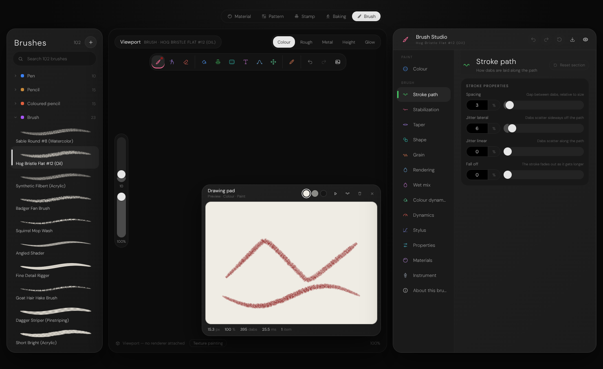

```
python3 Experimental/MaterialInspector/Serve.py       # serves the repo root on :8097
http://localhost:8097/Experimental/BrushStudio/
  ?brush=<catalogue id>   start on a brush, e.g. pencil-classic-yellow-hb
  ?tool=<tool id>         paint · smudge · erase · fill · stamp · gradient · text · curve · move · eyedropper
  ?section=<section id>   open a section in that tool's studio, e.g. shape, grain (Brush) · decal, material (Stamp)
  ?pad=0                  start with the Drawing Pad closed
```

## Layout

The page is library · viewport · card. It is the only workspace with a viewport; Material, Pattern, Stamp and Baking are outliner · card. It uses the same dock nav pill, 22 px card radius, DM Sans 300 type and the shared CardKit controls.

There is **no amber on this page**. Each tool icon and each studio-section icon has its own colour, drawn on the icon itself with no fill behind it. Edited marks and focus rings are blue.

- **Brush Library** card:
  - Search.
  - The 102 TextureStudio catalogue instruments, grouped by family, each with a live preview stroke.
  - Your own duplicated or imported brushes, listed as *My brushes*.
  - A blue dot on any brush that differs from its reset point.
- **Viewport** (blank, no renderer). It carries:
  - The **tool rail** (Paint · Smudge · Erase | Fill · Stamp · Gradient · Text · Curve · Move | Eyedropper, then pad undo / redo and the pad toggle).
  - Procreate-style size and opacity sliders.
  - Channel views (Colour / Rough / Metal / Height / Glow).
  - The floating **Drawing Pad**.
- **Drawing Pad** (a previewer you can close). Close it with its ×, the rail's pad button or the eye button in the studio header. It has:
  - Paper tones.
  - **Live** re-render: strokes are redrawn as you edit the brush.
  - A preview stroke.
  - Clear (undoable).
  - A one-line stats footer: size, opacity, dabs, render ms, items.
- **Studio** card: a section list and that section's settings, as in Procreate's Brush Studio.
  - Picking a tool on the rail switches the card to that tool's studio.
  - Each section shows a count of edited settings. Each section has *Reset section*, and each edited field has its own reset.

| Pad closed | Narrow (1366 × 768) | Narrow (1100) |
| --- | --- | --- |
| 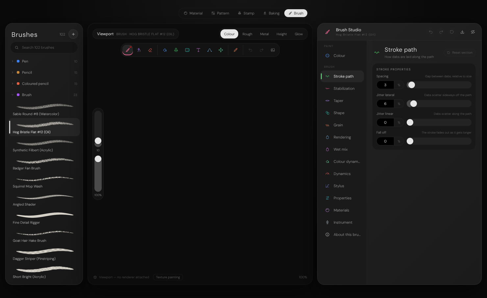 | 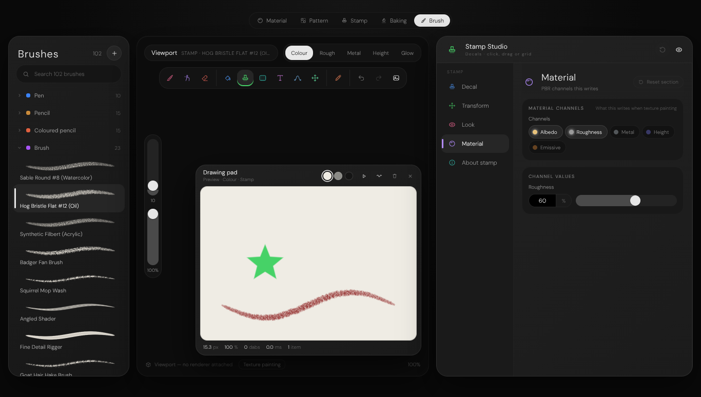 | 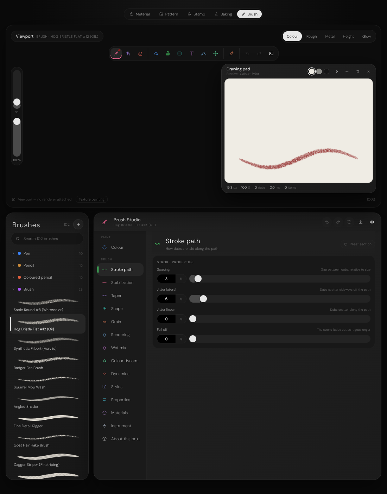 |

Responsive layout:

- **Below 1500 px:** the columns narrow.
- **Below 1240 px:** the viewport spans the top and the library sits next to the studio.
- **Below 820 px:** everything stacks.

## Dropdowns

Pick lists are Project Zero dropdowns (`CardKit.Dropdown`): **Shape source** and **Grain source** show a large preview of the current source beside a dropdown of every source with a thumbnail (filterable). Rendering mode, colour gradients and every option list longer than four are dropdowns too. Short toggles stay segments.

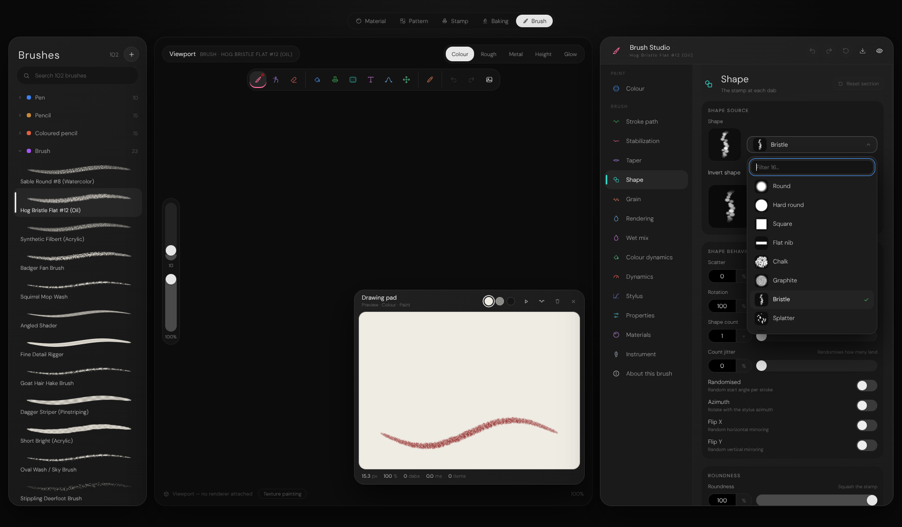

## Brush Studio sections (Procreate's Brush Studio, plus texture painting)

The Paint tool's studio starts with a **Colour** section (primary / secondary discs, swatches, symmetry and blend), followed by the brush sections:

| Section | Groups |
| --- | --- |
| Stroke path | spacing, jitter lateral / linear, fall off |
| Stabilization | StreamLine (+ pressure), stabilization, motion filtering (+ expression) |
| Taper | pressure taper, touch taper (with linked ends), size / opacity / pressure / tip, tip animation, classic taper |
| Shape | 16 procedural sources, scatter / rotation / count / jitter / flips / azimuth, roundness (+ graph), tip falloff, filtering |
| Grain | 12 procedural grains, moving or texturized, scale / zoom / rotation / depth / offset / blend, filtering |
| Rendering | 6 modes in a dropdown (light → heavy glaze, uniform / intense blending), flow, wet edges, burnt edges, blend mode, luminance |
| Wet mix | dilution, charge, attack, pull, grade, blur (+ jitter), wetness jitter |
| Colour dynamics | stroke gradients and multicolour modes, stamp and stroke HSB jitter, colour pressure and tilt, opacity over the stroke, hue over the stroke |
| Dynamics | speed → size / opacity, size / opacity jitter, over-the-stroke behaviour |
| Stylus | pressure curve editor, pressure → size / opacity / flow / bleed / smoothing, tilt curve and tilt targets, mouse and touch simulation |
| Properties | stamp preview, orient to screen, preview scale, smudge, min / max size and opacity |
| **Materials** | a **Channels dropdown** ([ChannelStack](../MaterialInspector/README.md#channelstack--the-reusable-channel-dropdown)) listing all 22 PBR channels in 5 groups. Each channel has an on / off switch, and opening it shows its slider card (value or colour, strength, source = shape / grain, amount, flow, blend). The old five keys (`mat.channels`, `mat.roughness`, …) stay the source of truth via `LinkedStack` |
| **Instrument** | the catalogue tool's own controls (shape, paint, bristle, grade, nib, ink…). Each control maps onto the studio settings, and the mapping is shown under the control |
| About this brush | name, author, created date, signature, brush data, and *Create new reset point* / *Reset all settings* |

In total the studio has 139 fields. Every value is normalised, so an imported brush can never contain an out-of-range value.

The Materials and Instrument sections go beyond Procreate's Brush Studio:

- **Materials** is there because this studio paints textures.
- **Instrument** keeps the TextureStudio tool menus' schema intact. Switching a control's option away and back restores the same settings, whatever order you touched the controls in.

## Tool studios

Every tool has a **dedicated studio**, built the same way as the Brush Studio:

- Coloured section icons on the left and the section's settings beside them.
- Edited counts on each section.
- Per-field and per-section reset.
- An **About** section with the shortcut, what changed since the defaults, and *Reset all settings*.

Settings marked as brush-bound edit the active brush directly, so a tool studio and the Brush Studio never disagree. In the Smudge, Eraser and Curve studios, the brush card has a **Brush Studio** button. It opens the brush's studio without changing tool; the header's back chip, or Esc, returns.

| Studio | Key | Sections |
| --- | --- | --- |
| Brush Studio (Paint) | B | Colour, then the 14 brush sections above |
| Smudge Studio | S | Tip (finger or current brush), Smudge (strength, finger painting, StreamLine, spacing), About |
| Eraser Studio | E | Eraser (catalogue eraser or current brush), Tip (size, strength, flow, hardness, edge), Feel, Channels to erase, About |
| Fill Studio | G | Scope (region / similar / all, threshold, feather, grow), Source (colour or grain, opacity, blend), Material, About |
| **Stamp Studio** (decals) | P | Decal (16 shapes, click / drag / grid), Transform (size, rotation, jitter, mirror), Look (tint, opacity, hardness, blend), Material, About |
| Gradient Studio | D | Shape (linear / radial / conic, spread), Colours (presets, stops), Blend (opacity, mode, painted / empty), Line (apply / clear), About |
| **Text Studio** | T | Text, Type (font, weight, italic, align), Layout (size, spacing, line height, arc, rotation), Look (colour, opacity, outline), Material, Place, About |
| Curve Studio | C | Brush, Path (smooth / polyline, closed, smoothness), Pressure (even / taper / swell / fade), Points (stroke, undo point, clear), About |
| Move Studio | V | Target, Offset (U / V, nudges), Transform (scale, rotation, flips, clip / tile edges), Commit, About |
| Eyedropper Studio | I | Sample (hex / RGB / HSL readout, send to primary / secondary), Sampling (area, target, source, return to previous tool), Recent, About |

| | | |
| --- | --- | --- |
| 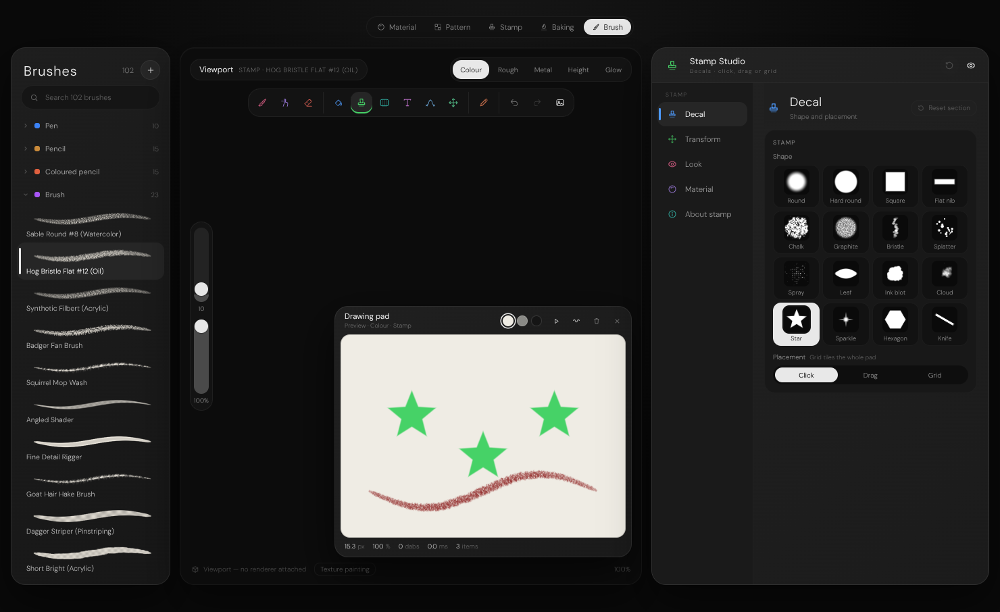 **Stamp Studio** | 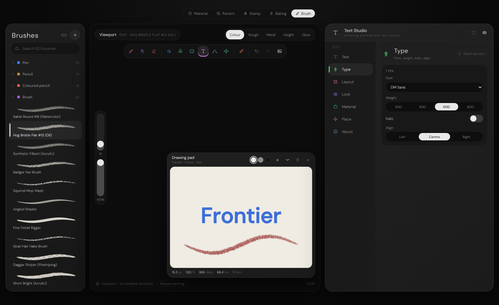 **Text Studio** | 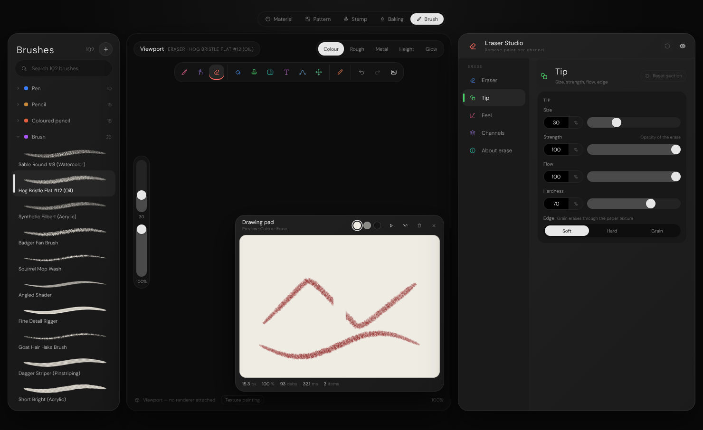 **Eraser Studio** |
| 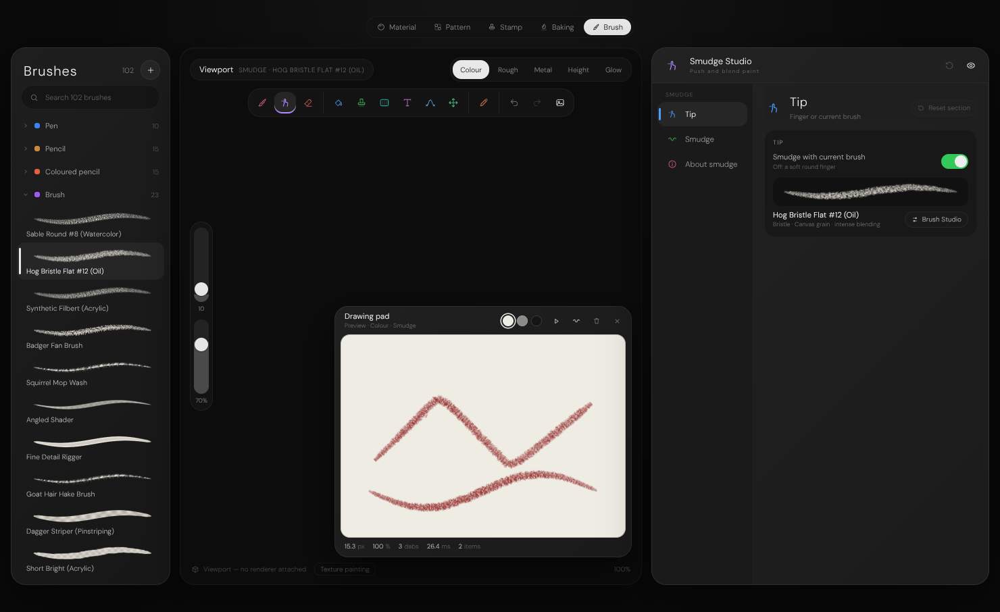 **Smudge Studio** | 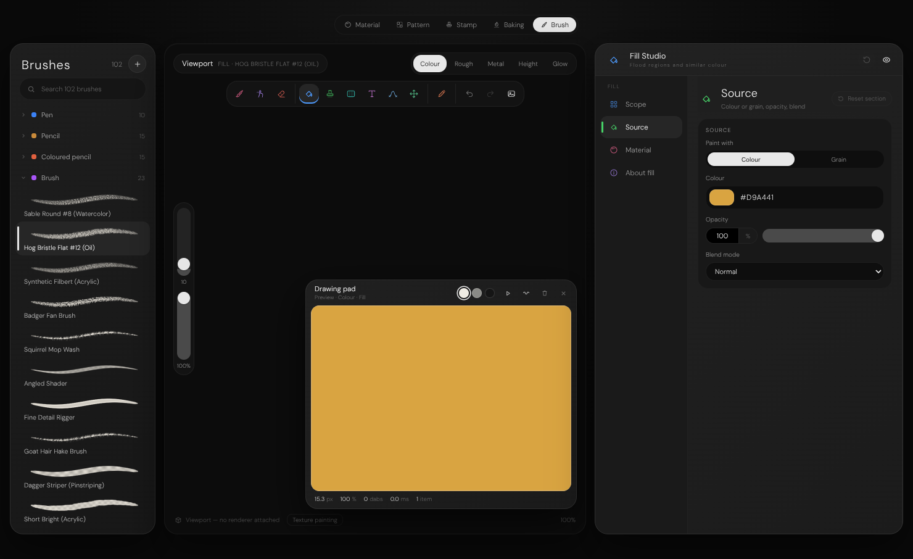 **Fill Studio** | 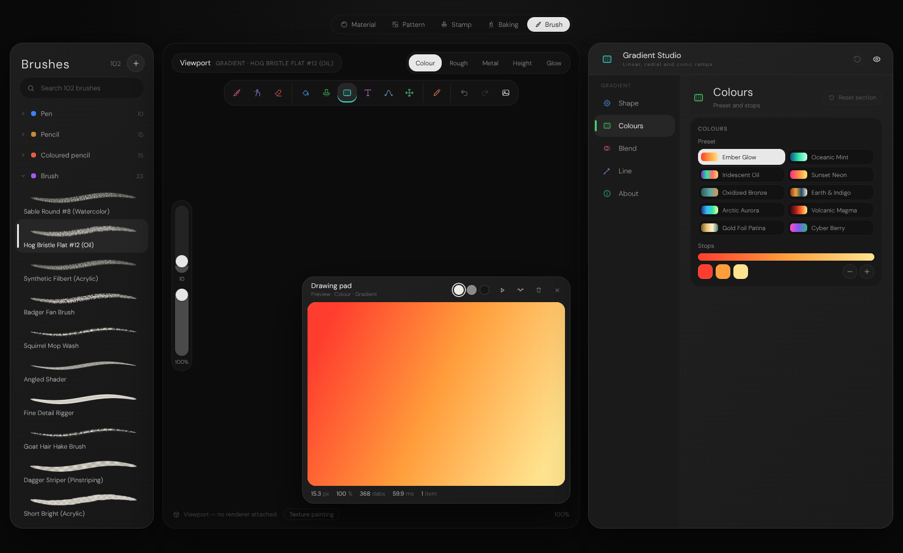 **Gradient Studio** |
| 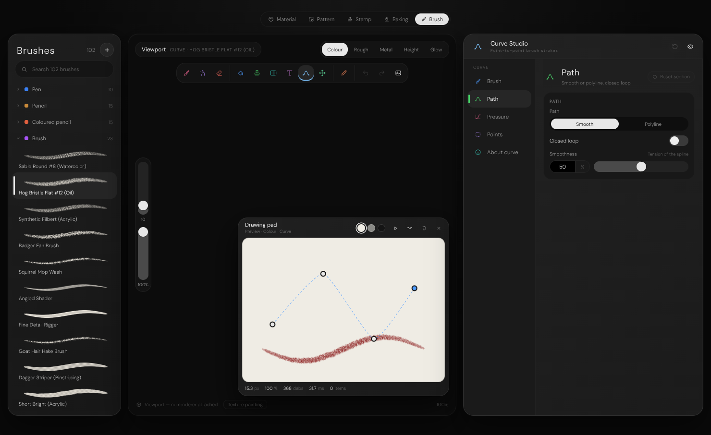 **Curve Studio** | 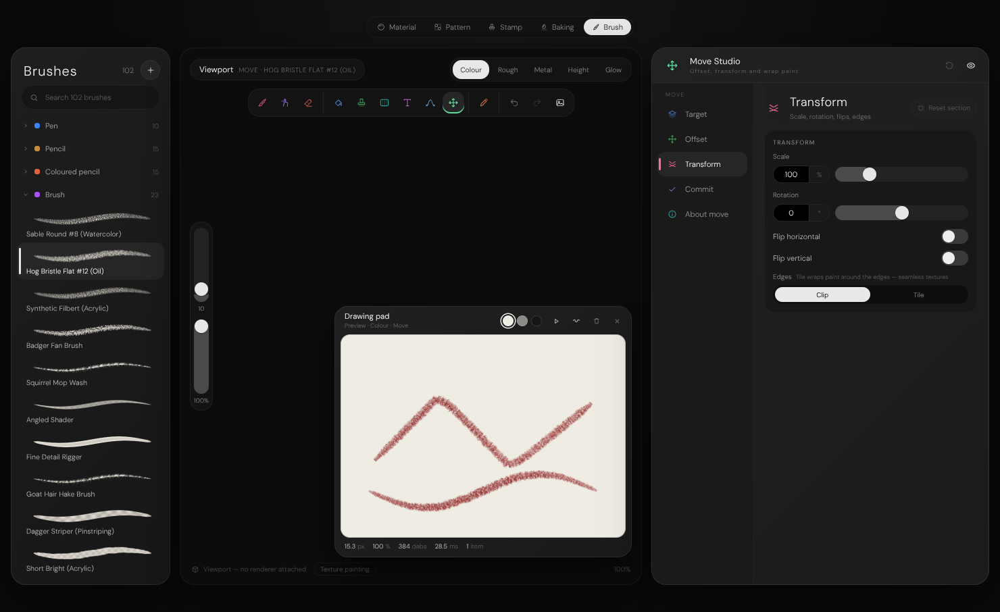 **Move Studio** | 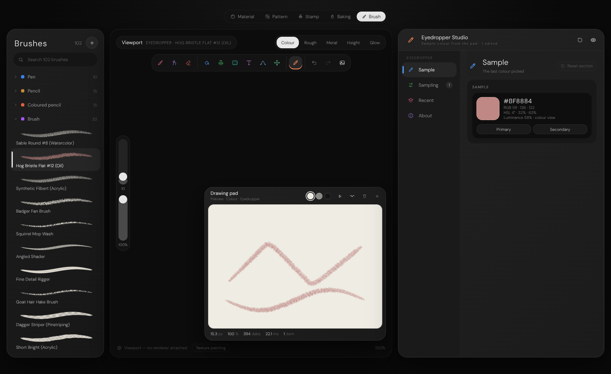 **Eyedropper Studio** |
| 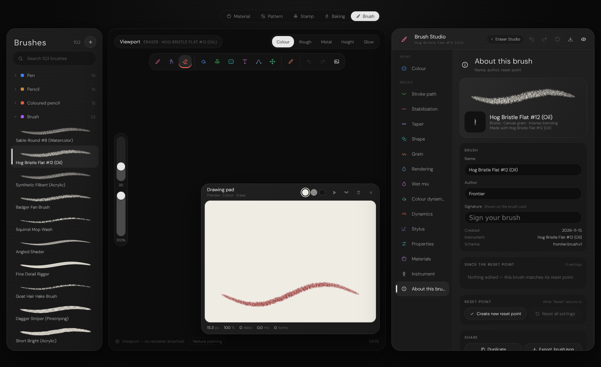 **About** (any tool) | | |

Pad keys:

- `[` / `]` change the brush size.
- Enter applies a gradient, text, curve or move.
- Backspace removes the last curve point.
- Ctrl+Z and Ctrl+Shift+Z undo and redo on the pad.
- Alt+Z undoes settings changes.
- Esc returns from the Brush Studio to the current tool's studio.

## Channels per tool

Every tool studio that writes texels has its own **Channels** dropdown. It uses the same component and design as the Material Inspector's channel groups, and each channel gets **its own slider card for that tool** (`ToolModel.TOOL_CARDS`):

| Tool | Card per channel |
| :--- | :--- |
| Paint (Brush Studio → Materials) | value / colour · strength · source (shape / grain) · amount · flow · blend |
| Fill | value · opacity · blend |
| Stamp | source · value · opacity · blend |
| Text | value · opacity |
| Gradient | start → end (channel range) · opacity |
| Eraser | strength · edge |
| Smudge | strength |
| Move | on / off only |

A channel that is switched off keeps its card settings. The bind for the brush is `b|mat.stack`; for a tool it is `t|<tool>|stack`, and a field inside either is `…@<channel>.<key>`. The pad applies each op's `Stack`, so a stroke writes only the enabled channels, each at its own strength.

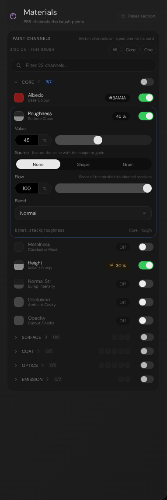

## Files

| File | What it holds |
| --- | --- |
| `BrushModel.js` | Pure brush schema: shapes, grains, render and blend modes, the 14 sections and their fields, defaults, family presets, instrument mapping, set / reset / reset point / duplicate / export / import |
| `BrushEngine.js` | Pure stroke planner: stabilisation, spacing, tapers, jitter, dynamics, colour, and a seeded RNG, so a replayed stroke is identical |
| `Sources.js` | Procedural tips and grains (no bitmap files) with cached thumbnails. `SetCanvasFactory` lets the tests run without a DOM |
| `ToolModel.js` | The 10 tools as typed field groups, their **studios** (sections, icon colours), edited-setting tracking, and the curve path and pressure profiles |
| `Painter.js` | 2D renderer: stroke (grain, wet edges, blending, smudge, per-channel values), flood fill, stamp, gradient, text, move, height shading |
| `Pad.js` | The Drawing Pad: an op list (undoable clear, capped at 160 ops), live re-render, channel views, pointer / pen input with pressure and tilt, and stats |
| `BrushStudio.js` / `.css` | Library, viewport overlays (rail, sliders, Drawing Pad), the Studio card for every tool, control bindings and keyboard handling. The blank viewport comes from `../MaterialInspector/Viewport.js` |
| `Engine/PaintToolCatalogue.js` | Byte-identical copy of TextureStudio's catalogue (102 instruments, schemas and artwork) |
| `Engine/BrushDynamics.js` | Verbatim extract of TextureStudio's `TexturePaintEngine.js` curves, HSL shifting, colour / opacity modes and gradient presets |

## Data

A brush exports as `*.brush.json` with schema `frontier.brush.v1`. The file holds:

- the catalogue `instrument` it came from;
- the instrument `params`;
- all 139 studio `values`;
- the `reset` point;
- name / author / signature.

Imports are normalised field by field. Unknown keys are dropped, and a foreign schema is rejected.

## Checks

```
TS_DIR=/path/to/TextureStudio node Experimental/BrushStudio/Scripts/CheckBrushStudio.mjs
JSDOM_DIR=/tmp/smoke node Experimental/BrushStudio/Scripts/SmokeBrushStudio.mjs      # npm i --prefix /tmp/smoke jsdom@25
```

- **`CheckBrushStudio.mjs`** checks the pure modules: schema, every instrument and every option, edits and resets, round trips, engine determinism and stabilisation, sources, tools and their studios (every group has a section, no amber, edits counted per section), the curve tool, and the renderer on a pixel-less canvas. With `TS_DIR` set, it also confirms the copied engine files match TextureStudio.
- **`SmokeBrushStudio.mjs`** boots the page in jsdom and drives it end to end: library, every section and field type, the curve editor, all resets, duplicate / export / import, undo / redo, every pad tool, every tool studio (every section and control, counts, resets, About), the Brush Studio link and Esc, closing / reopening the Drawing Pad, channel views and keyboard shortcuts.
