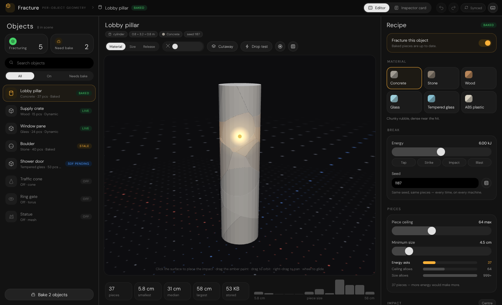

# Fracture Editor

A 3D redesign of the per-object **Fracture** editor from Frontier-OLD's Project Zero editor
(`arena/bc062d35-frontier-old`, `Experimental/ProjectZeroEditor`). The object is broken into real 3D pieces (a seeded
3D Voronoi fracture of its solid) and shown in a three.js viewport around the recipe UI. The pieces are an authoring
preview of what the recipe makes. This is not the runtime solver, and the drop test is a simple ballistic preview, not
physics.

```
python3 Experimental/FractureEditor/Serve.py         # http://0.0.0.0:8096/ → /Experimental/FractureEditor/
```

It is plain ES modules with no build step. three.js (r187), the glide camera (`Camera.js`) and the line-free visuals
(dot floor, glow sprite, in-material halo from `Visuals.js`) and the fonts are shared from `../ComponentViewer/`. The
look is the same Project Zero language as the Component Viewer: charcoal docks on a 2 px seam, pill sliders, white
active segments and amber (#ffb238) for selection and the impact point.

## Screenshots



## What changed from the old UI

| Old (Project Zero) | Redesign |
|---|---|
| A small inspector card plus an editor in a separate pop-up window (opened with ↗) | One window. The **Objects** list, the **3D viewport** and the **Recipe** sit side by side. The **Inspector card** tab swaps the recipe for the compact card, which edits the same recipe with the 3D view still live |
| One object at a time; you had to find it in the outliner | An object list with a state pill per object (Off · Live · Unbaked · Stale · SDF pending · Baked), search, filters (All / On / Needs bake) and **Bake N objects** |
| Material as a dropdown | Six material tiles, each with a one-line note on how it breaks (concrete rubble, stone slabs, wood splinters, radial glass, tempered dice, tough ABS) |
| Energy as a raw number | A cubic slider (most of the travel goes to the useful low range), shown in J or kJ, with **Tap / Strike / Impact / Blast** presets |
| Piece ceiling and minimum size with no feedback | A **budget meter** shows what energy asks for, what the ceiling allows and what the minimum size allows, and highlights the one that decides the piece count |
| Impact X/Y/Z number fields only | **Click the object's surface** in the 3D view to place the impact, drag the amber point across the surface, nudge it with the arrow keys and Page Up / Down (Shift for ×10), or type it in. **Centre** resets it |
| Status text "Open the editor to bake or refresh geometry." | A bake card with signature hash, piece count and age. When stale it lists **what changed** (e.g. `Material Concrete → Glass`) and offers **Revert** (restore the baked recipe) or **Rebake** |
| SDF toggle and resolution select | The same controls, plus a memory breakdown (pieces, then `N × res³ × 2 B` of R16F, then total) |
| No undo | Undo and redo per object (Ctrl Z / Ctrl Shift Z). A slider drag or impact drag counts as one step |
| 2D glyph / schematic | A **3D viewport**: outer skin in the material's surface, fresh crack faces lighter and rougher, the amber impact glow drawn through the solid. Shade by **Material**, **Size** (density ramp) or **Release** order. **Explode** pulls pieces apart from the impact. **Cutaway** (C) peels away the pieces between the camera and the impact so the crack network inside shows, and it follows as you orbit. **Drop test** (Space) breaks the object at the impact and lets the pieces fall and settle. Hovering a piece shows its size, volume, crack faces and release order with the amber in-material halo |
| Torus: "Concave preview needs decomposition." | Concave shapes **are** decomposed: the ring is 16 convex wedges, and pieces that span wedges stay one piece. Imported meshes use a 3-part proxy hull until source-mesh decomposition exists (shown as a chip) |

There are no wireframes, outline helpers or selection footprint. Selection is the halo inside the material, and the
floor is the Component Viewer's dot floor with a soft shadow.

## Compatibility

Storage is byte-compatible with the old editor, so recipes move both ways:

- Key `Frontier.Fracture.v2:<objectId>` → `{ Owner: {Id, Name, Primitive, Scale}, Settings }`
- Same defaults and clamps: Energy 0–50 000, Seed 1–999 999 (integer), Ceiling 2–160 (integer), Minimum size 0.002–0.3,
  impact ±1000. SDF resolution is 32, 64 or 128.
- Same materials (`concrete rock wood glass tempered plastic`).
- Same bake signature: `{Revision: 2, Primitive, Scale, Recipe}`. It ignores Enabled, Mode, PieceSdf, SdfResolution,
  Baked and EditedAt, so turning on SDF or changing its resolution only marks the SDF as pending, not the pieces.
- `?object=<id>` opens that object, which is how the old launcher opened the editor window.
- `storage` events keep other open windows (another editor, or the Project Zero inspector) in sync live.

## How the pieces are made

Each shape is a set of convex polyhedra built from tangent half-spaces in a unit box and scaled by the object's Scale:
- cube: box
- cylinder / cone: 28-sided frustum
- sphere: 110 tangent planes (Fibonacci directions)
- torus: 16 octagonal wedges
- imported mesh: plinth + tapered body + head proxy

Seeds come from the material pattern:
- concrete / stone: a cluster around the impact, widening with energy
- glass: radial spokes in the pane's plane
- wood: grain (the cell space is squashed along y, so cells come out as splinters)
- tempered: a jittered 3D grid of "dice"
- ABS: a few big pieces

Each piece is the solid clipped by the bisector planes to every nearer seed, with the cut capped as a crack face. The
checks verify that piece volumes add up exactly to the solid, that every piece is a closed surface, and that the outer
skin of all pieces equals the intact skin.

## Keys

Viewport: drag to orbit · right-drag to pan · wheel to glide · click the surface to place the impact · drag the amber point · `F` frame · `C` cutaway · `Space` drop test · arrows / PgUp / PgDn nudge the impact

`↑ ↓` object · `E` enable · `R` new seed · `B` bake · `1 2 3` shading · `V` recipe or inspector card · `?` shortcuts · Ctrl Z / Ctrl Shift Z

## Files

| File | Contents |
|---|---|
| `FractureModel.js` | Pure model: normalize/clamps, `describe`, `signature`, `bakeState`, `recipeDiff`, storage, piece budget, memory estimate, convex solids, `clipPoly`, deterministic 3D Voronoi `shatter`, `intact` |
| `Viewport3D.js` | three.js viewport: piece meshes (outer / crack material groups), shading, explode, cutaway, drop test, impact marker + click / drag placement, hover halo, card snapshot |
| `FractureEditor.js` | The UI: object list, viewport wiring, recipe panel, bake flow (simulated progress), inspector card, undo, keys, sync |
| `FractureEditor.css` | Styles |
| `Icons.js` | Inline stroke icons |
| `index.html`, `Serve.py` | Page and preview server |
| `Scripts/CheckFractureEditor.mjs` | 19 model checks: compatibility, clamps, signature, states, diff, volume / closure / skin invariants, material character, convex decomposition |
| `Scripts/SmokeFractureEditor.mjs` | jsdom drive of every UI path with WebGL mocked (`JSDOM_DIR=/tmp/smoke node …`) |
