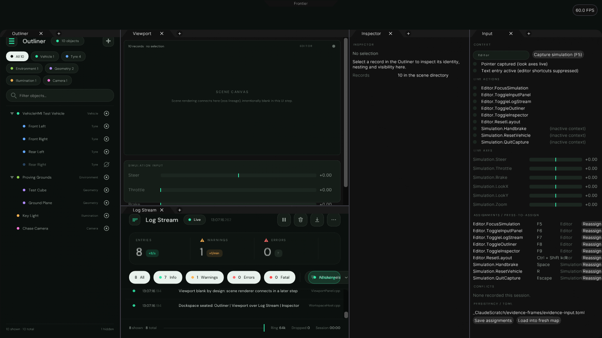

# Frontier Editor (Experimental)

The editor workspace shell: the Material Studio / TexturePaint dockable-tab interface assembled
as a standalone application, with the shared input layer that the editor, the game/simulation,
and future tools will all consume. Everything here is experimental; promotion into production
folders is a later, separate step.



## What is on screen

| Panel | Source | Notes |
|---|---|---|
| Notch / Control Centre | `UI/Editor/ControlCentrePanel` | Top-centre pull-down sheet (appearance, quick tiles, notifications). |
| Outliner | `Frontier/Engine/Interface/SceneDirectoryPanel` | Scene directory tree with classification pills, text filter, spawn menu, visibility eyes. |
| Viewport | `Workspace/ViewportPanel` | **Deliberately blank canvas** for this UI step (scene rendering is a separate workstream) plus a live simulation-axis strip. Click it (or F5) to capture the Simulation input context; Esc releases. |
| Log Stream | `Frontier/Engine/Interface/LogStreamPanel` | The retained log engine's panel, unchanged. |
| Inspector | `Workspace/RecordInspectorPanel` | New: identity (rename), classification, nesting (up-link / depth / down-links), Outliner visibility for the selected record. |
| Input | `Input/InputPanel` | New: the input layer's test bench — live actions/axes, press-to-assign rebinding, conflict log, TOML save/load. |

Docking, tabs, splitters, and layout persistence come from `Engine/Interface/PanelDockspace`,
the same composer the TexturePaint and Baking workspaces use. Layout changes persist next to the
executable's content root (`Settings/FrontierEditorLayout.toml`); Ctrl+Shift+R restores defaults.

A seeded vehicle scene (test vehicle, four tyres, proving grounds, cube, ground plane, key
light, chase camera) gives the Outliner and Inspector real records to work with
(`Workspace/VehicleSceneFixture`). The Outliner's + menu spawns further records.

## The input layer (`Input/`)

Designed once, for every consumer — editor chrome, game/simulation, and other applications:

```
GLFW events ──► Native/GlfwInputPoll ──► InputSubstrate ──► InputMap ──► actions / axes
(raw, per OS)      (translation)        (device truth)     (contexts,
                                                            chords, axes)
```

- **`KeyAssignment.h`** — keys, chords (Ctrl/Alt/Shift/Super), pointer buttons, gamepad
  controls, axis sources, labels.
- **`InputSubstrate`** — the device-truth layer. Producers queue raw transitions; `BeginCycle()`
  folds them in arrival order into levels, pressed/released edges, pointer deltas, and wheel
  accumulation. No policy lives here, so any application can sit on it.
- **`InputMap`** — the policy layer. A context stack (`Editor`, `Simulation`); only the top
  context resolves. Actions bind to chords or pointer buttons; axes bind to key pairs, pointer
  motion, wheel, or gamepad controls with scale and deadzone. Duplicate chords are refused at
  registration with a diagnostic (first assignment keeps control). Text entry suppresses editor
  shortcuts (Escape still passes). Pointer look axes stay silent unless captured.
- **`InputMapCodec`** — TOML persistence (`Format = 1`): `[[ActionAssignment]]` and
  `[[AxisAssignment]]` tables, human-editable next to the other settings files.
- **`InputPreferences` reuse** — pointer sensitivity/inversion/smoothing come from the engine's
  existing `InputPreferencesCodec`, so the Control Centre's input page and this layer agree.

Default assignments:

| Action | Default | Axis | Default |
|---|---|---|---|
| `Editor.FocusSimulation` | F5 | `Simulation.Steer` | A/D, gamepad LSX |
| `Editor.ToggleInputPanel` | F6 | `Simulation.Throttle` | W/S, gamepad RT |
| `Editor.ToggleLogStream` | F7 | `Simulation.Brake` | gamepad LT |
| `Editor.ToggleOutliner` | F8 | `Simulation.LookX/Y` | pointer (captured) |
| `Editor.ToggleInspector` | F9 | `Simulation.Zoom` | wheel |
| `Editor.ResetLayout` | Ctrl+Shift+R | `Simulation.Handbrake` | Space (action) |
| `Simulation.ResetVehicle` | R | `Simulation.QuitCapture` | Escape (action) |

**Validation:** `FrontierEditorInputValidation` (ctest) exercises the substrate edge rules,
chord/context resolution, conflict refusal, axis shaping, and a TOML round trip — 43 checks.

## Build & run

```
python Tools/PrepareUI.py          # pinned dependencies (ExternalPackages/)
python Tools/PrepareFonts.py       # prepared font archives
cmake -S . -B build -G Ninja -DCMAKE_BUILD_TYPE=Release
cmake --build build --target FrontierEditor
```

Run `build/FrontierEditor/FrontierEditor` (Windows: `FrontierEditor.exe`, or double-click
`LaunchFrontierEditor.bat`). On Windows the binary is also produced by the
`WindowsWorkspaces` GitHub Actions workflow and shipped in its package.

Tests: `ctest --test-dir build -R FrontierEditor` (needs `-DBUILD_TESTING=ON`).

## Evidence (`Evidence/`)

`FrontierEditorEvidence` drives the real dockspace on the headless CPU rasterizer (the
LogStream exhibit's PanelCapture pattern), discovering controls by effect and replaying them
recorded. Current run: **0 failures** across seating, Outliner select/filter/spawn, Inspector
rename, F6 panel toggles, press-to-assign rebind to Ctrl+L, notch open/dismiss, and Simulation
capture with W/A/D/Space/Escape.

| GIF | Shows |
|---|---|
| `outliner-inspector.gif` | Row selection, text filter, spawn from the + menu, rename in the Inspector. |
| `docking-input.gif` | F6 toggling the Input panel, press-to-assign rebinding, Ctrl+L toggling Log Stream, splitter drags, log pause. |
| `notch-simulation.gif` | Notch click opening the Control Centre, quick tile, dismissal, canvas capture, throttle/steer axes, Escape release. |

Stills (`still-*.png`) carry full-resolution detail. Regenerate with:

```
FrontierEditorEvidence <frames-dir> <repo-root>
python3 Experimental/FrontierEditor/Evidence/EncodeGif.py <frames-dir> Experimental/FrontierEditor/Evidence
```

Known headless-raster difference: the Control Centre sheet's frosted backdrop is a Vulkan
compositing effect; in CPU-raster evidence it reads as near-black glass with the live tiles and
text on top. The windowed application renders it as designed.

## Deliberately not here yet

- Scene rendering in the Viewport (separate eos-lineage workstream).
- Promotion of `Input/` into `Frontier/Engine/` (after it proves out here).
- Gamepad hardware polling in `GlfwInputPoll` (the substrate/map gamepad paths are implemented
  and validation-tested; the GLFW joystick feed is the remaining wire).
