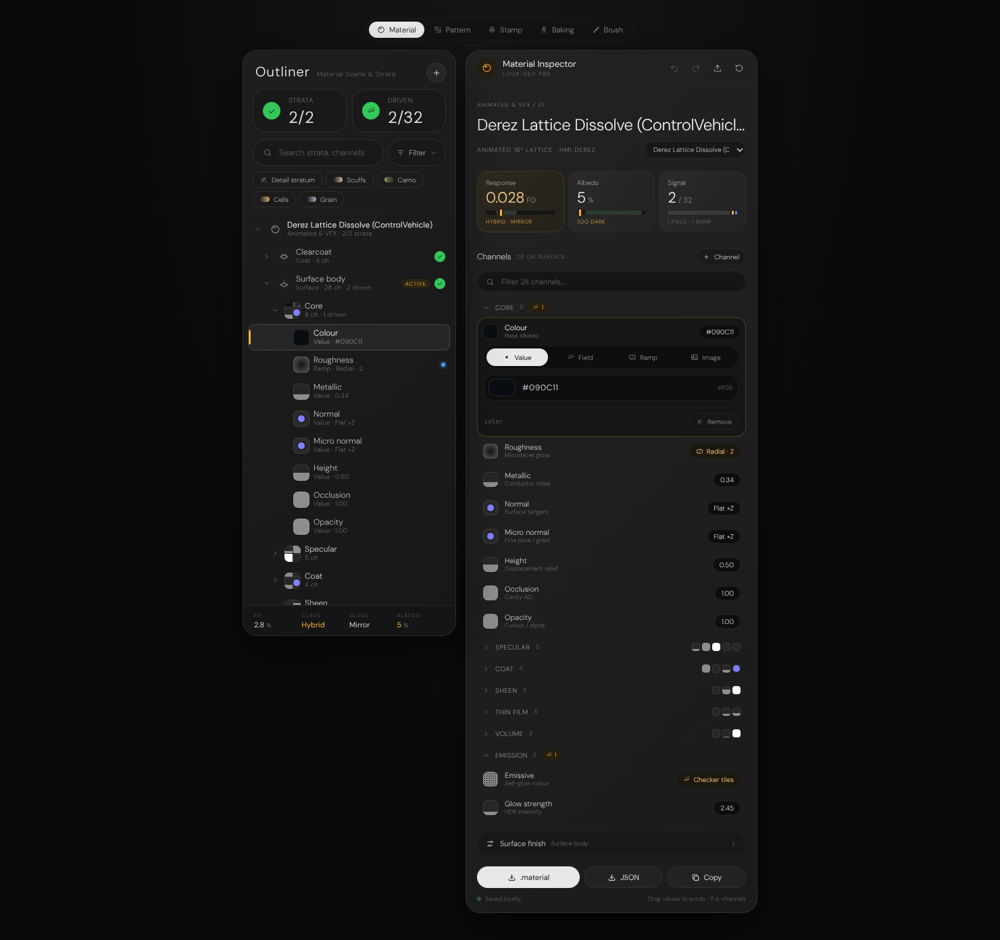
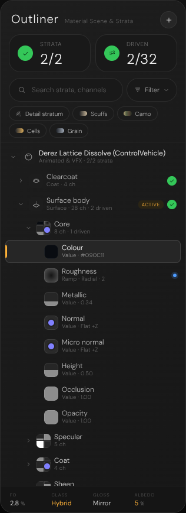

# Material Inspector

This is the Material workspace inspector from **TextureStudio** (`unassignedinbox/Frontier`, branch `arena/6eeea758-frontier`), rebuilt as a **single card** in the Project Zero editor style. It has no workspace, viewport or renderer.

```
python3 Experimental/MaterialInspector/Serve.py        # http://0.0.0.0:8097/
```

## Screenshots

| Material workspace (outliner · card, no viewport) | Material outliner |
| --- | --- |
|  |  |

Other workspaces: [Pattern / Stamp](../ArtworkInspector/README.md#screenshots), [Map Baking](../BakeInspector/README.md#screenshots) and [Brush Studio](../BrushStudio/README.md).

## Workspace viewport

`Viewport.js` and `Workspace.css` give Pattern, Stamp, Map Baking and Texture Painting the Project Zero workspace layout: outliner · **viewport** · card. The viewport is left **blank on purpose**, because no renderer is attached. It provides the frame a renderer would mount into: a title chip with live meta, view modes, a hint, chips and a zoom readout. `MountViewport(Host, { Title, Meta, Views, Chips, Hint, OnView })` returns `{ Body, SetMeta, SetView }`. The Material workspace has no viewport.

Layout breakpoints:

- **Below 1180 px:** the viewport spans the top.
- **Below 800 px:** the columns stack.
- **`?outliner=0`:** a viewport · card pair.

## What changed from the TextureStudio inspector

| TextureStudio | This card |
| --- | --- |
| Two tabs: *Properties* and *Layer Stack*. | One card. The strata are a compact stack inside it. |
| A cloud of 28 removable channel pills, followed by an "Inspect Channel" dropdown, a "Source" dropdown, a "Generator" dropdown and a column of sliders. | One quiet row per channel showing its live value. Rows are grouped (Core, Specular, Coat, Sheen, Thin film, Volume, Emission), and groups without authored channels start folded. Opening a row expands **that one channel's** editor in place. |
| Source and generator are hidden behind dropdowns. | Source is a visible segment (Value · Field · Ramp · Image). The eight field generators are chips. Ramp shape is a segment. |
| "Drag pills to scrub values". | You can drag any scalar readout in the list without opening anything. Shift gives fine control. |
| Separate "Surface Albedo & Microfacet" sliders that duplicate channels. | Channels *are* the values. Only the stratum's own knobs (finish, coat orange peel, flake dispersion and palette, detail presets) are in a folded section. |

Short strata (coat, flakes and new detail strata, with 8 or fewer channels) are shown as a flat list without group heads.

## Card anatomy

1. **Identity.** Editable material name, catalog label and library picker.
2. **Statistics.** Three tiles that answer questions the channel list cannot (the old Roughness / Metalness / Strata trio only repeated values shown below it):
   - **Response:** reflectance at normal incidence (F0), with a log-scale meter on which the dielectric band 2–8 % is marked. F0 is blended from IOR × specular and the base colour by metalness. The caption gives the class (Dielectric / Hybrid / Conductor) and gloss band. The tile turns amber for in-between metalness, which is rarely physical.
   - **Albedo:** sRGB luminance of the base colour (sampled mean when a field or ramp drives it), on a meter marked with the plausible band: 12–94 % for dielectrics, ≥ 70 % for conductors. It warns when the colour falls outside that band.
   - **Signal:** how many channel slots across enabled strata are driven by fields, ramps or images rather than constant values, as a stacked meter by source kind.
3. **Strata** (top → bottom):
   - The dot toggles a stratum on or off.
   - Click a stratum to select it; double-click to rename it.
   - `+ Detail` adds a masked detail stratum, which you can remove again.
4. **Channels.** Filter, `+ Channel` (adds a missing channel; the list keeps registry order), and grouped rows. One row is open at a time:
   - **Value:** a slider pill with a numeric field, a colour field with hex input, or X/Y/Z inputs for vectors.
   - **Field:** live preview, generator chips, Scale / Seed / Angle / Contrast, and a colour ramp (or the camouflage palette).
   - **Ramp:** linear, radial or conic, with angle and stops.
   - **Image:** drop or choose a tile. It is resampled to a PNG of at most 256 px and embedded.
   - For non-value sources there is also a *Base value* control and a *Drive directly* switch.
   - The footer shows the parameter address and a Remove button.
5. **Stratum knobs** (folded).
6. **Export:** `.material` TOML, JSON (`alloy.material.v6`), or Copy.

Keyboard: ↑ / ↓ move between channel rows. Esc closes the open editor. Ctrl+Z / Ctrl+Shift+Z (or Ctrl+Y) undo and redo.

The same card language is reused by the [Pattern / Stamp Studio](../ArtworkInspector/README.md) and [Map Baking](../BakeInspector/README.md) cards. `CardKit.js` holds the shared templates (knob, colour field, stops, segments, chips, stat tile + meters, undo history, dock nav) and `Icons.js` the shared glyphs.

## Data and compatibility

- **`MaterialModel.js`** is pure (no DOM). It keeps the TextureStudio document format unchanged:
  - flat look-dev parameters (`color`, `roughness`, `coat`, …);
  - `Authoring` v2 (`Layers`, `Generators`, `Inputs`, `Sources`, …);
  - the same `ChannelAddress` carrier rules: surface → targets, coat → `coat*`, flakes → `flake-output:*`, detail → `layer:<id>:*`.
- **`Engine/FieldSpecification.js`** and **`Engine/textureSource.js`** are byte-identical copies from TextureStudio.
- Every material is stored per id under `localStorage["Frontier.MaterialInspector.v1:<id>"]`. Changes sync live between open windows.
- `?material=<id>` opens a specific catalog entry.
- The catalog is a short slice of the TextureStudio library: Derez Lattice Dissolve, Candy Crimson, Brushed Titanium, Molten Magma Crust and Woodland Camouflage · Smooth. Together they cover every stratum model and source kind.

## Outliners

Each studio page shows its card next to a matching **outliner card**. The outliner follows the Project Zero editor's Outliner layout:

1. A heading with a round action button.
2. Two statistic tiles, which also act as filters.
3. A search pill with a filter menu, and the active filters shown as chips.
4. 39 px tree rows with a disclosure arrow, icon, name and metadata, a status disc and an amber selection bar.
5. A footer of readouts.

`OutlinerKit.js` holds the shared plumbing: search, filters, expand / collapse, keyboard navigation (arrows, Home / End, Enter, F2, Delete, Space), inline rename and drag reorder. Each outliner supplies only its rows and actions:

| Page | Outliner | Tree |
| --- | --- | --- |
| Material | `MaterialOutliner.js` | material → strata layers → driven channels (field / pattern / ramp / texture) |
| Pattern / Stamp | `../ArtworkInspector/ArtworkOutliner.js` | canvas → layers (motif / text / gradient…) → modifiers |
| Map Baking | `../BakeInspector/BakeOutliner.js` | study → map groups → maps, plus the study set |

The outliner and the card share one hub, so changes made in either one show up in the other. Add `?outliner=0` to the URL to show the card on its own.

## Checks

```
node Experimental/MaterialInspector/Scripts/CheckMaterialInspector.mjs
JSDOM_DIR=/tmp/smoke node Experimental/MaterialInspector/Scripts/SmokeMaterialInspector.mjs   # npm i --prefix /tmp/smoke jsdom@25
JSDOM_DIR=/tmp/smoke node Experimental/MaterialInspector/Scripts/SmokeOutliners.mjs           # all three outliners
```

If `TS_DIR` points at a TextureStudio checkout (`…/Experimental/TextureStudio`), the check script also confirms two things:

- the copied engine files are unchanged;
- TextureStudio's own `NormalizeMaterialAuthoring` accepts every document this card exports.
