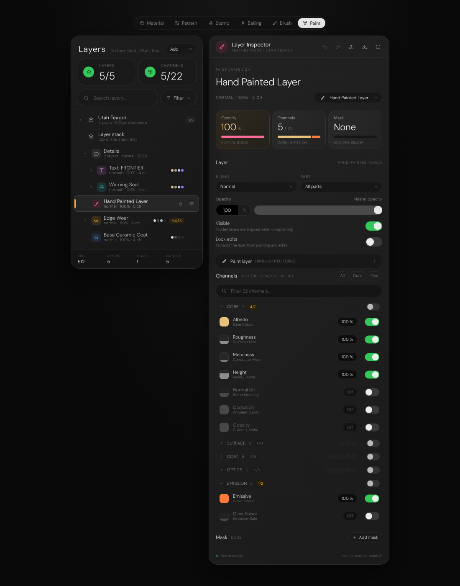
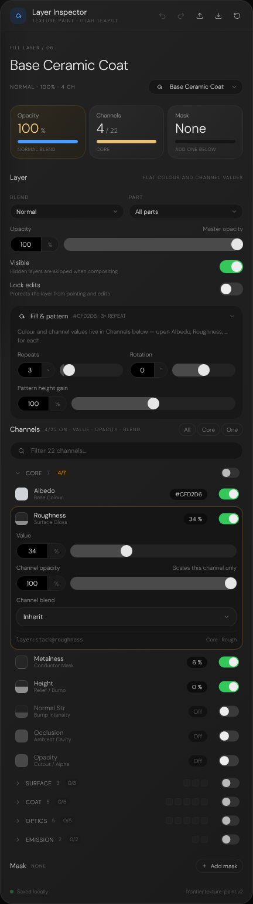
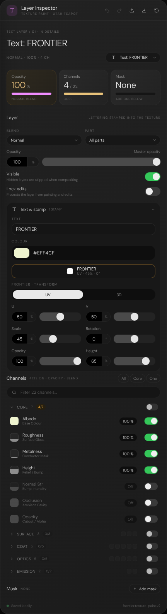

# Texture Paint — Layer Outliner + Layer Inspector

This is the Texture Paint workspace from **TextureStudio** (`TexturePaintWorkspace.js`): its left **Layers** panel and right **Layer Inspector**, rebuilt in the Project Zero style as the sixth dock page, **Paint**. It is an **outliner · card** page like Material, Pattern / Stamp and Map Baking. Strokes are painted on the [Brush](../BrushStudio/README.md) page; this page edits the layer document those strokes land in.

```
python3 Experimental/MaterialInspector/Serve.py        # http://0.0.0.0:8097/  →  /Experimental/PaintInspector/
```

`?outliner=0` shows the card alone, and `?layer=<id>` opens a layer.



| Channel card open (fill layer) | Text layer with stamps |
| --- | --- |
|  |  |

## Engine reuse

There is no parallel paint model. `PaintModel.js` builds and repairs every layer with TextureStudio's own engine (`TextureStudio/Engine/TexturePaintEngine.js`):

- `createPaintDocument` (schema `frontier.texture-paint.v2`) and `createPaintLayer` for all 7 layer types;
- `PAINT_BLENDS` and `PAINT_MESH_PRESETS` (the part filter);
- `createMaterialLayerOverridesFromPreset` with the 168 presets in `Engine/Materials/materials.js`.

The engine imports bare `three`. The page maps it with an importmap; the check and smoke scripts map it with a Node resolve hook.

The card holds no texels: layers are created at 4 px, and `Serialise` strips `pixels` and stamp rasters. A host paint engine owns the full-resolution buffers and reads the same layer fields.

## Outliner (`PaintOutliner.js`)

It uses `OutlinerKit`, the same shell as every other outliner.

- **Head.** The title, plus an **Add** dropdown with the 7 layer types: Paint · Fill · Material · Stamp · Text · Generator · Folder. A new layer lands above the selection; if a folder is selected, it lands inside.
- **Stats.** *Layers* (visible / total; toggles the hidden filter) and *Channels* (painted / 22; toggles the masked filter).
- **Filters.** Layer type, with mask, hidden, locked. Search matches names, types, blends and channel names.
- **Tree.** The mesh first (its parts are the part-filter targets), then the layer stack top-first: folders → their layers → a layer's **mask** row (with an enable switch) and its **stamps**.
  - A layer row reads `blend · opacity · n ch` (plus the part when filtered), with **six channel peek dots**, a MASK badge, a lock tool and an eye.
  - A layer hidden by a folder is shown muted.
- **Editing.**
  - Drag to reorder, or drop onto a folder (cycles are refused).
  - F2 or double-click renames, Delete removes (Ctrl+Z restores), and Space toggles visibility.
- **Footer.** Resolution · layers · masks · painted channels.

## Layer Inspector (`PaintInspector.js`)

| Part | Contents |
| :--- | :--- |
| Header | layer-type mark, undo / redo, import, reset |
| Identity | type · position · folder · lock; the name (editable); `blend · opacity · n CH · MASK`; a layer picker dropdown |
| Stat tiles | **Opacity** (blend, hidden), **Channels** (on / 22, coloured by group), **Mask** (source, inverted, opacity) |
| Layer | blend and part filter (dropdowns), master opacity, visible, lock |
| Type card | **Fill**: pattern repeats, rotation and height gain · **Material**: searchable preset dropdown with swatches, grain · **Generator**: preset, threshold, softness, noise breakup and scale, invert · **Stamp / Text**: text and colour, stamp list, projection (UV / 3D), U, V, scale, rotation, opacity, height · **Paint**: link to the Brush page · **Folder**: what it holds |
| Channels | the shared **[ChannelStack](../MaterialInspector/README.md#channelstack--the-reusable-channel-dropdown)**: 22 channels in 5 groups with a switch each. Opening a channel shows its card: **value / colour** (Fill, Material and Generator layers, written into the engine's value block and ×100 for display), **channel opacity** and **channel blend** (Inherit + the engine blends) |
| Mask | add / remove, enabled, invert, source (manual or a generator preset), opacity |
| Footer | `.texpaint.json` · layer JSON · Copy; save status and schema |

- A **locked** layer refuses every edit except visibility and the lock itself, matching TextureStudio.
- Every edit goes through `CardKit.History` (Ctrl+Z / Ctrl+Shift+Z). Typing in a field and dragging a slider each count as one undo step.
- The document persists in `localStorage` (`frontier.paint-inspector.v1`).

## Files

| File | What it holds |
| --- | --- |
| `PaintModel.js` | Pure document edits on engine layers: `Create`, `Normalise`, `Serialise` / `Export` / `Load`, `AddLayer`, `Duplicate`, `Remove` (a folder's layers move up a level), `Move` (before / after / inside, no cycles), `Edit`, `AssignMask`, `UseMaterial`, and the channel view `LayerCard` / `LayerStack` / `AssignLayerStack` / `AssignChannelField`, plus `Stats` |
| `PaintInspector.js` / `.css` | The card, and the inspector object the outliner talks to (`Add`, `Duplicate`, `Remove`, `Move`, `Rename`, `Edit`, `OpenLayer`, `Subscribe`) |
| `PaintOutliner.js` | The layer outliner |
| `index.html` | The dock page (importmap for `three`) |

## Checks

```
node Experimental/PaintInspector/Scripts/CheckPaintInspector.mjs
JSDOM_DIR=/tmp/smoke node Experimental/PaintInspector/Scripts/SmokePaintInspector.mjs   # npm i --prefix /tmp/smoke jsdom@25
```

- **`CheckPaintInspector.mjs`** (15 checks):
  - the catalogue matches the engine, and the `PbrChannelDefinitions.js` copy is byte-identical;
  - every layer type carries all 22 engine keys;
  - lossless export → load, hostile input repaired;
  - channel view ↔ engine fields;
  - duplicate, remove, move (and cycle refusal), material overrides equal the engine's, mask and stats;
  - edits never mutate their input.
- **`SmokePaintInspector.mjs`** drives the page in jsdom:
  - outliner: select, add every type, eye, lock, drag, rename, delete, filters;
  - card: every section and type card;
  - ChannelStack: open, value, colour, opacity, blend, switch, group, bulk, search;
  - the lock guard; mask add / edit / remove;
  - undo / redo, export, copy, reset and import.
