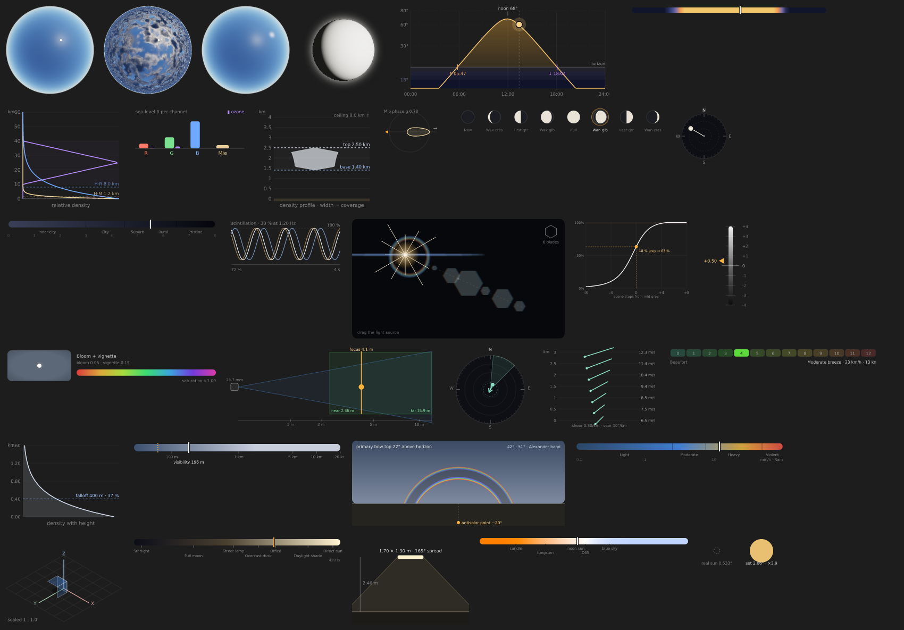

# World Inspector

World Mirror inspector **cards only**: no viewport and no editor shell. It covers the environment and the scene objects, and it is built in the same Project Zero card style as the Texture Studio cards ([Material Inspector](../MaterialInspector/README.md)).

```
python3 Experimental/WorldInspector/Serve.py          # http://0.0.0.0:8103/
```

`?card=<id>` shows one card. With no parameter, every card is shown in a masonry grid. The nav pill switches between them.



## Cards

| Card | Hero graphic | Tiles + diagrams | Reaches |
| --- | --- | --- | --- |
| Sun | Solar elevation through the day, from `Solar.mjs` (drag to set the time); sky-phase strip | Elevation · azimuth · irradiance / CCT, compass, declination, equation of time, disc size against the real sun, Kelvin bar | Renderer |
| Atmosphere | Sky-View LUT fisheye dome · Rayleigh / Mie / ozone density by altitude | Zenith CCT, sun transmittance per channel, air mass, sea-level β bars, Mie phase polar | Renderer |
| Volumetric Clouds | Cloud dome rendered by `EvalVolumetricCloudsCpu` · layer cross-section | Oktas / METAR cover, layer band, drift from the wind card, phase polar, optical depth | Renderer |
| Moon | Preset texture lit with the renderer's phase vector · sky compass | Lunar cycle strip (click a phase), illumination, age, size against the real moon | Renderer |
| Stars | 30° zenith window from the star evaluator | Limiting-magnitude scale (drag), sky class, daylight fade, scintillation trace | Renderer |
| Lens Flare | Ghost axis, halo, starburst and anamorphic streak layout (drag the source) | Element count, blade star points, chromatic split | Record |
| Exposure | Tone curve (ACES fit, the renderer's display transform) · EV ladder (drag) | Exposure gain, mid-grey output, display latitude in stops, bloom / vignette / saturation preview | Renderer (EV, gain) · Record |
| Camera | Field-of-view wedge with depth-of-field band | Horizontal FOV, in-focus range, hyperfocal distance, sensor overlay, f-stop strip | Renderer |
| Wind | Wind rose (drag the bearing) · speed / veer with height | Beaufort strip, force, gust ceiling, cloud drift | Renderer (cloud drift) |
| Fog | Height-fog density profile | Koschmieder visibility strip, visibility class, column depth | Record |
| Weather | Rainbow geometry from the live sun elevation (42° / 51°, Alexander band) | Rate class scale, bow height, accumulation | Record |
| Object | Material ball lit by the compiled sun and sky · isometric transform | Albedo plausibility band, F0, gloss, PBR swatch strip, material type presets | Renderer |
| Light | Area-light footprint above the floor | On-axis floor illuminance (lux scale), lumens, luminance, colour temperature | Renderer |
| Group | Composition bar by component type | Member visibility (feeds the compile's `Hidden`), visible count, tint | Renderer |

**Reaches** names where a control lands:

- **Renderer** means the value goes through `CompileLiveGtxScene`, the same mapping the World Mirror renderer uses.
- **Record** means the value is stored in the World Mirror record that the editor saves and the C++ engine bridge reads, but the browser GTX compile does not consume it.

Each card's footer says which of these it is.

## State

`WorldDocument.js` deep-clones `ShowcaseInitialRows` / `ShowcaseInitialValues`.

- **Extra panels.** Rows are added for the panels the showcase does not instance (post, wind, flare, fogs, precipitation, rainbow). These are seeded from the `NativePanels.json` defaults.
- **Wind seed.** The wind record is seeded with the compile's no-wind drift (6.5 m/s from 25°), so the showcase sky is unchanged.
- **Field metadata.** Labels, ranges, decimals, units and options come from `NativePanels.json`. Object material channels use `MaterialSpecification.js`.
- **Shared side effects.** `Edit()` applies the same side effects as the World Mirror inspector:
  - the clock re-solves `Direction`;
  - a moon preset picks its size;
  - speed and day duration stay coupled.
- **Day-cycle animation.** Animation uses the same ticker arithmetic as World Mirror.
- **Persistence.** State is saved to `localStorage` (`frontier.world-inspector.v1`). Undo / redo is Ctrl+Z / Ctrl+Shift+Z. **World JSON** exports every record.

## Files

| File | Role |
| --- | --- |
| `WorldDocument.js` | Document, catalogue metadata, edits with World Mirror side effects, compile cache, storage |
| `WorldDerived.js` | Pure numbers behind the graphics (formulas named inline) |
| `WorldGraphics.js` | SVG infographics plus canvas renderers (sky dome, star window, moon, material ball) |
| `WorldInspector.js` | Card builders, live regions, graphic drags, mount |
| `WorldIcons.js` | Card icons (falls back to `MaterialInspector/Icons.js`) |
| `WorldInspector.css` | Infographic layout on top of `MaterialInspector.css` |

Rendering:

- Discrete edits rebuild the cards.
- While a slider or graphic is being dragged, only the `[data-live]` regions refresh, so the control under the pointer is never replaced.
- Canvases are cached and re-attached. They repaint only when their key changes, in chunks, so a drag never stalls.

## Validation

```
JSDOM_DIR=/tmp/smoke node Experimental/WorldInspector/WorldInspectorValidation.mjs
RESVG_DIR=/tmp/rs node Experimental/WorldInspector/Scripts/RenderGraphicsSheet.mjs 22 /tmp/night.png
```

There are 10 suites:

- **Compile parity.** An unedited document compiles identically to the showcase.
- **Edits.** Every card's edits move the compiled scene as the renderer expects.
- **Reference formulas.** Kasten–Young, Beaufort, Koschmieder, McCamy, hyperfocal distance and the HG phase function are checked against published values.
- **Rendering.** All 14 cards render cleanly at five hours of the day, for every object and group.
- **Binds.** Every bound control is a real catalogue field.
- **Negative control.** A raw clock write without the re-solve does not move the sun.
- **UI drive (jsdom).** This covers:
  - the nav pill, sliders mid-drag and dropdowns;
  - switches, the solar-chart and wind-rose drags and the f-stop strip;
  - the object colour, undo / redo, export, reload from storage and card reset.
